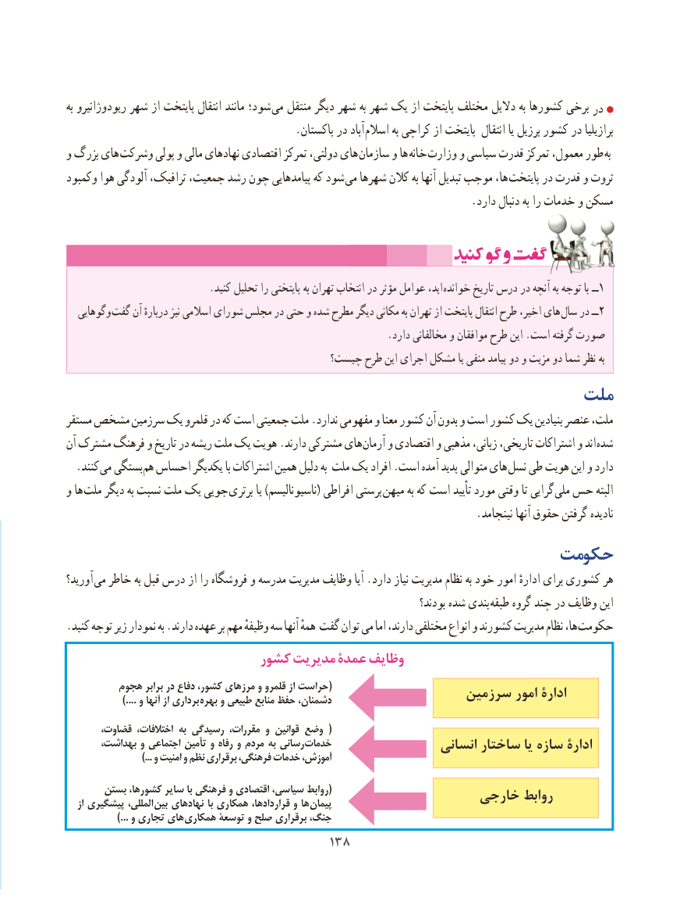

# PDF page 146

به ریودوژانیرو شهر از پایتخت انتقال مانند شود؛ می منتقل دیگر شهر به شهر یک از پایتخت مختلف دالیل به کشورها برخی در
                                          .پاکستان در آباد اسالم به کراچی از پایتخت انتقال یا برزیل کشور در برازیلیا
و بزرگ های وشرکت پولی و مالی نهادهای اقتصادی تمرکز دولتی، های  سازمان و ها خانه وزارت و سیاسی قدرت تمرکز معمول، طور  به
وکمبود هوا آلودگی ترافیک، جمعیت، رشد چون پیامدهایی که شود می شهرها کالن به آنها تبدیل موجب ها،  پایتخت در قدرت و ثروت
                                                                          .دارد دنبال به را خدمات و مسکن

                            .کنید تحلیل را پایتختی به تهران انتخاب در مؤثر عوامل اید، خوانده تاریخ درس در آنچه به توجه با ــ1
  وگوهایی گفت آن دربارهٔ نیز اسالمی شورای مجلس در حتی و شده مطرح دیگر مکانی به تهران از پایتخت انتقال طرح اخیر، های  سال در ــ2
                                                               .دارد مخالفانی و موافقان طرح این .است گرفته صورت
                                          چیست؟ طرح این اجرای مشکل یا منفی پیامد دو و مزیت دو شما نظر به
                                                  ملت
مستقر مشخص سرزمین یک قلمرو در که است جمعیتی ملت .ندارد مفهومی و معنا کشور آن بدون و است کشور یک بنیادین عنصر ملت،
آن مشترک فرهنگ و تاریخ در ریشه ملت یک هویت .دارند مشترکی های آرمان و اقتصادی و مذهبی زبانی، تاریخی، اشتراکات و اند شده
 . کنند می بستگی هم احساس یکدیگر با اشتراکات همین دلیل به ملت یک افراد .است آمده پدید متوالی های نسل طی هویت این و دارد
و ها ملت دیگر به نسبت ملت یک جویی برتری یا )ناسیونالیسم( افراطی پرستی میهن به که است تأیید مورد وقتی تا گرایی ملی حس البته
                                                                           .نینجامد آنها حقوق گرفتن نادیده
                                             حکومت
آورید؟ می خاطر به قبل درس از را فروشگاه و مدرسه مدیریت وظایف آیا .دارد نیاز مدیریت نظام به خود امور ادارهٔ برای کشوری هر
                                                                                  بودند؟ شده بندی طبقه گروه چند در وظایف این
. کنید توجه زیر نمودار به .دارند عهده بر مهم وظیفهٔ سه آنها همهٔ گفت توان می اما دارند، مختلفی انواع و کشورند مدیریت نظام ها، حکومت
                         کشور مدیریت عمدۀ وظایف
         هجوم                      برابر                       در                         دفاع کشور،                                مرزهای                                            و قلمرو                                                                   از حراست                                                                             (                  سرزمین امور ادارۀ    ....) و                      آنها از                       برداری                              بهره و                                طبیعی منابع                                  حفظ                                                دشمنان،

       قضاوت، اختالفات، به رسیدگی مقررات، و قوانین وضع  (
       بهداشت، و اجتماعی تأمین و رفاه و مردم به رسانی خدمات                                                             انسانی ساختار یا سازه ادارۀ                             ...) و امنیت و نظم برقراری فرهنگی، خدمات آموزش،
       بستن کشورها، سایر با فرهنگی و اقتصادی سیاسی، روابط(                  خارجی روابط   از پیشگیری المللی،  بین نهادهای با همکاری قراردادها، و ها پیمان
    ...) و تجاری های همکاری توسعۀ و صلح برقراری جنگ،
                                      138138

