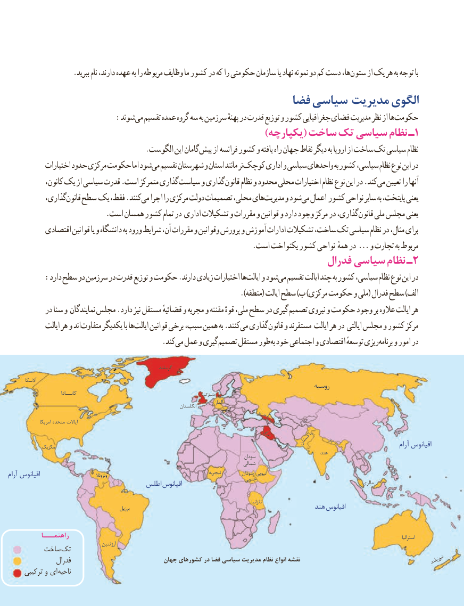

# PDF page 147

.ببرید نام دارند، عهده به را مربوطه وظایف ما کشور در که را حکومتی سازمان یا نهاد نمونه دو کم دست ها، ستون از یک هر به توجه با
                                               فضا سیاسی مدیریت الگوی
           : شوندمی تقسیم عمده گروه سه به سرزمین پهنهٔ در قدرت توزیع و کشور جغرافیایی فضای مدیریت نظر از ها حکومت
   )1یکپارچه( ساخت تک سیاسی نظام ـ
                                     .الگوست این گامان پیش از فرانسه کشور و یافته راه جهان نقاط دیگر به اروپا از ساخت تک سیاسی نظام
            اختیارات حدود مرکزی حکومت اما شود می تقسیم شهرستان و استان مانند تر کوچک اداری و سیاسی واحدهای به کشور سیاسی، نظام نوع این در
            کانون، یک از سیاسی قدرت .است متمرکز گذاری سیاست و گذاری قانون نظام و محدود محلی اختیارات نظام نوع این در .کند می تعیین را آنها
           گذاری، قانون سطح یک فقط، .کنند می اجرا را مرکزی دولت تصمیمات محلی، های مدیریت و شود می اعمال کشور نواحی سایر به پایتخت، یعنی
 . است همسان کشور تمام در اداری تشکیالت و مقررات و قوانین و دارد وجود مرکز در گذاری،قانون ملی مجلس یعنی
          اقتصادی قوانین یا و دانشگاه به ورود شرایط آن، مقررات و وقوانین پرورش و آموزش ادارات تشکیالت ساخت، تک سیاسی نظام در مثال، برای
                                                                  .است یکنواخت کشور نواحی همهٔ در ... و تجارت به مربوط
                                                                فدرال سیاسی نظام ـ 2
        :دارد سطح دو سرزمین در قدرت توزیع و حکومت .دارند زیادی اختیارات ها ایالت و شود می تقسیم ایالت چند به کشور سیاسی، نظام نوع این در
                                                                              ).منطقه( ایالت سطح )ب )مرکزی حکومت و ملی( فدرال سطح )الف
           در سنا و نمایندگان مجلس .دارد نیز مستقل قضائیهٔ و مجریه و مقننه قوهٔ ملی، سطح در گیری تصمیم نیروی و حکومت وجود بر عالوه ایالت هر
             ایالت هر و اند متفاوت یکدیگر با ها ایالت قوانین برخی سبب، همین به .کنند می گذاری قانون و مستقرند ایالت هر در ایالتی مجلس و کشور مرکز
                     . کندمی عمل و گیری تصمیم مستقل طور به خود اجتماعی و اقتصادی توسعهٔ ریزی برنامه و امور در

                                                                             گرینلند
         آالسکا
                                                                                                   روسیه
                               کانـــادا                                                                                دانمارک
                                                                                                         آلمان                                                                                  انگلستان                                                                                            اتریش
                                                                                                                         گرجستان
                                                                                                         امریکا متحده ایاالت                                                                                                                    آذربایجانجمهوری
                                                                                 عراق
                                                                                                                                                                       نپال                                                                                                                  پاکستان             مکزیک                                                                                                                                             آرام اقیانوس
                                                                                                                             هند                                                                                                    سودان
                                                                                             شمالی
آرام اقیانوس                                  ونزوئال                                                  نیجریه         سودان اتیوپی                                                                                                   جنوبی
                                   اطلس اقیانوس                                                                                 مالزی

                                                                                                                                                                                        تانزانیا
                                                        برزیل                                                      هند اقیانوس

           راهنمـــا                                                                                                                                                                                                               استرالیا
         ساخت تک                 آرژانتین
                فدرال                           جهان کشورهای در فضا سیاسی مدیریت نظام انواع نقشه                                                             نیوزیلند
     ترکیبی و ای ناحیه

