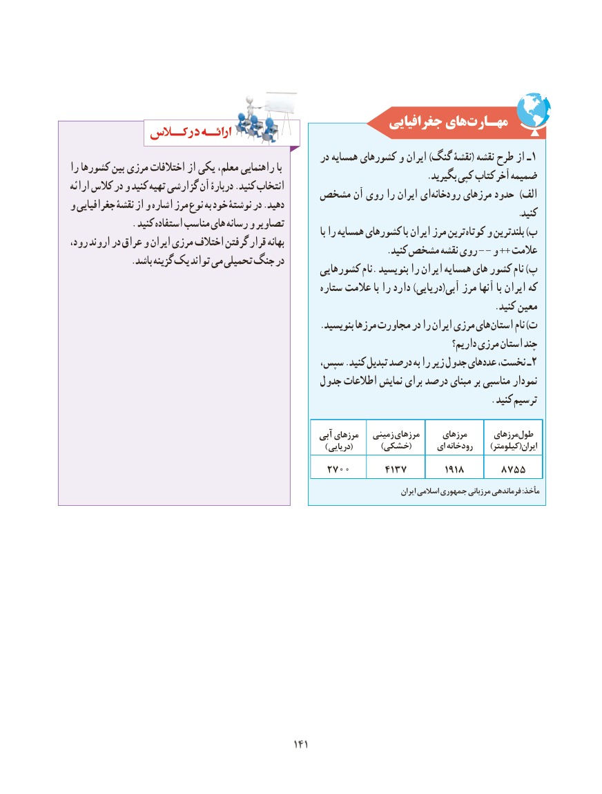

# PDF page 149

جغرافیایی هایمهـارت‌

                                                      در همسایه کشورهای و ایران )گنگ نقشۀ( نقشه طرح از ـ 1را کشورها بین مرزی اختالفات از یکی معلم، راهنمایی با                                                                                .بگیرید کپی کتاب آخر ضمیمهارائه کالس در و کنید تهیه گزارشی آن دربارۀ .کنید انتخاب                                 مشخص آن روی را ایران ای رودخانه مرزهای حدود  )الفو جغرافیایی نقشۀ از و اشاره مرز نوع به خود نوشتۀ در .دهید                                                                                                    .کنید              . کنید استفاده مناسب های رسانه و تصاویر                                                                                         با را همسایه کشورهای با ایران مرز ترین کوتاه و بلندترین )برود، اروند در عراق و ایران مرزی اختالف گرفتن قرار بهانه       .-کنید مشخص نقشه روی - و ++ عالمت              .باشد گزینه یک تواند می تحمیلی جنگ در                                                  کشورهایی نام. بنویسید را ایران همسایه های کشور نام )پ
                                                        ستاره عالمت با را دارد )دریایی(آبی مرز آنها با ایران که
                                                                                               .کنید معین
   . بنویسید مرزها مجاورت در را ایران مرزی هایاستان نام )ت
                                                                                             داریم؟ مرزی استان چند
                                          سپس، .کنید تبدیل درصد به را زیر جدول عددهای نخست، ـ 2
                                               جدول اطالعات نمایش برای درصد مبنای بر مناسبی نمودار
                                                                                              . کنید ترسیم

                                                      آبی مرزهای   زمینی مرزهای     مرزهای      مرزهایطول
                                                                           ) دریایی(        )خشکی(      ای رودخانه     )کیلومتر(ایران
                                            2700      4137        1918      8755
                                                                                                            ایرانایران اسالمیاسالمی جمهوریجمهوری مرزبانیمرزبانی فرماندهیفرماندهی ::مأخذمأخذ

                                             141141

