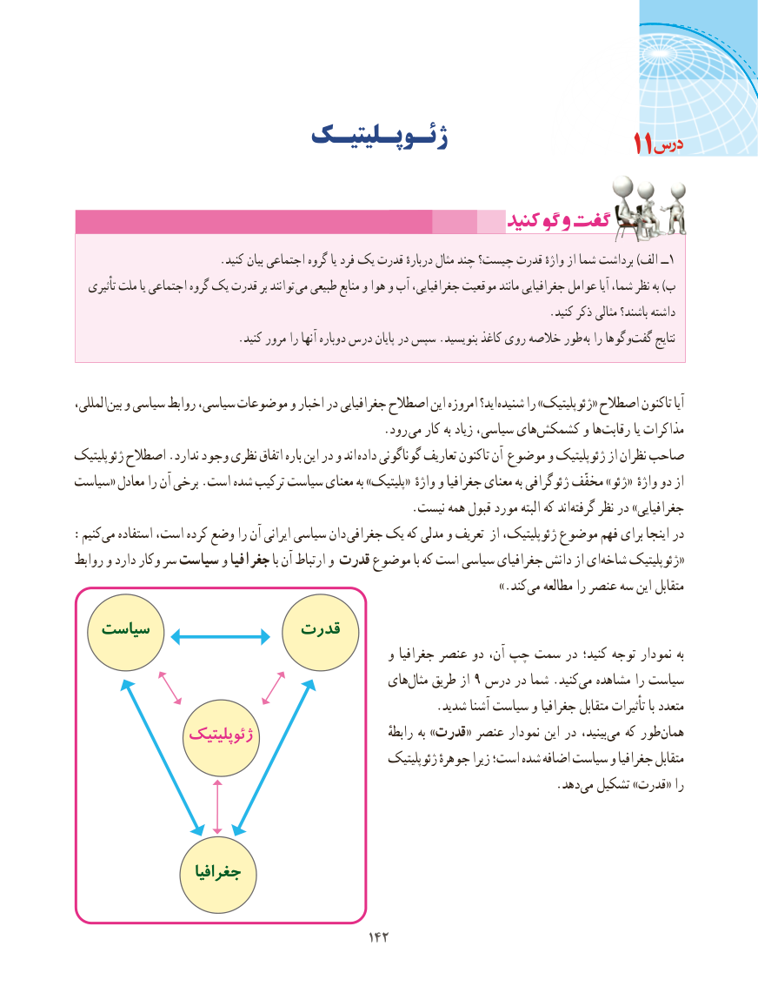

# PDF page 150

ژئـوپـلیتیـک                                                   11

                          .کنید بیان اجتماعی گروه یا فرد یک قدرت دربارهٔ مثال چند چیست؟ قدرت واژهٔ از شما برداشت )الف ــ1
   تأثیری ملت یا اجتماعی گروه یک قدرت بر توانند  می طبیعی منابع و هوا و آب جغرافیایی، موقعیت مانند جغرافیایی عوامل آیا شما، نظر به )ب
                                                                                    .کنید ذکر مثالی باشند؟ داشته
 . کنید مرور را آنها دوباره درس پایان در سپس .بنویسید کاغذ روی خالصه طور به را وگوها‌گفت نتایج

،المللیبین‌  و سیاسی روابط سیاسی، موضوعات و اخبار در جغرافیایی اصطالح این امروزه اید؟ شنیده‌     را »ژئوپلیتیک« اصطالح تاکنون آیا
                       . رود می کار به زیاد سیاسی، هایکشمکش‌       و هارقابت‌         یا مذاکرات
ژئوپلیتیک اصطالح .ندارد وجود نظری اتفاق باره این در و اند داده گوناگونی تعاریف تاکنون آن موضوع و ژئوپلیتیک از نظران صاحب
سیاست« معادل را آن برخی .است شده ترکیب سیاست معنای به »پلیتیک« واژهٔ و جغرافیا معنای به ژئوگرافی مخفّف »ژئو« واژهٔ دو از
    .‌نیست همه قبول مورد البته که اندگرفته نظر در »جغرافیایی
:‌کنیممی استفاده است، کرده وضع را آن ایرانی سیاسی دان جغرافی یک که مدلی و تعریف از ژئوپلیتیک، موضوع فهم برای اینجا در
روابط و دارد وکار سر سیاست و جغرافیا با آن ارتباط و قدرت موضوع با که است سیاسی جغرافیای دانش از ای‌«شاخه ژئوپلیتیک
                                          .»‌کندمی مطالعه را عنصر سه این متقابل
   سیاست               قدرت
                                                    و جغرافیا عنصر دو آن، چپ سمت در کنید؛ توجه نمودار به
                                               های ‌مثال طریق از 9 درس در شما .کنیدمی‌  مشاهده را سیاست
                                                            .شدید آشنا سیاست و جغرافیا متقابل تأثیرات با متعدد
                ژئوپلیتیک                                رابطهٔ به »قدرت« عنصر نمودار این در بینید، ‌می که طور ‌همان
                                                         ژئوپلیتیک جوهرهٔ زیرا است؛ شده اضافه سیاست و جغرافیا متقابل
                                   .‌دهدمی تشکیل »قدرت« را

                  جغرافیا

                                          142142

