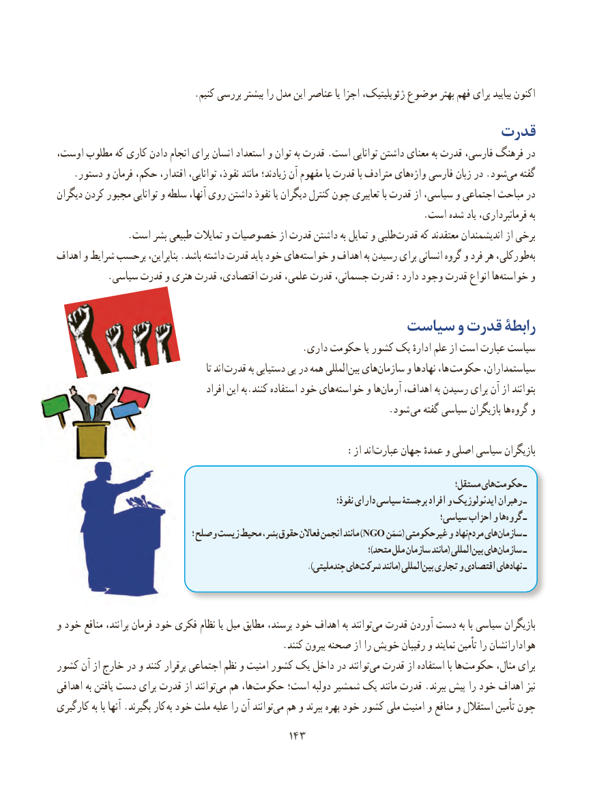

# PDF page 151

.کنیم بررسی بیشتر را مدل این عناصر یا اجزا ژئوپلیتیک، موضوع بهتر فهم برای بیایید اکنون
                                                  قدرت
اوست، مطلوب که کاری دادن انجام برای انسان استعداد و توان به قدرت .است توانایی داشتن معنای به قدرت فارسی، فرهنگ در
.‌دستور و فرمان حکم، اقتدار، توانایی، نفوذ، مانند زیادند؛ آن مفهوم یا قدرت با مترادف هایواژه فارسی زبان در .شودمی‌   گفته
دیگران کردن مجبور توانایی و سلطه آنها، روی داشتن نفوذ یا دیگران کنترل چون تعابیری با قدرت از سیاسی، و اجتماعی مباحث در
                                                                             .است شده یاد فرمانبرداری، به
 .‌است بشر طبیعی تمایالت و خصوصیات از قدرت داشتن به تمایل و طلبیقدرت که معتقدند اندیشمندان از برخی
اهداف و شرایط برحسب بنابراین، .باشد داشته قدرت باید خود های ‌خواسته و اهداف به رسیدن برای انسانی گروه و فرد هر طورکلی،‌به
.‌سیاسی قدرت و هنری قدرت اقتصادی، قدرت علمی، قدرت جسمانی، قدرت :دارد وجود قدرت انواع هاخواسته و

                                    سیاست و قدرت رابطۀ
                                                   .داری حکومت یا کشور یک ادارهٔ علم از است عبارت سیاست
                                                        تا اند  قدرت به دستیابی پی در همه المللی‌بین های‌سازمان و نهادها ها،  حکومت سیاستمداران،
                                         افراد این به.کنند استفاده خود های‌خواسته و هاآرمان‌    اهداف، به رسیدن برای آن از بتوانند
                            . شود می گفته سیاسی بازیگران ها گروه و

                                                :از اند‌عبارت جهان عمدهٔ و اصلی سیاسی بازیگران

                                                                                           مستقل؛ هایحکومت‌       ـ
                                                                               نفوذ؛ دارای سیاسی برجستۀ افراد و ایدئولوژیک رهبران ـ
                                                                                   سیاسی؛ احزاب و هاگروه‌    ـ
                                         ؛ وصلح زیست محیط بشر، حقوق فعاالن انجمن مانند )NGO سَمَن( غیرحکومتی و نهادمردم‌   هایسازمان‌      ـ
                                                                                              ؛)متحد ملل سازمان مانند( المللیبین‌  هایسازمان‌      ـ
                                                                             .)چندملیتی هایشرکت‌      مانند( المللیبین‌  تجاری و اقتصادی نهادهای ـ

و خود منافع برانند، فرمان خود فکری نظام یا میل مطابق برسند، خود اهداف به توانندمی‌  قدرت آوردن دست به با سیاسی بازیگران
                                               .کنند بیرون صحنه از را خویش رقیبان و نمایند تأمین را هوادارانشان
کشور آن از خارج در و کنند برقرار اجتماعی نظم و امنیت کشور یک داخل در توانندمی‌  قدرت از استفاده با هاحکومت‌        مثال، برای
اهدافی به یافتن دست برای قدرت از توانند ‌می هم ها،‌حکومت است؛ دولبه شمشیر یک مانند قدرت .ببرند پیش را خود اهداف نیز
کارگیری به با آنها .بگیرند کار به خود ملت علیه را آن توانند‌می هم و ببرند بهره خود کشور ملی امنیت و منافع و استقالل تأمین چون
                                        143143

