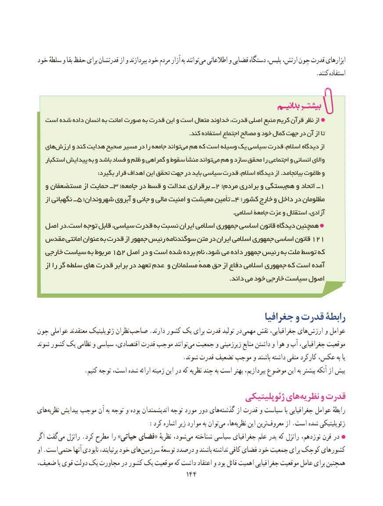

# PDF page 152

خود سلطهٔ و بقا حفظ برای قدرتشان از و بپردازند خود مردم آزار به توانند می اطالعاتی و قضایی دستگاه پلیس، ارتش، چون قدرت ابزارهای
                                                                                           .کنند استفاده

  است شده داده انسان به امانت صورت به قدرت این و است متعال خداوند قدرت، اصلی منبع کریم قرآن نظر از
                                                                            .کند استفاده اجتماع مصالح و خود کمال جهت در آن از تا
  هایارزش‌     و کند هدایت صحیح مسیر در را جامعه تواندمی‌  هم که است وسیله‌    یک سیاسی قدرت اسالم، دیدگاه از
   استکبار پیدایش به و باشد فساد و ظلم و گمراهی و سقوط منشأ تواندمی‌  هم و سازد محقق را اجتماعی و انسانی واالی
                              :بگیرد قرار اهداف این تحقق جهت در باید سیاسی قدرت اسالم، دیدگاه از .بیانجامد طاغوت و
  و مستضعفان از حمایت ــ 3 جامعه؛ در قسط و عدالت برقراری ــ2 مردم؛ برادری و بستگی هم و اتحاد ــ 1
   از نگهبانی ــ 5 شهروندان؛ آبروی و جانی و مالی امنیت و معیشت تأمین ــ4 کشور؛ خارج و داخل در مظلومان
                                                                                                  .اسالمی جامعۀ عزت و استقالل آزادی،
  اصل در.است توجه قابل سیاسی، قدرت به نسبت ایران اسالمی جمهوری اساسی قانون دیدگاه همچنین
  مقدس امانتی عنوان به قدرت از جمهور رئیس سوگندنامه متن در ایران اسالمی جمهوری اساسی قانون 121
  خارجی سیاست به مربوط 152 اصل در و است شده برده نام شود، می داده جمهور رئیس به ملت توسط که
   از را گر سلطه های قدرت برابر در تعهد عدم و مسلمانان همهٔ حق از دفاع اسالمی جمهوری که است آمده
                                                                                        .داند می خود خارجی سیاست اصول

                                                       جغرافیا و قدرت رابطۀ
چون عواملی معتقدند ژئوپلیتیک نظران صاحب .دارند کشور یک برای قدرت تولید در مهمی نقش جغرافیایی، های ارزش و عوامل
شوند کشور یک نظامی و سیاسی اقتصادی، قدرت موجب توانند‌می جمعیت و زیرزمینی منابع داشتن و هوا و ‌آب جغرافیایی، موقعیت
                                               .شوند قدرت تضعیف موجب و باشند داشته منفی کارکرد عکس، به یا
               .کنیم توجه است، شده ارائه زمینه این در که نظریه چند به است بهتر بپردازیم، موضوع این به بیشتر آنکه از پیش
                                                    ژئوپلیتیکی هاینظریه‌     و قدرت
های‌نظریه پیدایش موجب آن به توجه و بوده اندیشمندان توجه مورد دور های‌گذشته از قدرت و سیاست با جغرافیایی عوامل رابطهٔ
   :‌کرد اشاره زیر موارد به توانمی ها،نظریه‌     این ترینمعروف‌       از .است شده ژئوپلیتیکی
اگر گفت‌می راتزل .کرد مطرح را »حیاتی فضای« نظریهٔ شود،‌می شناخته سیاسی جغرافیای علم پدر که راتزل نوزدهم، قرن در
او .است حتمی آنها نابودی برنیایند، خود هایسرزمین‌        توسعهٔ درصدد و باشند نداشته کافی فضای خود جمعیت برای کوچک کشورهای
ضعیف، یا قوی دولت یک مجاورت در کشور یک موقعیت که داشت اعتقاد و بود قائل اهمیت جغرافیایی موقعیت عامل برای همچنین
                                          144144

