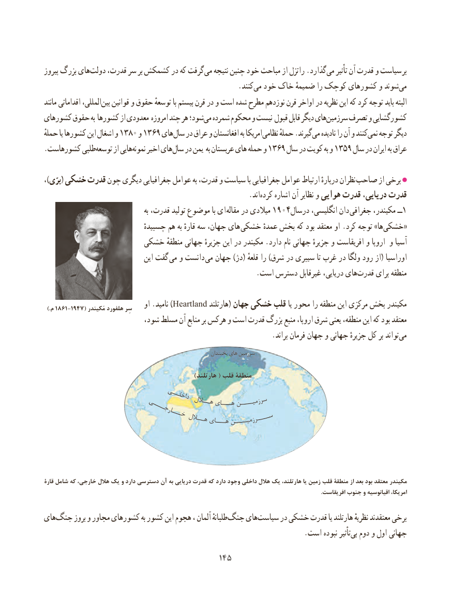

# PDF page 153

پیروز بزرگ های‌دولت قدرت، سر بر کشمکش در که گرفت ‌می نتیجه چنین خود مباحث از راتزل .گذاردمی‌   تأثیر آن قدرت و سیاست  بر
                                                      .کنندمی‌  خود خاک ضمیمهٔ را کوچک کشورهای و شوندمی‌
مانند اقداماتی المللی،بین‌   قوانین و حقوق توسعهٔ با بیستم قرن در و است شده مطرح نوزدهم قرن اواخر در نظریه این که کرد توجه باید البته
کشورهای حقوق به کشورها از معدودی امروزه چند هر شود؛می‌  شمرده محکوم و نیست قبول قابل دیگر هایسرزمین‌    تصرف و کشورگشایی
حملهٔ یا کشورها این اشغال و 1380 و 1369 های سال در عراق و افغانستان به امریکا نظامی حملهٔ .گیرندمی‌   نادیده را آن و کنندنمی‌   توجه دیگر
.‌کشورهاست طلبیتوسعه از هایینمونه‌    اخیر های سال در یمن به عربستان های حمله و 1369 سال در کویت به و 1359 سال در ایران به عراق

،)برّی( خشکی قدرت چون دیگری جغرافیایی عوامل به قدرت، و سیاست با جغرافیایی عوامل ارتباط دربارهٔ نظران صاحب از برخی
                                                         .اند ‌کرده اشاره آن نظایر و هوایی قدرت دریایی، قدرت
                                            به قدرت، تولید موضوع با ای مقاله در میالدی 1904درسال انگلیسی، دان جغرافی مکیندر، ــ1
                            چسبیدهٔهایهم به قارهٔ سه جهان،        خشکی عمدهٔ بخش که بود معتقد او .کرد توجه »هاخشکی‌«
                   خشکی ‌منطقهٔآسیاجهانی جزیرهٔ این در مکیندر .دارد نام جهانی جزیرهٔ و افریقاست و اروپا و
                                 این گفت  می و دانست می جهان )دژ( قلعهٔ را )شرق در سیبری تا غرب در ولگا رود از( اوراسیا
    .‌است دسترس غیرقابل دریایی، هایقدرت برای منطقه

 .)1861-1947(م       كيندرَسِرم هلفورد       او .نامید )Heartland هارتلند( جهان خشکی قلب یا محور را منطقه این مرکزی بخش مکیندر
                          شود، مسلط آن منابع بر هرکس و است قدرت بزرگ منبع اروپا، شرق یعنی منطقه، این که بود معتقد
                                                               .براند فرمان جهان و جهانی جزیرهٔ کل بر تواندمی‌
                                                                   یخبندان های سرزمین

                                                          )هارتلند ( قلب منطقۀ
                            ــی                                          اخلـد                                    ه یـــاهـ ــنـــزمیسر                          ـــی        اللـــ                           جــ                                       ــار                                                                    ـــســ                                 خــ لــالهـ ـایـــه نـــیــرزم

قارۀ شامل كه ،يكخارجي هالل    و دارد دسترسي آن به دريايي قدرت كه دارد وجود داخلي هالل يك ،ياهارتلند  زمين قلب منطقۀ از بعد بود معتقد مكيندر
                                                                                                                                                                                                     .افريقاست جنوب و اقيانوسيه امريكا،

هایجنگ‌     بروز و مجاور کشورهای به کشور این هجوم ، آلمان طلبانهٔجنگ‌    هایسیاست‌      در خشکی قدرت یا هارتلند نظریهٔ معتقدند برخی
           .‌است نبوده تأثیربی دوم و اول جهانی
                                         145145

