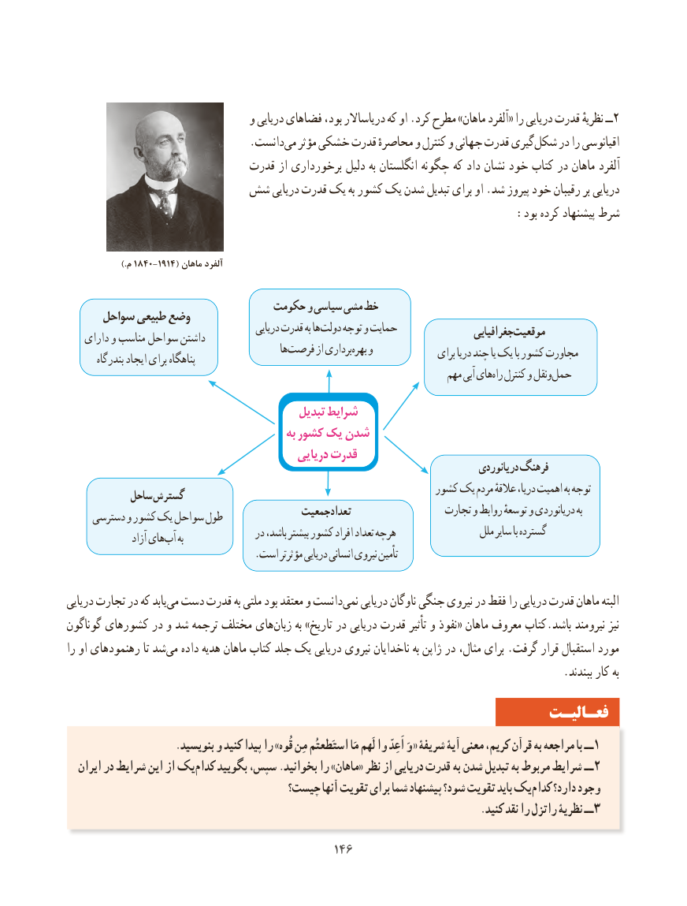

# PDF page 154

و دریایی فضاهای بود، دریاساالر که او .کرد مطرح »ماهان آلفرد« را دریایی قدرت نظریهٔ ــ 2
                                 .دانستمی‌  مؤثر خشکی قدرت محاصرهٔ و کنترل و جهانی قدرت گیریشکل‌    در را اقیانوسی
                             قدرت از برخورداری دلیل به انگلستان چگونه که داد نشان خود کتاب در ماهان آلفرد
                  شش دریایی قدرت یک به کشور یک شدن تبدیل برای او .شد پیروز خود رقیبان بر دریایی
                                                                 :بود کرده پیشنهاد شرط

                   ).م 1840-1914( ماهان آلفرد

                                حکومت و سیاسی مشی خط     سواحل طبیعی وضع
                                               دریایی قدرت به ها دولت توجه و حمایت                 جغرافیاییموقعیت    دارای و مناسب سواحل داشتن                                                     هافرصت‌      از برداریبهره‌   و                                                                                   برای دریا چند یا یک با کشور مجاورت        بندرگاه ایجاد برای پناهگاه
                                                                             مهم آبی هایراه‌  کنترل و ونقلحمل‌

                                           تبدیل شرایط
                                             به کشور یک شدن
                                            دریایی قدرت
                                                                                            دریانوردی فرهنگ
                                                                کشور یک مردم عالقهٔ دریا، اهمیت به توجه           ساحل گسترش
                                         جمعیت تعداد                 تجارت و روابط توسعهٔ و دریانوردی به     دسترسی و کشور یک سواحل طول
                                       در باشد، بیشتر کشور افراد تعداد هرچه                 ملل سایر با گسترده                 آزاد هایآب‌   به
                                     .است مؤثرتر دریایی انسانی نیروی تأمین

دریایی تجارت در که یابدمی‌ دست قدرت به ملتی بود معتقد و دانستنمی‌   دریایی ناوگان جنگی نیروی در فقط را دریایی قدرت ماهان البته
گوناگون کشورهای در و شد ترجمه مختلف های‌زبان به »تاریخ در دریایی قدرت تأثیر و نفوذ« ماهان معروف کتاب.باشد نیرومند نیز
را او رهنمودهای تا شد‌می داده هدیه ماهان کتاب جلد یک دریایی نیروی ناخدایان به ژاپن در مثال، برای .گرفت قرار استقبال مورد
                                                                                          .ببندند کار به
                                                                 فعـالیـت
                     .بنویسید و کنید پیدا را »قُوه مِن استَطعتُم مَا لَهم وا اَعِدّ وَ « شریفۀ آیۀ معنی کریم، قرآن به مراجعه با ــ 1
  ایران در شرایط این از یککدام‌    بگویید سپس، .بخوانید را »ماهان« نظر از دریایی قدرت به شدن تبدیل به مربوط شرایط ــ 2
                                  چیست؟ آنها تقویت برای شما پیشنهاد شود؟ تقویت باید یککدام‌    دارد؟ وجود
       .3کنید نقد را راتزل نظریۀ ــ

                                          146146

