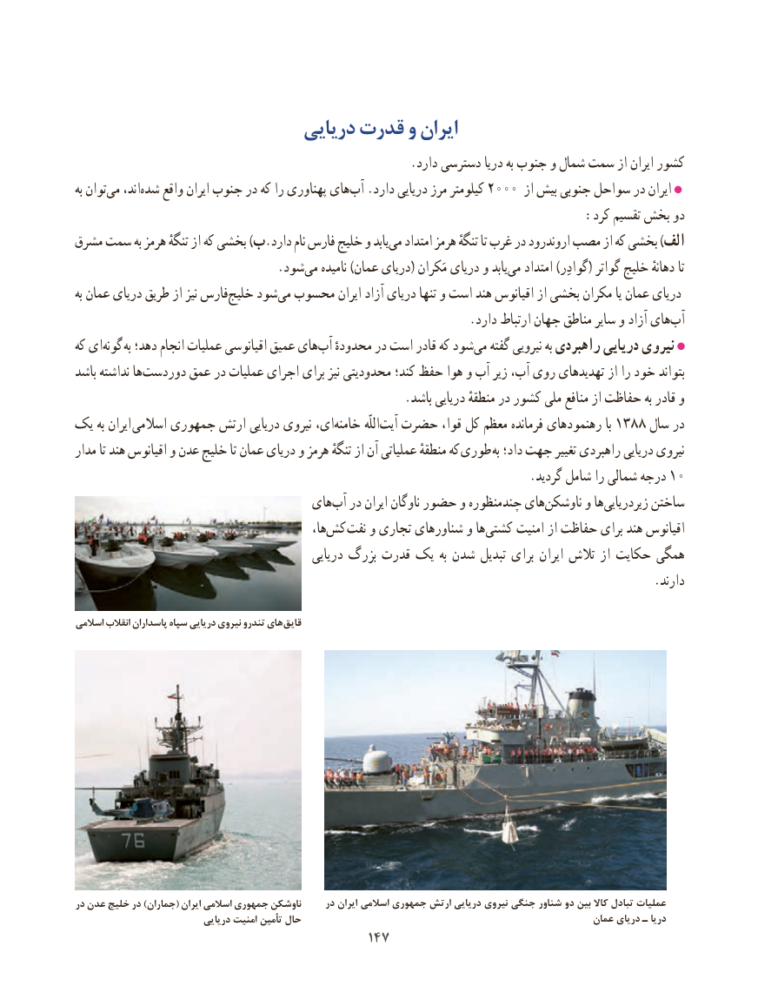

# PDF page 155

دریایی قدرت و ایران
                                                       .دارد دسترسی دریا به جنوب و شمال سمت از ایران کشور
به توان ‌می اند،شده‌    واقع ایران جنوب در که را پهناوری های ‌آب .دارد دریایی مرز کیلومتر 2000 از بیش جنوبی سواحل در ایران
                                                                   :کرد تقسیم بخش دو
مشرق سمت به هرمز تنگهٔ از که بخشی )ب.دارد نام فارس خلیج و یابدمی‌   امتداد هرمز تنگهٔ تا غرب در اروندرود مصب از که بخشی )الف
             .‌شودمی نامیده )عمان دریای( مَکران دریای و یابدمی‌   امتداد )گوادِر( گواتر خلیج دهانهٔ تا
به عمان دریای طریق از نیز فارس‌خلیج شود‌می محسوب ایران آزاد دریای تنها و است هند اقیانوس از بخشی مکران یا عمان دریای
    .‌دارد ارتباط جهان مناطق سایر و آزاد هایآب
که ای‌گونه به دهد؛ انجام عملیات اقیانوسی عمیق هایآب‌   محدودهٔ در است قادر که شود‌می گفته نیرویی به راهبردی دریایی نیروی
باشد نداشته هادوردست‌      عمق در عملیات اجرای برای نیز محدودیتی کند؛ حفظ هوا و آب زیر آب، روی تهدیدهای از را خود بتواند
                                                      .باشد دریایی منطقهٔ در کشور ملی منافع از حفاظت به قادر و
یک به ایران  اسالمی جمهوری ارتش دریایی نیروی ای،‌خامنه اللّه‌آیت حضرت قوا، کل معظم فرمانده رهنمودهای با 1388 سال در
مدار تا هند اقیانوس و عدن خلیج تا عمان دریای و هرمز تنگهٔ از آن عملیاتی منطقهٔ که  طوری به داد؛ جهت تغییر راهبردی دریایی نیروی
         .10گردید شامل را شمالی درجه
                                   های ‌آب در ایران ناوگان حضور و چندمنظوره های ‌ناوشکن و ها‌زیردریایی ساختن
                                                  ها،‌کش نفت و تجاری شناورهای و هاکشتی‌     امنیت از حفاظت برای هند اقیانوس
                                              دریایی بزرگ قدرت یک به شدن تبدیل برای ایران تالش از حکایت همگی
                                                                                               .دارند

اسالمی انقالب پاسداران سپاه دریایی نیروی تندرو های قایق

در عدن خلیج در )جماران( ایران اسالمی جمهوری ناوشکن     در ایران اسالمی جمهوری ارتش دریایی نیروی جنگی شناور دو بین کاال تبادل عملیات
                            دریایی امنیت تأمین حال                                                        عمان دریای ـ دریا
                                        147147

