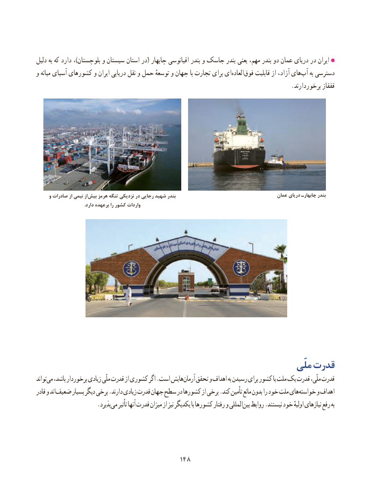

# PDF page 156

دلیل به که دارد ،)بلوچستان و سیستان استان در( چابهار اقیانوسی بندر و جاسک بندر یعنی مهم، بندر دو عمان دریای در ایران
و میانه آسیای کشورهای و ایران دریایی نقل و حمل توسعهٔ و جهان با تجارت برای ایالعاده‌       ‌فوق قابلیت از آزاد، های‌آب به دسترسی
                                                                                      .برخوردارند قفقاز

      و صادرات از نیمی از  بیش هرمز تنگه نزدیکی در رجایی شهید بندر                                        عمان دریای چابهارـ بندر
                                          .دارد برعهده را کشور واردات

                                                                   ملّی قدرت
تواندمی‌  باشد، برخوردار زیادی ملّی قدرت از کشوری اگر .است هایشآرمان‌   تحقق و اهداف به رسیدن برای کشور یا ملت یک قدرت ملّی، قدرت
قادر و اندضعیف‌      بسیار دیگر برخی .دارند زیادی قدرت جهان سطح در کشورها از برخی .کند  تأمین مانع بدون را خود ملت هایخواسته‌     و اهداف
        .‌پذیردمی تأثیر آنها قدرت میزان از نیز یکدیگر با کشورها رفتار و المللیبین‌  روابط .نیستند خود ‌اولیهٔبهنیازهای رفع

                                        148148

