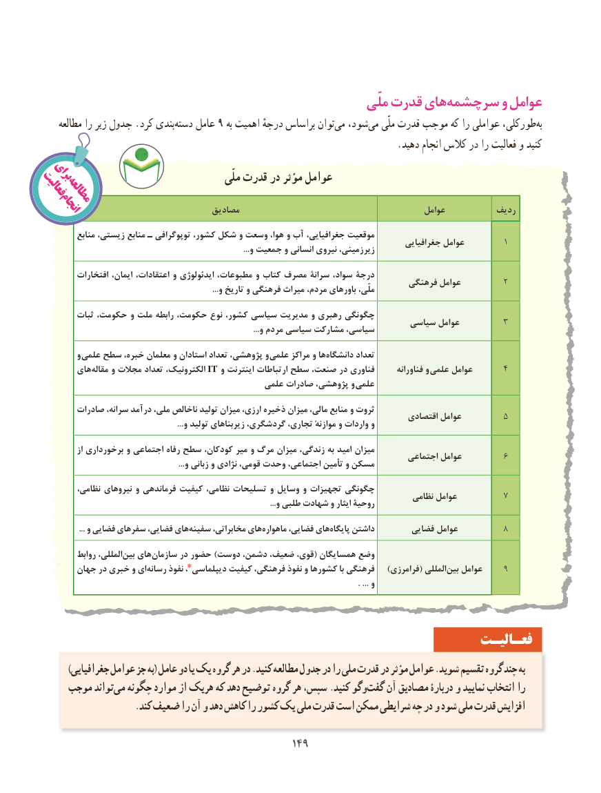

# PDF page 157

ملّی قدرت هایسرچشمه‌        و عوامل
      مطالعه را زیر جدول .کرد بندیدسته‌    عامل 9 به اهمیت درجهٔ براساس توان ‌می شود، ‌می ملّی قدرت موجب که را عواملی طورکلی،‌به
                                                                           .دهید انجام کالس در را فعالیت و کنید
  برایفعالیت                                       ملّی قدرت در مؤثر عوامل    مطالعه   انجام                           مصادیق                                           عوامل          ردیف
           منابع زیستی، منابع ـ توپوگرافی کشور، شکل و وسعت هوا، و آب جغرافیایی، موقعیت                                                                                            جغرافیایی عوامل        1                                                                                                   ...و جمعیت و انسانی نیروی زیرزمینی،
          افتخارات ایمان، اعتقادات، و ایدئولوژی مطبوعات، و کتاب مصرف سرانۀ سواد، درجۀ                                                                              فرهنگی عوامل         2                                                                                    ...و تاریخ و فرهنگی میراث مردم، باورهای ملّی،
         ثبات حکومت، و ملت رابطه حکومت، نوع کشور، سیاسی مدیریت و رهبری چگونگی                                                                       سیاسی عوامل         3                                                                                                        ...و مردم سیاسی مشارکت سیاسی،
          و علمی سطح خبره، معلمان و استادان تعداد پژوهشی، و  علمی مراکز و هادانشگاه‌       تعداد
        های ‌مقاله و مجالت تعداد الکترونیک، IT و اینترنت ارتباطات سطح صنعت، در فناوری       فناورانه و  علمی عوامل      4
                                                                                                       علمی صادرات پژوهشی، و  علمی
         صادرات سرانه، درآمد ملی، ناخالص تولید میزان ارزی، ذخیره میزان مالی، منابع و ثروت                                                                                      اقتصادی عوامل         5                                                                   ...و تولید زیربناهای گردشگری، تجاری، موازنهٔ و واردات و
             از برخورداری و اجتماعی رفاه سطح کودکان، میر و مرگ میزان زندگی، به امید میزان                                                                                     اجتماعی عوامل         6                                                                    ...و زبانی و نژادی قومی، وحدت اجتماعی، تأمین و مسکن
                   ،چگونگینظامی نیروهای و فرماندهی کیفیت نظامی، تسلیحات و وسایل و تجهیزات                                                                                        نظامی عوامل          7                                                                                                                    ...و طلبی شهادت و ایثار روحیۀ
 ...‌و فضایی سفرهای فضایی، هایسفینه مخابراتی، هایماهواره‌      فضایی، هایپایگاه‌    داشتن        فضایی عوامل         8
          روابط المللی،‌بین های‌سازمان در حضور )دوست دشمن، ضعیف، قوی،( همسایگان وضع
        جهان در خبری و ای ‌رسانه نفوذ دیپلماسی٭، کیفیت فرهنگی، نفوذ و کشورها با فرهنگی    )فرامرزی( المللی ‌بین عوامل    9
                                                                                                                                                          . ... و

                                                                    فعـالیـت
          )جغرافیایی عوامل جز به( عامل دو یا یک گروه هر در .کنید مطالعه جدول در را ملی قدرت در مؤثر عوامل .شوید تقسیم گروه چند به
     موجب تواندمی‌  چگونه موارد از هریک که دهد توضیح گروه هر سپس، .کنید وگوگفت‌   آن مصادیق دربارۀ و نمایید انتخاب را
                      .کند ضعیف را آن و دهد کاهش را کشور یک ملی قدرت است ممکن شرایطی چه در و شود ملی قدرت افزایش

                                              149149

