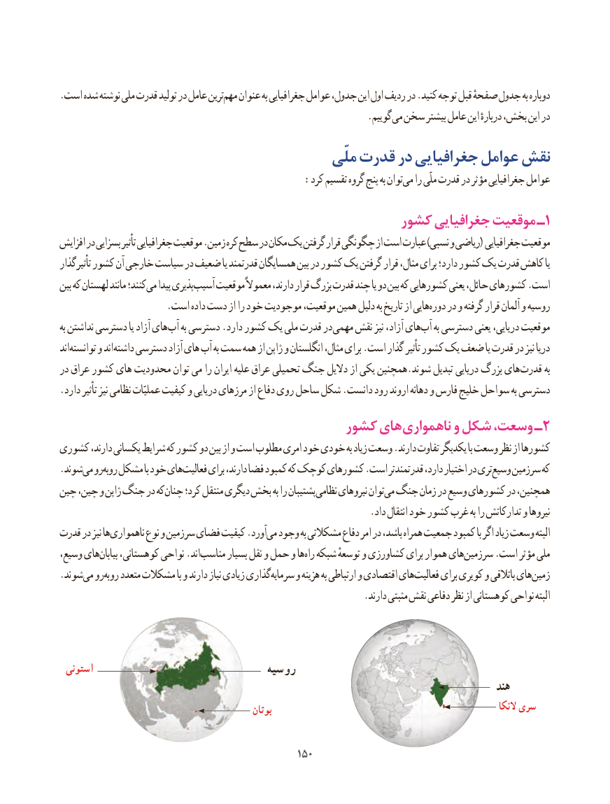

# PDF page 158

.است شده نوشته ملی قدرت تولید در عامل ترینمهم‌   عنوان به جغرافیایی عوامل جدول، این اول ردیف در .کنید توجه قبل صفحهٔ جدول به دوباره
                                                               .گوییم می سخن بیشتر عامل این دربارهٔ بخش، این در
                                           ملّی قدرت در جغرافیایی عوامل نقش
     :‌کرد تقسیم گروه پنج به توانمی را ملّی قدرت در مؤثر جغرافیایی عوامل
                                           کشور جغرافیایی موقعیت ـ1
افزایش در بسزایی تأثیر جغرافیایی موقعیت .زمین کره سطح در مکان یک گرفتن قرار چگونگی از است عبارت )نسبی و ریاضی( جغرافیایی موقعیت
تأثیرگذار کشور آن خارجی سیاست در ضعیف یا قدرتمند همسایگان بین در کشور یک گرفتن قرار مثال، برای دارد؛ کشور یک قدرت کاهش یا
بین که لهستان مانند کنند؛می‌   پیدا پذیریآسیب‌    موقعیت معموالً دارند، قرار بزرگ قدرت چند یا دو بین که کشورهایی یعنی حائل، کشورهای .است
                      .است داده دست از را خود موجودیت موقعیت، همین دلیل به تاریخ از هاییدوره‌   در و گرفته قرار آلمان و روسیه
به نداشتن دسترسی یا آزاد های آب به دسترسی .دارد کشور یک ملی قدرت در مهمی نقش نیز آزاد، هایآب‌   به دسترسی یعنی دریایی، موقعیت
اند توانسته و اند داشته دسترسی آزاد های آب به سمت همه از ژاپن و انگلستان مثال، برای .است گذار تأثیر کشور یک ضعف یا قدرت در نیز دریا
در عراق کشور های محدودیت توان می را ایران علیه عراق تحمیلی جنگ دالیل از یکی همچنین.شوند تبدیل دریایی بزرگ های قدرت به
.دارد تأثیر نیز نظامی عملیّات کیفیت و دریایی مرزهای از دفاع روی ساحل شکل .دانست رود اروند دهانه و فارس خلیج سواحل به دسترسی
                                    کشور های ناهمواری و شکل وسعت، ـ2
کشوری دارند، یکسانی شرایط که کشور دو بین از و است مطلوب امری خود خودی به زیاد وسعت .دارند تفاوت یکدیگر با وسعت نظر از کشورها
.شوندمی‌  روروبه‌  مشکل با خود هایفعالیت‌     برای دارند، فضا کمبود که کوچک کشورهای .است قدرتمندتر دارد، اختیار در تریوسیع‌    سرزمین که
چین چین، و ژاپن جنگ در که چنان کرد؛ منتقل دیگری بخش به را پشتیبان نظامی نیروهای توانمی‌ جنگ زمان در وسیع کشورهای در همچنین،
                                                               .داد انتقال خود کشور غرب به را تدارکاتش و نیروها
قدرت در نیز ها ناهمواری نوع و سرزمین فضای کیفیت .آوردمی‌  وجود به مشکالتی دفاع امر در باشد، همراه جمعیت کمبود با اگر زیاد وسعت البته
وسیع، هایبیابان‌    کوهستانی، نواحی .اندمناسب‌      بسیار نقل و حمل و هاراه‌  شبکه توسعهٔ و کشاورزی برای هموار هایسرزمین‌      .است مؤثر ملی
.شوندمی‌  روروبه‌   متعدد مشکالت با و دارند نیاز زیادی گذاریسرمایه‌     و هزینه به ارتباطی و اقتصادی هایفعالیت‌     برای کویری و باتالقی هایزمین‌
                                                              .دارند مثبتی نقش دفاعی نظر از کوهستانی نواحی البته

 استونی                               روسیه
                                                                                               هند
                                                                                                                             النکا سری                                                  بوتان

                                              150150

