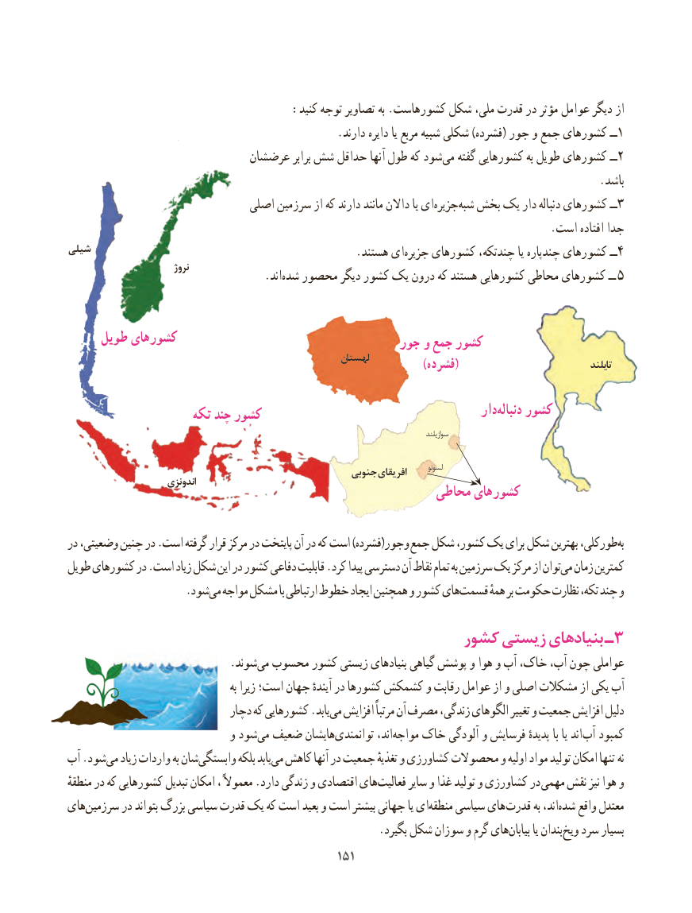

# PDF page 159

:کنید توجه تصاویر به .کشورهاست شکل ملی، قدرت در مؤثر عوامل دیگر از
  .1دارند دایره یا مربع شبیه شکلی )فشرده( جور و جمع کشورهای ــ
                           عرضشان برابر شش حداقل آنها طول که شودمی‌   گفته کشورهایی به طویل کشورهای ــ2
                                                                                                .باشد
                              اصلی سرزمین از که دارند مانند داالن یا ای ‌جزیره‌شبه بخش یک دار ‌دنباله کشورهای ــ3
                                                                                       .است افتاده جدا
شیلی          .‌هستند ایجزیره کشورهای چندتکه، یا چندپاره کشورهای ــ4
                           نروژ                                    .اند‌شده محصور دیگر کشور یک درون که هستند کشورهایی محاطی کشورهای ــ 5

     طویل کشورهای                                                 جور و جمع کشور
                                                        لهستان              )فشرده(                                   تایلند

                                                                            دار‌دنباله کشور                    تکه چند کشور
                                                                                                                             سوازیلند

                                                      جنوبی افریقای       لسوتو                        اندونزی                                                     محاطی کشورهای

در وضعیتی، چنین در .است گرفته قرار مرکز در پایتخت آن در که است )فشرده(جور و جمع شکل کشور، یک برای شکل بهترین طورکلی،به‌
طویل کشورهای در .است زیاد شکل این در کشور دفاعی قابلیت .کرد پیدا دسترسی آن نقاط تمام به سرزمین یک مرکز از توانمی‌  زمان کمترین
         .‌شودمی مواجه مشکل با ارتباطی خطوط ایجاد همچنین و کشور هایقسمت‌       همهٔ بر حکومت نظارت تکه، چند و

                                            کشور زیستی بنیادهای ـ3
                             .شوندمی‌  محسوب کشور زیستی بنیادهای گیاهی پوشش و هوا و آب خاک، آب، چون عواملی
                                               به زیرا است؛ جهان آیندهٔ در کشورها کشمکش و رقابت عوامل از و اصلی مشکالت از یکی آب
                              دچار که کشورهایی .یابدمی‌  افزایش مرتباً آن مصرف زندگی، الگوهای تغییر و جمعیت افزایش دلیل
                             و شودمی‌  ضعیف هایشانتوانمندی‌          اند،مواجه‌   خاک آلودگی و فرسایش پدیدهٔ با یا اند آب کمبود
آب .شودمی‌   زیاد واردات به شانوابستگی‌        بلکه یابدمی‌  کاهش آنها در جمعیت تغذیهٔ و کشاورزی محصوالت و اولیه مواد تولید امکان تنها‌  نه
منطقهٔ در که کشورهایی تبدیل امکان ، معموالً .دارد زندگی و اقتصادی هایفعالیت‌      سایر و غذا تولید و کشاورزی در مهمی نقش نیز هوا و
هایسرزمین‌      در بتواند بزرگ سیاسی قدرت یک که است بعید و است بیشتر جهانی یا ایمنطقه‌    سیاسی های قدرت به اند،شده‌    واقع معتدل
     .‌بگیرد شکل سوزان و گرم هایبیابان یا بندان ویخ سرد بسیار
                                              151151

