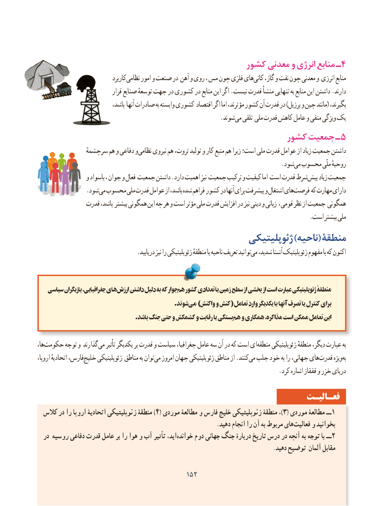

# PDF page 160

کشور معدنی و انرژی منابع ـ4
                                کاربرد نظامی امور و صنعت در آهن و روی ، مس چون فلزی هایکانی‌    گاز، و نفت چون معدنی و انرژی منابع
                               قرار صنایع توسعهٔ جهت در کشوری در منابع این اگر .نیست قدرت منشأ تنهایی به منابع این داشتن .دارند
                              باشد، آنها صادرات به وابسته کشوری اقتصاد اگر اما مؤثرند، کشور آن قدرت در )برزیل و چین مانند( بگیرند،
                      .‌شوندمی تلقی ملی قدرت کاهش عامل و منفی ویژگی یک
                                                  کشور جمعیت ـ 5
              سرچشمهٔوهم و دفاعی   نظامی نیروی هم ثروت، تولید و کار منبع هم زیرا است؛ ملی قدرت عوامل از زیاد جمعیت داشتن
                                 .‌شودمی محسوب ملّی روحیهٔ
                و باسواد ، جوان و فعال جمعیت داشتن .دارد اهمیت نیز جمعیت ترکیب و کیفیت اما است قدرت شرطپیش‌    زیاد جمعیت
       . شودمی محسوب ملی قدرت عوامل از باشد، شده فراهم کشور در آنها برای پیشرفت و اشتغال هایفرصت‌      که مهارت دارای
              قدرت باشد، بیشتر همگونی این چه هر و است مؤثر ملی قدرت افزایش در نیز دینی و زبانی ، قومی نظر از جمعیت همگونی
                                                                                        .است بیشتر ملی
                                               ژئوپلیتیکی )ناحیه( منطقۀ
  .‌دریابید نیز را ژئوپلیتیکی منطقهٔ یا ناحیه تعریف توانیدمی شدید، آشنا ژئوپلیتیک مفهوم با که اکنون

   سیاسی بازیگران جغرافیایی، هایارزش‌    داشتن دلیل به که جوار هم کشور تعدادی یا زمین سطح از بخشی از است عبارت ژئوپلیتیکی منطقهٔ
                                                          .شوندمی‌   )واکنش و کنش( تعامل وارد یکدیگر با آنها تصرف یا کنترل برای
  . باشد جنگ حتی و کشمکش و رقابت یا بستگیهم و همکاری مذاکره، است ممکن تعامل این

ها،حکومت‌      توجه و گذارند می تأثیر یکدیگر بر قدرت و سیاست جغرافیا، عامل سه آن در که است ایمنطقه‌     ژئوپلیتیکی منطقهٔ دیگر، عبارت به
اروپا، اتحادیهٔ فارس،خلیج‌     ژئوپلیتیکی مناطق به توانمی‌  امروز جهان ژئوپلیتیکی مناطق از .کنندمی‌ جلب خود به را جهانی، هایقدرت‌      ویژهبه‌
                                                                              .کرد اشاره قفقاز و خزر دریای

                                                                 فعـالیـت
  کالس در را اروپا اتحادیۀ ژئوپلیتیکی منطقۀ ) 4( موردی مطالعۀ و فارس‌خلیج ژئوپلیتیکی منطقۀ ،)3( موردی مطالعۀ ــ 1
                                                               .دهید انجام را آن به مربوط هایفعالیت‌     و بخوانید
  در روسیه دفاعی قدرت عامل بر را هوا و آب تأثیر اید،خوانده‌     دوم جهانی جنگ دربارۀ تاریخ درس در آنچه به توجه با ــ 2
                                                                                  .دهید توضیح آلمان مقابل

                                         152152

