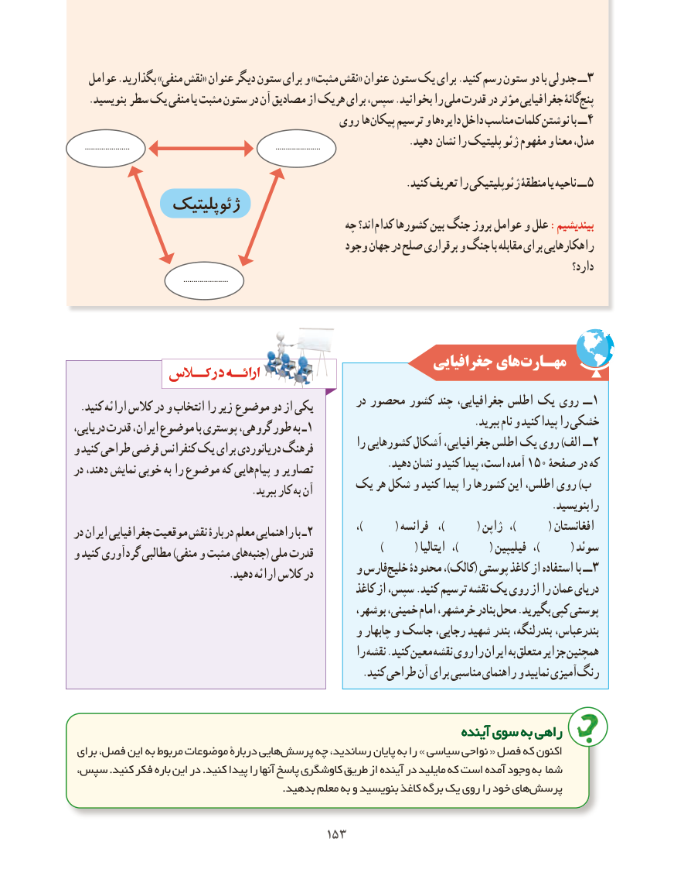

# PDF page 161

عوامل .بگذارید »منفی نقش« عنوان دیگر ستون برای و »مثبت نقش« عنوان ستون یک برای .کنید رسم ستون دو با جدولی ــ 3
   .بنویسید سطر یک منفی یا مثبت ستون در آن مصادیق از هریک برای سپس، .بخوانید را ملی قدرت در مؤثر جغرافیایی گانۀپنج‌
                                        روی ها پیکان ترسیم و ها دایره داخل مناسب کلمات نوشتن با ــ4
                                                                   .دهید نشان را پلیتیک ژئو مفهوم و معنا مدل،     ......................                                                                       ......................

     . 5کنید تعریف را ژئوپلیتیکی منطقۀ یا ناحیه ــ
             ژئوپلیتیک
                                                چه اند؟ کدام کشورها بین جنگ بروز عوامل و علل :بیندیشیم
                                                وجود جهان در صلح برقراری و جنگ با مقابله برای راهکارهایی
                                                                                                                   دارد؟
                                                      ......................

                                                      جغرافیایی هایمهـارت‌
                                                       در محصور کشور چند جغرافیایی، اطلس یک روی ــ 1 .کنید ارائه کالس در و انتخاب را زیر موضوع دو از یکی
                                                                                .ببرید نام و کنید پیدا را خشکیدریایی، قدرت ایران، موضوع با پوستری گروهی، طور به ـ 1
                                                          را کشورهایی اَشکال جغرافیایی، اطلس یک روی )الف ــ 2و کنید طراحی فرضی کنفرانس یک برای دریانوردی فرهنگ
                                                               .دهید نشان و کنید پیدا است، آمده 150 صفحۀ در کهدر دهند، نمایش خوبی به را موضوع که هاییپیام‌   و تصاویر
                                یک هر شکل و کنید پیدا را کشورها این اطلس، روی )ب                                   .ببرید کار به آن
                                                                                               .بنویسید را
                                                                     ،)         ( فرانسه  ،)         ( ژاپن  ،)         ( افغانستاندر ایران جغرافیایی موقعیت نقش دربارۀ معلم راهنمایی با ـ 2
                                                                                         )         ( ایتالیا  ،)         ( فیلیپین  ،)         ( سوئدو کنید گردآوری مطالبی )منفی و مثبت هایجنبه‌    ( ملی قدرت
                                             و فارسخلیج‌    محدودۀ ،)کالک( پوستی کاغذ از استفاده با ــ 3                               .دهید ارائه کالس در
                                                          کاغذ از سپس، .کنید ترسیم نقشه یک روی از را عمان دریای
                                                        بوشهر، خمینی، امام خرمشهر، بنادر محل .بگیرید کپی پوستی
                                             و چابهار و جاسک رجایی، شهید بندر بندرلنگه، بندرعباس،
                                                          را نقشه .کنید معین نقشه روی را ایران به متعلق جزایر همچنین
   .‌کنید طراحی آن برای مناسبی راهنمای و نمایید آمیزیرنگ

                                                                   آیندهآینده سویسوی بهبه راهیراهی
 برای فصل، این به مربوط موضوعات دربارۀ هاییپرسش‌     چه رساندید، پایان به را » سیاسی نواحی « فصل که اکنون
سپس، .کنید فکر باره این در .کنید پیدا را آنها پاسخ کاوشگری طریق از آینده در مایلید که است آمده وجود به شما
  .‌بدهید معلم به و بنویسید کاغذ برگه یک روی را خود هایپرسش

                                      153153

