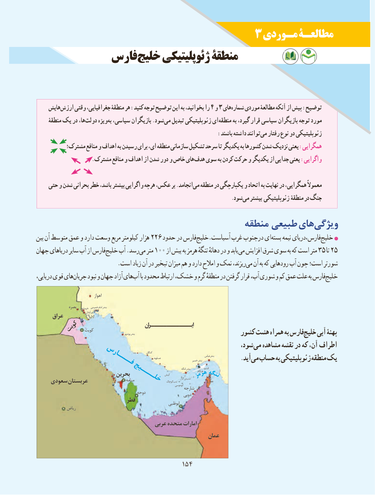

# PDF page 162

3 مـوردی مطالعـۀ
           فارسخلیج‌     ژئوپلیتیکی منطقۀ

    هایش ارزش وقتی جغرافیایی، منطقۀ هر :کنید توجه توضیح این به بخوانید، را 4 و 3 هایشماره‌    موردی مطالعۀ آنکه از پیش :توضیح
     منطقۀ یک در ها،دولت‌     ویژهبه‌ سیاسی، بازیگران .شودمی‌   تبدیل ژئوپلیتیکی ای منطقه به گیرد، قرار سیاسی بازیگران توجه مورد
        :‌باشند داشته توانندمی رفتار نوع دو ژئوپلیتیکی
          مشترک؛ منافع و اهداف به رسیدن برای ای، منطقه سازمانی تشکیل سرحد تا یکدیگر به کشورها شدن نزدیک یعنی :همگرایی
 .‌مشترک منافع و اهداف از شدن دور و خاص هایهدف سوی به کردن حرکت و یکدیگر از جدایی یعنی :واگرایی

    حتی و شدن بحرانی خطر باشد، بیشتر واگرایی هرچه عکس، بر .انجامدمی‌  منطقه در یکپارچگی و اتحاد به نهایت در همگرایی، معموالً
                                                                            .شودمی‌  بیشتر ژئوپلیتیکی منطقۀ در جنگ
                                           منطقه طبیعی هایویژگی‌
بین آن متوسط عمق و دارد وسعت مربع کیلومتر هزار 226 حدود در فارسخلیج‌   .آسیاست غرب‌درجنوب ایبسته‌     ‌نیمه فارس،دریایخلیج‌
جهان دریاهای سایر آب از فارسخلیج‌   آب .رسدمی‌  متر 100 از بیش به هرمز تنگهٔ دهانهٔ در و یابد می افزایش شرق سوی به که است متر 35 تا 25
                           .است زیاد آن در تبخیر میزان هم و دارد امالح و نمک ریزند،می‌  آن به که رودهایی آب چون است؛ شورتر
دریایی، قوی هایجریان‌     نبود و جهان آزاد هایآب‌    با محدود ارتباط خشک، و گرم منطقهٔ در گرفتن قرار آب، شوری و کم عمق علت به فارسخلیج‌

                                        اهواز
                 بصره   خرمشهر خمینی امام بندر
      عراق                        آبادان
      کویت  کویت                         بوشهر بندر    ایـــــــــــــران                                                         کشور هشت همراه به فارسخلیج‌    آبی پهنۀ
                                                               شود، می مشاهده نقشه در که آن، اطراف
                                                                                          کنگان
                                                                                                                                           بندرعباس                                                                                                     عسلویه                                                                                                               خمیر بندر                                                                    .آیدمی‌  حساب به ژئوپلیتیکی منطقه‌   یک                فــــارس
                                                                                                                                  لنگه بندر         قشم
                                                                     کیش                            بحرین                                                         هنگام                                                                                                              بزرگتنب زمره هگنت
                                                                          کوچکتنب                                                                                                                عمان    سعودی عربستان                      منامهخلــــیج                                                                                                                    ابوموسی
                                                                      شارجه
                                              دوحه                                                                          دوبی
                              قطر                                                                      ابوظبی
             ریاض
                                        عربی متحده امارات
                                                           عمان

                                         154154

