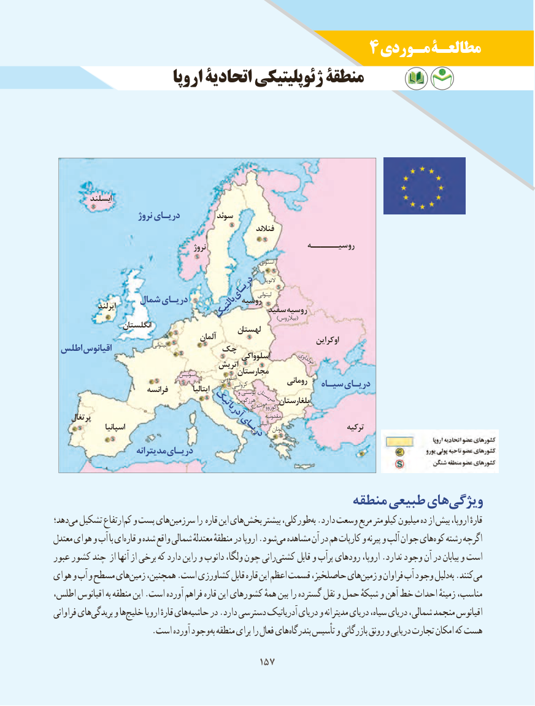

# PDF page 165

4 مـوردی مطالعـۀ
                    اروپا اتحادیۀ ژئوپلیتیکی منطقۀ

          ایسلند
                       نروژ دریـای         سوئد
                                                                 فنالند
                                           نروژ                       روسیــــــه
                                                                                    استونی

                                                                                                                         التویا
                                                                                                    لیتوانی                                دریـای                شمال دریـای             روسیه               ایرلند                                               سفید روسیه                              بالتیک                  )بیالروس(
                   انگلستان                                              لهستان                                           آلمان                                                                               اوکراین اطلس اقیانوس                    لیتوانی       چک                                                   اسلوواکی         مولداوی                                        اتریش                                       سوئیس           مجارستان                                                                   اسلوونی              رومانی                                                             کرواسی                سیـاه دریـای                          فرانسه          ایتالیا            و بوسنی                                                                     هرزگوین صربستان بلغارستان                                                                       مونتهکوزوو                                                                نگرو
                                                                                            مقدونیه     پرتغال                         آدریاتیک
                  اسپانیا                                                                   آلبانی یونان                  ترکیه                                  دریـای
                      مدیترانه دریـای

                                           منطقه طبیعی هایویژگی‌
دهد؛می‌  تشکیل ارتفاعکم‌  و پست هایسرزمین‌       را قاره این های بخش بیشتر طورکلی،به‌ .دارد وسعت مربع کیلومتر میلیون ده از بیش اروپا، قارهٔ
معتدل هوای و آب با ایقاره‌   و شده واقع شمالی معتدلهٔ منطقهٔ در اروپا .شودمی‌  مشاهده آن در هم کارپات و پیرنه و آلپ جوان های کوه رشته اگرچه
عبور کشور چند از آنها از برخی که دارد راین و دانوب ولگا، چون رانی کشتی قابل و پرآب رودهای اروپا، .ندارد وجود آن در بیابان و است
هوای و آب و مسطح هایزمین‌   همچنین، .است کشاورزی قابل قاره این اعظم قسمت حاصلخیز، هایزمین‌   و فراوان آب وجود دلیل به .کنندمی‌
اطلس، اقیانوس به منطقه این .است آورده فراهم قاره این کشورهای همهٔ بین را گسترده نقل و حمل شبکهٔ و آهن خط احداث زمینهٔ مناسب،
فراوانی هایبریدگی‌     و هاخلیج‌     اروپا قارهٔ های حاشیه در .دارد دسترسی آدریاتیک دریای و مدیترانه دریای سیاه، دریای شمالی، منجمد اقیانوس
   . است آورده وجودبه منطقه برای را فعال های بندرگاه تأسیس و بازرگانی رونق و دریایی تجارت امکان که هست

                                       157157

