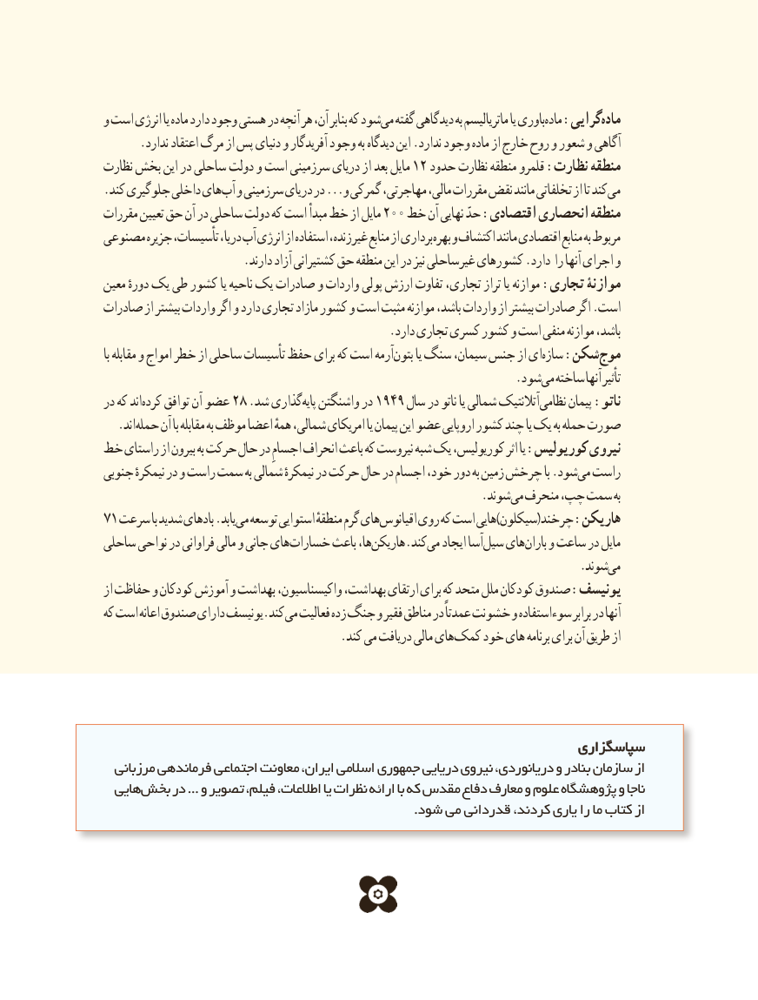

# PDF page 171

و است انرژی یا ماده دارد وجود هستی در آنچه هر آن، بنابر که شودمی‌  گفته دیدگاهی به ماتریالیسم یا باوریماده‌  :گراییماده‌
      .ندارد اعتقاد مرگ از پس دنیای و آفریدگار وجود به دیدگاه این .ندارد وجود ماده از خارج روح و شعور و آگاهی
نظارت بخش این در ساحلی دولت و است سرزمینی دریای از بعد مایل 12 حدود نظارت منطقه قلمرو :نظارت منطقه
. کند جلوگیری داخلی هایآب و سرزمینی دریای در ...و گمرکی مهاجرتی، مالی، مقررات نقض مانند تخلفاتی از تا کند می
مقررات تعیین حق آن در ساحلی دولت که است مبدأ خط از مایل 200 خط آن نهایی حدّ :اقتصادی انحصاری منطقه
مصنوعی جزیره تأسیسات، دریا، آب انرژی از استفاده زنده، غیر منابع از برداری بهره و اکتشاف مانند اقتصادی منابع به مربوط
                       .دارند آزاد کشتیرانی حق منطقه این در نیز ساحلی غیر کشورهای .دارد را آنها اجرای و
معین دورهٔ یک طی کشور یا ناحیه یک صادرات و واردات پولی ارزش تفاوت تجاری، تراز یا موازنه :تجاری موازنۀ
صادرات از بیشتر واردات اگر و دارد تجاری مازاد کشور و است مثبت موازنه باشد، واردات از بیشتر صادرات اگر .است
                                               .دارد تجاری کسری کشور و است منفی موازنه باشد،
با مقابله و امواج خطر از ساحلی تأسیسات حفظ برای که است آرمهبتون‌      یا سنگ سیمان، جنس از ایسازه‌   :شکنموج‌
                            .‌شودمی ساخته آنها تأثیر
در که اندکرده‌    توافق آن عضو 28 .شد گذاریپایه‌  واشنگتن در 1949 سال در ناتو یا شمالی آتالنتیک نظامی پیمان :ناتو
 . اندحمله آن با مقابله به موظف اعضا همهٔ شمالی، امریکای یا پیمان این عضو اروپایی کشور چند یا یک به حمله صورت
خط راستای از بیرون به حرکت حال در اجسامِ انحراف باعث که نیروست‌شبه یک کوریولیس، اثر یا :کوریولیس نیروی
جنوبی نیمکرهٔ در و راست سمت به شمالی نیمکرهٔ در حرکت حال در اجسام خود، دور به زمین چرخش با .شودمی‌  راست
                       .‌شوندمی منحرف چپ، سمت به
71 سرعت با شدید بادهای .یابدمی‌  توسعه استوایی منطقهٔ گرم هایاقیانوس‌     روی که است هایی)سیکلون(چرخند :هاریکن
ساحلی نواحی در فراوانی مالی و جانی های خسارات باعث ها،هاریکن‌          .کندمی‌  ایجاد آساسیل‌   هایباران‌   و ساعت در مایل
                              .‌شوندمی
از حفاظت و کودکان آموزش و بهداشت واکیسناسیون، بهداشت، ارتقای برای که متحد ملل کودکان صندوق :یونیسف
که است اعانه صندوق دارای یونیسف.کند می فعالیت زده جنگ و فقیر مناطق در عمدتاً خشونت و استفاده سوء برابر در آنها
    . کند می دریافت مالی هایکمک خود های برنامه برای آن طریق از

                                                                سپاسگزاریسپاسگزاری
  مرزبانی فرماندهی اجتماعی معاونت ایران، اسالمی جمهوری دریایی نیروی دریانوردی، و بنادر سازمان از
  هایی بخش در ... و تصویر ، فیلم اطالعات، یا نظرات ارائه با که مقدس دفاع معارف و علوم پژوهشگاه و ناجا
                                                                        .شود می قدردانی کردند، یاری را ما کتاب از

