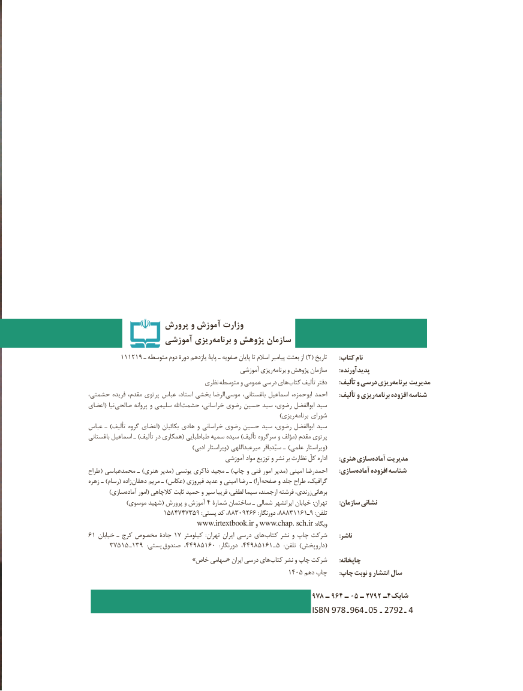

# PDF page 2

پرورش و آموزش وزارت
                 آموزشی ریزی‌برنامه و پژوهش سازمان
         111219 ـ متوسطه دوم دورۀ یازدهم پایۀ ـ صفویه پایان تا اسالم پیامبر بعثت از ) 2( تاریخ       :کتاب نام
                                                آموزشی ریزی برنامه و پژوهش سازمان       :پدیدآورنده
                                  نظری متوسطه و عمومی درسی های کتاب تألیف دفتر : تألیف و درسی ریزیبرنامه مدیریت
حشمتی، فریده مقدم، پرتوی عباس استاد، بخشی الرضا  موسی باغستانی، اسماعیل ابوحمزه، احمد       :تألیف و ریزی برنامه افزوده شناسه
اعضای( نیا صالحی پروانه و سلیمی اهلل حشمت خراسانی، رضوی حسین سید رضوی، ابوالفضل سید
                       ) ریزی برنامه شورای
عباس ـ )تألیف گروه اعضای( بکائیان هادی و خراسانی رضوی حسین سید رضوی، ابوالفضل سید
باغستانی اسماعیل ـ )تألیف در همکاری( طباطبایی سمیه سیده )تألیف سرگروه و مؤلف( مقدم پرتوی
                                              )ادبی ویراستار( میرعبداللهی سیّدباقر ـ )علمی ویراستار(
                                            آموزشی مواد توزیع و نشر بر نظارت کلّ اداره       :هنری سازیآماده‌    مدیریت
طراح( محمدعباسی ـ )هنری مدیر( یونسی ذاکری مجید ـ )چاپ و فنی امور مدیر( امینی احمدرضا : سازی آماده افزوده شناسه
زهره  ـ )رسام( زاده دهقان مریم ـ )عکاس( فیروزی عدید و امینی رضا ـ )آرا صفحه و جلد طراح گرافیک،
         )سازی آماده امور( کالچاهی ثابت حمید و سیر فریبا لطفی، سیما ارجمند، فرشته زرندی، برهانی
                 )موسوی شهید( پرورش و آموزش ٤ شمارۀ ساختمان ـ شمالی ایرانشهر خیابان :تهران       :سازمان نشانی
                     ١٥٣٧٤٧٤٨٥٩ :پستی٩٢٣٨٨٨،کد ٠٣٨٨، ٦٦١١٦١ـ٩:دورنگار                              :تلفن
                                 www.irtextbook.ir و www.chap. sch.ir :وبگاه
٦ ١ خیابان١هایـ کرج مخصوص جادۀ  ٧ کیلومتر  :تهران ایران درسی        کتاب نشر و چاپ شرکت       :ناشر
      ٥٧٣١٥ ـ١٣٩   :پستی 44صندوق  ،  958106   :دورنگار٩٥٨١٦١٤٤،            ـ (٥   :تلفن )داروپخش
   » خاص سهامی« ایران درسی های کتاب نشر و چاپ شرکت       :چاپخانه
                   :1504دهم چاپ   چاپ نوبت و انتشار سال

                                                         978 ـ 964 ـ 05 ـ 2792 ـ4شابك
                                                   ISBN 978  ـ 964  ـ 05    ـ 2792   ـ 4

