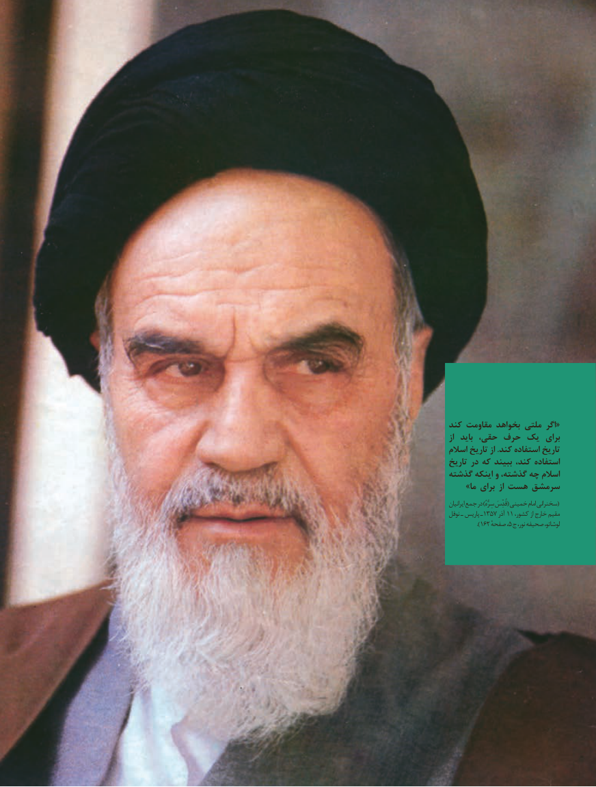

# PDF page 3

کند مقاومت بخواهد ملتی اگر «
از  باید حقی، حرف یک  برای
اسالم تاریخ از .کند استفاده تاریخ
تاریخ در که ببیند کند، استفاده
گذشته اینکه و گذشته، چه اسالم
    »ما برای از هست سرمشق
ایرانیان جمع در )سِرُّهُ قُدِّسَ( خمینی امام سخنرانی(
نوفل ـ پاریس ـ  1753 آذر 11 ،مقیمکشور از خارج
          ).162 صفحه5، ج نور، صحیفه لوشاتو،

