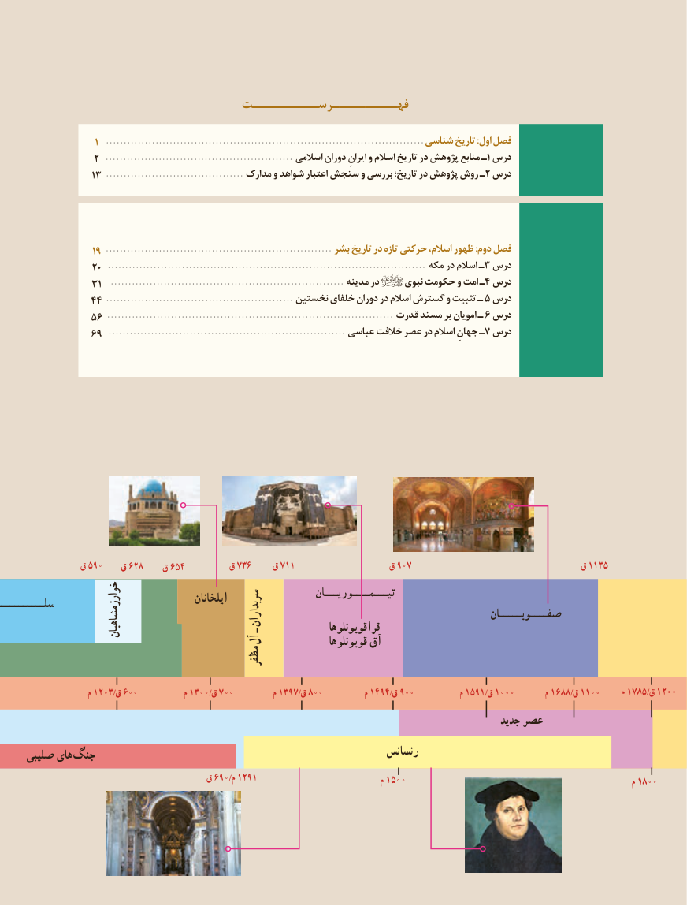

# PDF page 4

فهــــــــــرســــــــــت

                         1  .......................................................................................... شناسی تاریخ :اول فصل
                 2  ..................................................... اسالمی دوران ایرانِ و اسالم تاریخ در پژوهش منابع ـ1 درس
                   13 ....................................... مدارک و شواهد اعتبار سنجش و بررسی تاریخ؛ در پژوهش روش ـ 2 درس

                    19 ................................................................ بشر تاریخ در تازه حرکتی اسالم، ظهور :دوم فصل
                    20  .......................................................................................... مکه در اسالم ـ3 درس
                   31  .................................................................. مدینه در     نبوی حکومت و امت ـ4 درس
                 44 .....................................................5نخستین خلفای دوران در اسالم گسترش و تثبیت ـ درس
                56 ................................................................................. قدرت مسند بر امویان ـ 6 درس
                 69  ................................................................... عباسی خالفت عصر در اسالم جهانِ ـ7 درس

               ق 590   ق 628    ق 654        ق 736    ق 711                 ق 907                               ق 1135
                                                                        تیـــمــــوریـــان                                                ایلخانانسلـــــــــــ                                                                 سربداران                                               صفــــویـــــان
           ـ                                                      خوارزمشاهیان                                                قراقویونلوها
                     آل                                                                              قویونلوها آق
                                          مظفر

                      م 1203/ق 600           م 1300/ق 700          م 1397/ق 800          م 1494/ق 900           م 1591/ق 1000       م 1688/ق 1100     م 1785/ق 1200
                                                                                                      جدید عصر
     صلیبی های جنگ                                                       رنسانس
                                      ق 690/م 1291                              م 1500                                                        م 1800

