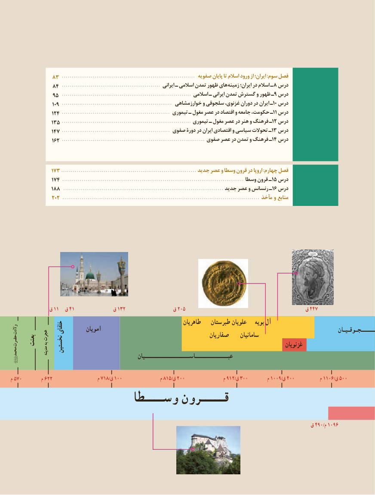

# PDF page 5

83 ...................................................................... صفویه پایان تا اسالم ورود از ایران؛ :سوم فصل
             84 .................................................... ایرانی ـ اسالمی تمدن ظهور های زمینه ایران؛ در اسالم ـ 8 درس
             95 .................................................................... اسالمی ـ ایرانی تمدن گسترش و ظهور ـ9 درس
                  109 .......................................................... خوارزمشاهی و سلجوقی غزنوی، دوران در ایران ـ10 درس
               124 ......................................................... تیموری ـ مغول عصر در اقتصاد و جامعه حکومت، ـ11 درس
              135 .................................................................... تیموری ـ مغول عصر در هنر و فرهنگ ـ12 درس
               147 ......................................................... صفوی دورۀ در ایران اقتصادی و سیاسی تحوالت ـ13 درس
                162 ........................................................................... صفوی عصر در تمدن و فرهنگ ـ14 درس

              173 ...................................................................... جدید عصر و وسطا قرون در اروپا :چهارم فصل
               174 .............................................................................................. وسطا قرون ـ15 درس
              188 ................................................................................... جدید عصر و رنسانس ـ16 درس
               202 ...................................................................................................... مآخذ و منابع

             ق 11  ق 41             ق 132                ق 205                                        ق 447
                                                                   طاهریان   طبرستان علویان    بویه آل
والدت             خلفای        امویان                                                                                              ــــــجـوقـیـان            هجرت                                                         صفاریان     سامانیانحضرت  بعثت به                                                                                                              غزنویان                    نخستینمحمد           مدینه                                                     عبــــــــــــــاســـــــــــــــــــیان

م 570         م 622                    م 718/ق 100                 م 815/ق 200                 م 912/ق 300         م 1009/ق 400           م 1106/ق 500
                      وســــطا قـــــرون

                                                                                                    ق 490/م 1096

