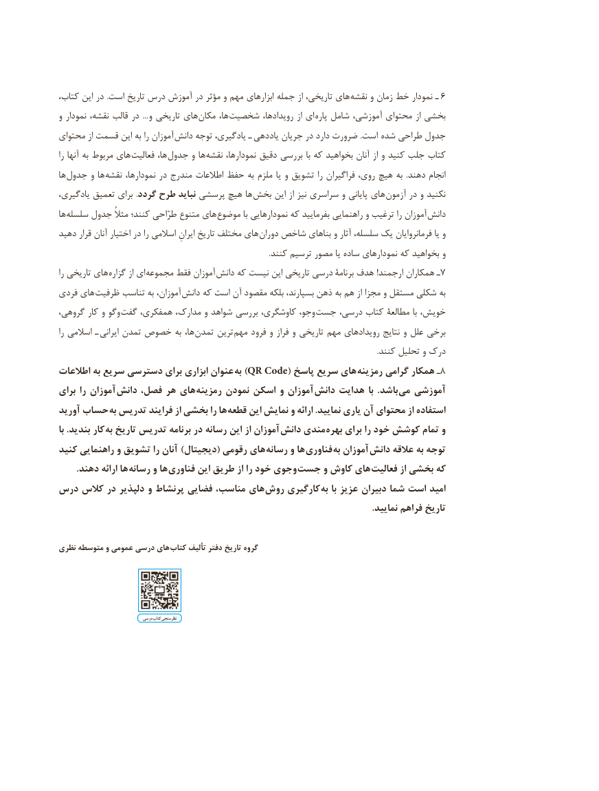

# PDF page 10

کتاب، این در  .است تاریخ درس آموزش در مؤثر و مهم ابزارهای جمله از تاریخی، های نقشه و زمان خط نمودار ـ   6
و نمودار نقشه، قالب در  ... و تاریخی های مکان ها، شخصیت رویدادها، از ای پاره شامل آموزشی، محتوای از بخشی
محتوای از قسمت این به را آموزان  دانش توجه یادگیری، ـ  یاددهی جریان در دارد ضرورت .است  شده طراحی جدول
را آنها به مربوط های فعالیت ها، جدول و ها نقشه نمودارها، دقیق بررسی با که بخواهید آنان از و کنید جلب کتاب
ها  جدول و ها  نقشه نمودارها، در مندرج اطالعات حفظ به ملزم یا و تشویق را فراگیران روی، هیچ به  .دهند انجام
یادگیری، تعمیق برای  .گردد طرح نباید پرسشی هیچ ها بخش این از نیز سراسری و پایانی های آزمون در و نکنید
ها سلسله جدول مثالً کنند؛ طرّاحی متنوع های  موضوع با نمودارهایی که بفرمایید راهنمایی و ترغیب را آموزان  دانش
دهید قرار آنان اختیار در را اسالمی ایرانِ تاریخ مختلف های  دوران شاخص بناهای و آثار سلسله، یک فرمانروایان یا و
                                                                                                                  .کنند ترسیم مصور یا ساده نمودارهای که بخواهید و
را تاریخی های گزاره از ای مجموعه فقط آموزان 7دانش که نیست این تاریخی درسی برنامۀ هدف !ارجمند همکاران ـ
فردی های ظرفیت تناسب به آموزان، دانش که است آن مقصود بلکه بسپارند، ذهن به هم از مجزا و مستقل شکلی به
گروهی، کار و وگو گفت همفکری، مدارک، و شواهد بررسی کاوشگری، وجو،  جست درسی، کتاب مطالعۀ با خویش،
را اسالمی ـ ایرانی تمدن خصوص به ها، تمدن ترین مهم فرود و فراز و تاریخی مهم رویدادهای نتایج و علل برخی
                                                                                                                                                                            .کنند تحلیل و درک
اطالعات به سریع دسترسی برای ابزاری عنوان  )به QR Code( پاسخ سریع های  8رمزینه گرامی همکار ـ
برای را آموزان  دانش فصل، هر های  رمزینه نمودن اسکن و آموزان دانش هدایت با  .باشد می آموزشی
آورید حساب به تدریس فرایند از بخشی را ها  قطعه این نمایش و ارائه .نمایید یاری آن محتوای از استفاده
با .بندید کار به تاریخ تدریس برنامه در رسانه این از آموزان دانش مندی بهره برای را خود کوشش تمام و
کنید راهنمایی و تشویق را آنان )دیجیتال( رقومی های رسانه و ها  فناوری  به آموزان دانش عالقه به توجه
 . دهند ارائه ها رسانه و ها فناوری این طریق از را خود وجوی جست و کاوش های  فعالیت از بخشی که
درس کالس در دلپذیر و پرنشاط فضایی مناسب، های روش کارگیری  به با عزیز دبیران شما است امید
                                                                                                                                         .نمایید فراهم تاریخ

نظری متوسطه و عمومی درسی های کتاب تألیف دفتر تاریخ گروه

                                   درسی کتاب نظرسنجی

