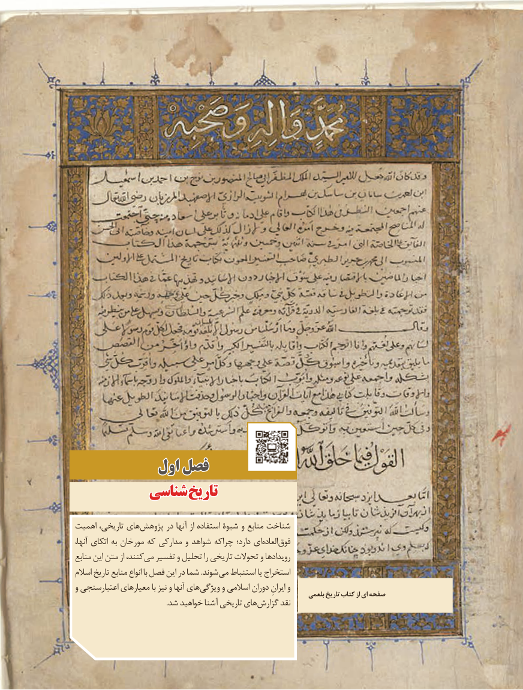

# PDF page 11

اولاول فصلفصل
          شناسیشناسی تاریختاریخ

اهمیت تاریخی، های پژوهش در آنها از استفاده شیوۀ و منابع شناخت
آنها، اتکای به مورخان که مدارکی و شواهد که چرا دارد؛ ای العاده فوق
منابع این متن از کنند، می تفسیر و تحلیل را تاریخی تحوالت و رویدادها
اسالم تاریخ منابع انواع با فصل این در شما .شوند می استنباط یا استخراج
و اعتبارسنجی معیارهای با نیز و آنها های ویژگی و اسالمی دوران ایرانِ و                                                                        بلعمی تاریخ کتاب از ای صفحه
  . شد خواهید آشنا تاریخی هایگزارش نقد

                                                    1

