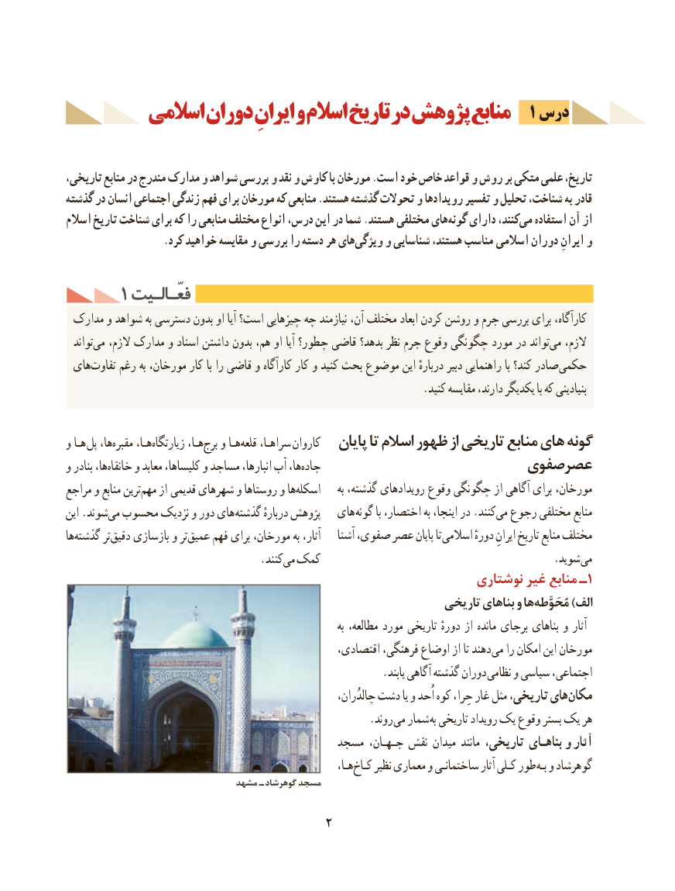

# PDF page 12

1 درس         اسالمی دوران ایرانِ و اسالم تاریخ در پژوهش منابع

،تاریخ،تاریخی منابع در مندرج مدارک و شواهد بررسی و نقد و کاوش با مورخان .است خود خاص قواعد و روش بر متکی علمی
گذشته در انسان اجتماعی زندگی فهم برای مورخان که منابعی .هستند گذشته تحوالت و رویدادها تفسیر و تحلیل شناخت، به قادر
اسالم تاریخ شناخت برای که را منابعی مختلف انواع درس، این در شما .هستند مختلفی هایگونه‌   دارای کنند،می‌   استفاده آن‌  از
 .‌کرد خواهید مقایسه و بررسی را دسته هر هایویژگی و شناسایی هستند، مناسب  اسالمی دوران ایرانِ و

     1 فعّـالـیتفعّـالـیت
 مدارک و شواهد به دسترسی بدون او آیا است؟ چیزهایی چه نیازمند آن، مختلف ابعاد کردن روشن و جرم بررسی برای کارآگاه،
  تواندمی‌   الزم، مدارک و اسناد داشتن بدون هم، او آیا چطور؟ قاضی بدهد؟ نظر جرم وقوع چگونگی مورد در تواندمی‌   الزم،
 هایتفاوت‌    رغم به مورخان، کار با را قاضی و کارآگاه کار و کنید بحث موضوع این دربارهٔ دبیر راهنمایی با کند؟ صادر حکمی
                                                                  .کنید مقایسه دارند، یکدیگر با که بنیادینی

و هـا پل ها،مقبره‌     هـا،زیارتگاه‌        هـا،برج‌   و هـاقلعه‌    سراهـا، کاروان   پایان تا اسالم ظهور از تاریخی منابع های گونه
و بنادر ها،خانقاه‌    و معابد کلیساها، و مساجد انبارها، آب ها،جاده‌                       صفویعصر
مراجع و منابع ترینمهم‌    از  قدیمی شهرهای و روستاها و هااسکله‌           به گذشته، رویدادهای وقوع چگونگی از آگاهی برای مورخان،
این .شوندمی‌  محسوب نزدیک و دور های گذشته دربارهٔ پژوهش   های گونه با اختصار، به اینجا، در .کنندمی‌  رجوع مختلفی منابع
هاگذشته‌       تردقیق‌    بازسازی و ترعمیق‌    فهم برای مورخان، به آثار،    آشنا صفوی، عصر پایان تا اسالمی دورهٔ ایرانِ تاریخ منابع مختلف
               .‌کنندمی کمک                . شوید می
                                                             نوشتاری غیر منابع ـ1
                                                              تاریخی بناهای و هامُحَوَّطه‌       )الف
                                                                                به مطالعه، مورد تاریخی دورهٔ از مانده برجای بناهای و آثار
                                                   اقتصادی، فرهنگی، اوضاع از تا دهند می را امکان این مورخان
                                                          .یابند آگاهی گذشته دوران نظامی و سیاسی اجتماعی،
                                                                چالدُران، دشت یا و اُحد کوه حِرا، غار مثل تاریخی، هایمکان‌
                                                        .روند می شمار به تاریخی رویداد یک وقوع بستر یک هر
                                         مسجد جـهـان، نقش میدان مانند تاریخی، بناهـای  و آثار
                                                                   هـا،کـاخ‌    نظیر معماری و ساختمانـی آثار کـلی طور بـه و گوهرشاد
                               مشهد  ـ گوهرشاد مسجد

                                      2

