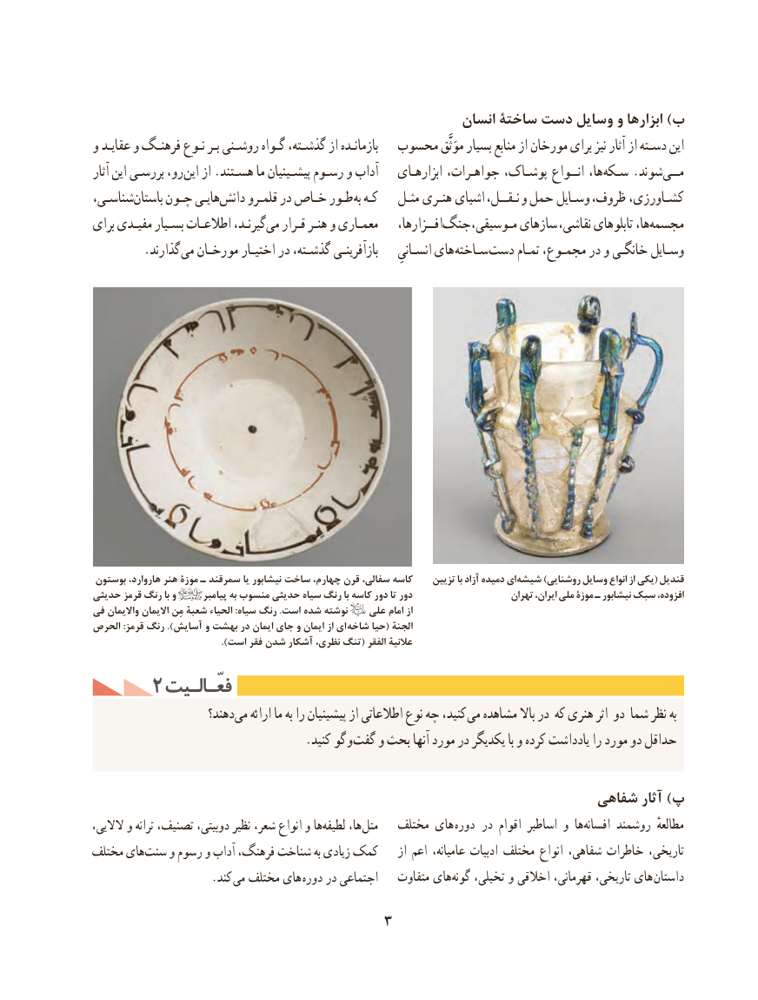

# PDF page 13

انسان ساختۀ دست وسایل و ابزارها )ب
و عقایـد و فرهنـگ نـوع بـر روشـنی گـواه گذشـته، از بازمانـده  محسوب موَثَّق بسیار منابع از مورخان برای نیز آثار از دسـته این
آثار این بررسـی رو، این از .هسـتند ما پیشـینیان رسـوم و آداب    ابزارهـای جواهـرات، پوشـاک، انــواع ها، سـکه .شوندمــی‌
شناسـی،باستان‌    چـون هایـیدانش‌     قلمـرو در خـاص طـور به کـه    مثـل هنـری اشیای ،نـقــل و حمل وسـایل ،کشـاورزی،ظروف
برای مفیـدی بسـیار اطالعـات گیرنـد،می‌   قـرار هنـر و معمـاری    افــزارها،جنگ‌         ،سازهایمـوسیقی              ،ها،نقاشی تابلوهای  مجسمه‌
   . گذارند می مورخـان اختیـار در گذشـته، بازآفرینـی     انسـانیِ های سـاخته دست تمـام مجمـوع، در و خانگـی وسـایل

 بوستون هاروارد، هنر موزۀ ـ سمرقند یا نیشابور ساخت چهارم، قرن سفالی، کاسه    تزیین با آزاد دمیده ای شیشه )روشنایی وسایل انواع از یکی( قندیل
حدیثی قرمز رنگ با و           پیامبر به منسوب حدیثی سیاه رنگ با کاسه دور تا دور                      تهران ایران، ملی موزۀ ـ نیشابور سبک افزوده،
فی واالیمان االیمان مِنشعبه الحیاء :سیاه رنگ .است شده نوشته    علی امام از
الحرص :قرمز رنگ ).آسایش و بهشت در ایمان جای و ایمان از ای شاخه حیا(الجنه
                                          ).است فقر شدن آشکار نظری، تنگ( الفقرعالنیه
     2 فعّـالـیتفعّـالـیت
                      دهند؟می‌   ارائه ما به را پیشینیان از اطالعاتی نوع چه کنید، می مشاهده باال در که هنری اثر دو شما نظر به
          . کنید گو و گفت و بحث آنها مورد در یکدیگر با و کرده یادداشت را مورد دو حداقل

                                                              شفاهی آثار )پ
،هاالالیی و ترانه تصنیف، دوبیتی، نظیر شعر، انواع و   لطیفه‌     ها،‌متل   مختلف های  دوره  در اقوام اساطیر و هاافسانه‌     روشمند  مطالعهٔ
مختلف های‌سنت و رسوم و آداب فرهنگ، شناخت به زیادی کمک    از اعم عامیانه، ادبیات مختلف انواع شفاهی، خاطرات تاریخی،
          . کند می مختلف های  دوره در اجتماعی    متفاوت های ‌گونه تخیلی، و اخالقی قهرمانی، تاریخی، های داستان

                                 3

