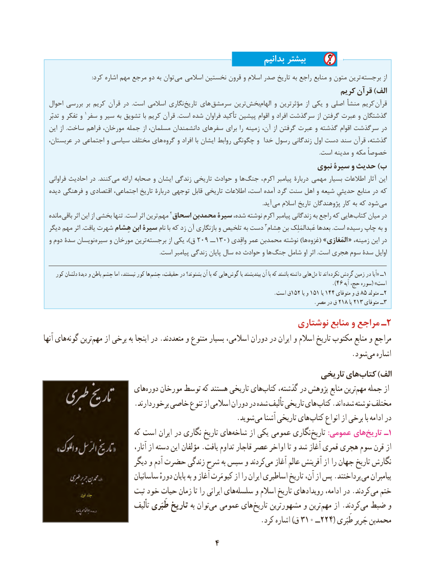

# PDF page 14

بدانیم بیشتر
                                   :کرد اشاره مهم مرجع دو به توان‌می   اسالمی نخستین قرون و اسالم صدر تاریخ به راجع منابع و متون ترین  برجسته از
                                                                               کریم قرآن )الف
  احوال بررسی بر کریم قرآن در  .است اسالمی نگاری تاریخ های سرمشق ترین‌بخش ‌الهام و مؤثرترین از یکی و اصلی منشأ کریم  قرآن
   تدبّر و تفکر و 1سفر و سیر به تشویق با کریم قرآن  .است شده فراوان تأکید پیشین اقوام و افراد سرگذشت از گرفتن عبرت و گذشتگان
  این از  .ساخت فراهم مورخان، جمله از مسلمان، دانشمندان سفرهای برای را زمینه آن، از گرفتن عبرت و گذشته اقوام سرگذشت در
  عربستان، در اجتماعی و سیاسی مختلف های  گروه و افراد با ایشان روابط چگونگی و خدا رسول زندگانی اول دست سند قرآن گذشته،
                                                                                                                                                                                                        .است مدینه و مکه خصوصاً
                                                                         نبوی سیرۀ و حدیث )ب
  فراوانی احادیث در  .کنندمی‌    ارائه صحابه و ایشان زندگی تاریخی حوادث و ها ‌جنگ ،  اکرم پیامبر دربارۀ   مهمی بسیار اطالعات آثار این
  دیده فرهنگی و اقتصادی اجتماعی، تاریخ دربارۀ توجهی قابل تاریخی اطالعات است، آمده گرد سنت اهل و شیعه حدیثیِ منابع در که
                                      . آید می اسالم تاریخ پژوهندگان کار به که شود می
  مانده باقی اثر این از بخشی تنها .است اثر ترین مهم 2اسحاق محمدبن سیرۀ شده، نوشته اکرم پیامبر زندگانی به راجع که هایی کتاب میان در
                                                                                                3هِشام بن عَبدالمَلِک بعدها .است رسیده چاپ به و  دیگر مهم اثر .یافت شهرت هِشام ابن سیرۀ نام با که زد آن بازنگاری و تلخیص به دست
  و دوم سدۀ نویسان سیره و مورخان ترینبرجسته‌          از یکی ،)ق 209 ــ 130( واقِدی عمر محمدبن نوشته )ها غزوه( »المَغازی « ،درزمینه این
  . است پیامبر زندگی پایان سال ده حوادث و ها جنگ شامل او اثر .است هجری سوم سدۀ اوایل

     کور دلشان دیدهٔ و باطن چشم اما نیستند، کور ها چشم حقیقت، در بشنوند؟ آن با که هایی گوش یا بیندیشند آن با که باشند داشته هایی دل تا اند  نکرده گردش زمین در آیا« ــ1
                                                                                                           .)46 آیه حج، سوره( »است
                                                                                          .است ق152 یا و 151 یا 144 متوفای و ق 85 متولد ــ2
                                                                                                          .مصر در ق 218 یا 213 متوفای ــ3
                                                         نوشتاری منابع و مراجع ـ2
آنها های گونه ترینمهم‌    از برخی به اینجا در .متعددند و متنوع بسیار اسالمی، دوران در ایران و اسالم تاریخ مکتوب منابع و مراجع
                                   .‌شودمی اشاره
                                                                    تاریخی هایکتاب‌     )الف
                       هایدوره‌   مورخان توسط که هستند تاریخی هایکتاب‌    گذشته، در پژوهش منابع ترینمهم‌   جمله از
                         .برخوردارند خاصی تنوع از اسالمی دوران در شده تألیف تاریخی های کتاب .اند شده نوشته مختلف
                                                      .شوید می آشنا تاریخی های کتاب انواع از برخی با ادامه در
                             که است ایران در نگاری تاریخ هایشاخه‌     از یکی  عمومی نگاری تاریخ :عمومی هایتاریخ‌    ـ1
 ،ازآثار از دسته این مؤلفان .یافت تداوم قاجار عصر اواخر تا و شد آغاز قمری هجری سوم قرن
                            دیگر و آدم حضرت زندگی شرح به سپس و کردندمی‌   آغاز عالم آفرینش از را جهان تاریخ نگارش
                              ساسانیان دورهٔ پایان به و آغاز کیومَرث از را ایران اساطیری تاریخ آن، از پس .پرداختند می پیامبران
                         ثبت خود حیات زمان تا را ایرانی هایسلسله‌     و اسالم تاریخ رویدادهای ادامه، در .کردند می ختم
                              تألیف طَبَری تاریخ به توانمی‌     عمومی های تاریخ مشهورترین و ترین مهم از .کردندمی‌  ضبط و
                                                             .کرد اشاره )ق 310 ــ224( طَبَری جَریر محمدبن
                                     4

