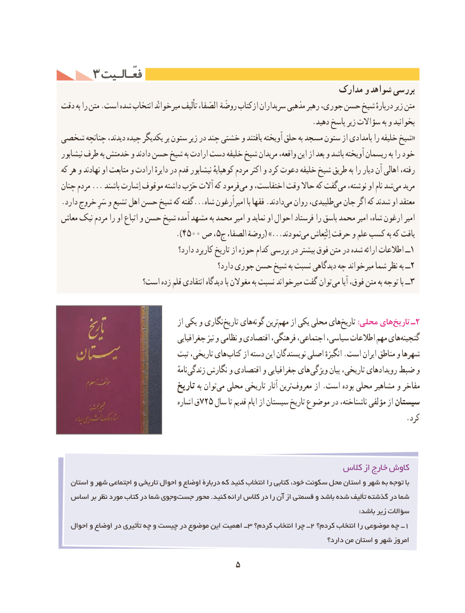

# PDF page 15

3 فعّـالـیتفعّـالـیت
                                                          مدارک و شواهد بررسی
دقت به را متن .است شده انتخاب میرخوانْد تألیف الصَفا، روضَة ازکتاب سربداران مذهبی رهبر جوری، حسن شیخ دربارهٔ زیر متن
                                                                   .دهید پاسخ زیر سؤاالت به و بخوانید
شخصی چنانچه دیدند، چیده یکدیگر بر ستون زیر در چند خشتی و یافتند آویخته حلق به مسجد ستون از بامدادی را خلیفه شیخ«
نیشابور طرف به خدمتش و دادند حسن شیخ به ارادت دست خلیفه شیخ مریدان واقعه، این از بعد و باشد آویخته ریسمان به را خود
که هر و نهادند او متابعت و ارادت دایرهٔ در قدم نیشابور کوهپایهٔ مردم اکثر و کرد دعوت خلیفه شیخ طریق به را دیار آن اهالی رفته،
چنان مردم ... باشند اِشارت موقوف داشته حَرْب آالت که فرمودمی‌  و اختفاست، وقت حاال که گفتمی‌  نوشته، او نام شدمی‌   مرید
.دارد خروج سَرِ و تشیع اهل حسن شیخ که گفته...شاه امیراَرغون با فقها .دادندمی‌  روان طلبیدی،می‌  جان اگر که شدند او معتقد
معاش نیک مردم را او اتباع و حسن شیخ آمده مشهد به محمد امیر و نماید او احوال فرستاد را باسق محمد امیر شاه، ارغون امیر
                            ).4500 ص ،5ج الصفا، روضة( ...»نمودندمی‌    اِنْتِعاش حرفت و علم کسب به که یافت
                                      دارد؟ کاربرد تاریخ از حوزه کدام بررسی در بیشتر فوق متن در شده ارائه اطالعات ــ1
                                                  دارد؟ جوری حسن شیخ به نسبت دیدگاهی چه میرخواند شما نظر به ــ2
                   است؟ زده قلم انتقادی دیدگاه با مغوالن به نسبت میرخواند گفت توان می آیا فوق، متن به توجه با ــ3

                                       از یکی و نگاری تاریخ هایگونه‌    ترینمهم‌    از یکی محلی های تاریخ :محلی های تاریخ  ـ2
                                     جغرافیایی نیز و  نظامی و اقتصادی فرهنگی، اجتماعی، سیاسی، اطالعات مهم هایگنجینه‌
                               ثبت تاریخی، های کتاب از دسته این نویسندگان اصلی انگیزهٔ .است ایران مناطق و شهرها
                                                           نامهٔ زندگی نگارش و اقتصادی و جغرافیایی های ویژگی بیان تاریخی، رویدادهای ضبط و
                                 تاریخ به توانمی‌  محلی تاریخی آثار ترین معروف از .است بوده محلی مشاهیر و مفاخر
                                     اشاره ق725 سال تا قدیم ایام از سیستان تاریخ موضوع در ناشناخته، مؤلفی از سیستان
                                                                                            .کرد

                                                           کالس از خارج کاوش
   استان و شهر اجتماعی و تاریخی احوال و اوضاع دربارۀ که کنید انتخاب را کتابی خود، سکونت محل استان و شهر به توجه با
  اساس بر نظر مورد کتاب در شما وجوی جست محور .کنید ارائه کالس در را آن از قسمتی و باشد شده تألیف گذشته در شما
                                                                                                                                       :باشد زیر سؤاالت
   احوال و اوضاع در تأثیری چه و چیست در موضوع این اهمیت ــ3 کردم؟ انتخاب چرا ــ 2 کردم؟ انتخاب را موضوعی چه ــ 1
                                                                                  دارد؟ من استان و شهر امروز

                                  5

