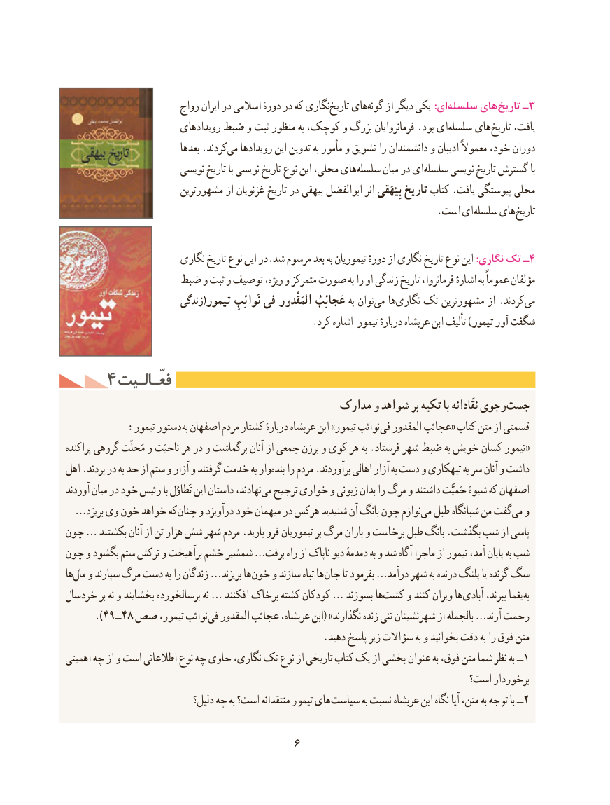

# PDF page 16

رواج ایران در اسالمی دورهٔ در که نگاریتاریخ‌    هایگونه‌    از دیگر یکی :ایسلسله‌     های تاریخ ـ3
                          رویدادهای ضبط و ثبت منظور به کوچک، و بزرگ فرمانروایان .بود ای سلسله های تاریخ یافت،
                              بعدها .کردندمی‌   رویدادها این تدوین به مأمور و تشویق را دانشمندان و ادیبان معموالً خود، دوران
                        نویسی تاریخ با نویسی تاریخ نوع این محلی، هایسلسله‌      میان در ای سلسله نویسی تاریخ گسترش با
                        مشهورترین از غزنویان تاریخ در بیهقی ابوالفضل اثر بِیْهَقی تاریخ کتاب .یافت پیوستگی محلی
                   . است ای سلسله های تاریخ

                        نگاری تاریخ نوع این در.شد مرسوم بعد به تیموریان دورهٔ از نگاری تاریخ نوع این :نگاری تک ـ4
                 ضبط و ثبت و توصیف ویژه، و متمرکز صورت به را او زندگی تاریخ فرمانروا، اشارهٔ به عموماً مؤلفان
                         زندگی(تیمور نَوائِبِ فی المَقْدور عَجائِبُ به توانمی‌   هانگاری‌   تک مشهورترین از .کردند می
                                                  .کرد اشاره تیمور دربارهٔ عربشاه ابن تألیف )تیمور آور شگفت

    4 فعّـالـیتفعّـالـیت
                                            مدارک و شواهد بر تکیه با نقّادانه وجوی جست
  : تیمور دستور به اصفهان مردم کشتار دربارهٔ عربشاه ابن »تیمور نوائب فی المقدور عجائب« کتاب متن از قسمتی
پراکنده گروهی مَحلّت و ناحیَت هر در و برگماشت آنان از جمعی برزن و کوی هر به .فرستاد شهر ضبط به خویش کسان تیمور«
اهل .بردند در به حد از ستم و آزار و گرفتند خدمت به واربنده‌   را مردم .برآوردند اهالی آزار به دست و تبهکاری به سر آنان و داشت
آوردند میان در خود رئیس با تَطاوُل این داستان نهادند،می‌  ترجیح خواری و زبونی بدان را مرگ و داشتند حَمیَّت شیوهٔ که اصفهان
… بریزد وی خون خواهد که چنان و درآویزد خود میهمان در هرکس شنیدید آن بانگ چون نوازممی‌  طبل شبانگاه من گفتمی‌  و
چون … بکشتند آنان از تن هزار شش شهر مردم .بارید فرو تیموریان بر مرگ باران و برخاست طبل بانگ .بگذشت شب از پاسی
چون و بگشود ستم ترکش و برآهیخت خشم شمشیر …برفت راه از ناپاک دیو دمدمهٔ به و شد آگاه ماجرا از تیمور آمد، پایان به شب
هامال‌  و سپارند مرگ دست به را زندگان …بریزند ها خون و سازند تباه ها جان تا بفرمود …درآمد شهر به درنده پلنگ یا گزنده سگ
خردسال بر نه و بخشایند برسالخورده نه … افکنند برخاک کشته کودکان … بسوزند هاکشت‌    و کنند ویران ها آبادی ببرند، یغما به
      ).49ــ48 صص تیمور، نوائب فی المقدور عجائب عربشاه، ابن( »نگذارند زنده تنی شهرنشینان از بالجمله …آرند رحمت
                                                     .دهید پاسخ زیر سؤاالت به و بخوانید دقت به را فوق متن
اهمیتی چه از و است اطالعاتی نوع چه حاوی نگاری، تک نوع از تاریخی کتاب یک از بخشی عنوان به فوق، متن شما نظر به ــ1
                                                                        است؟ برخوردار
                               دلیل؟ چه به است؟ منتقدانه تیمور های سیاست به نسبت عربشاه ابن نگاه آیا متن، به توجه با ــ2

                                     6

