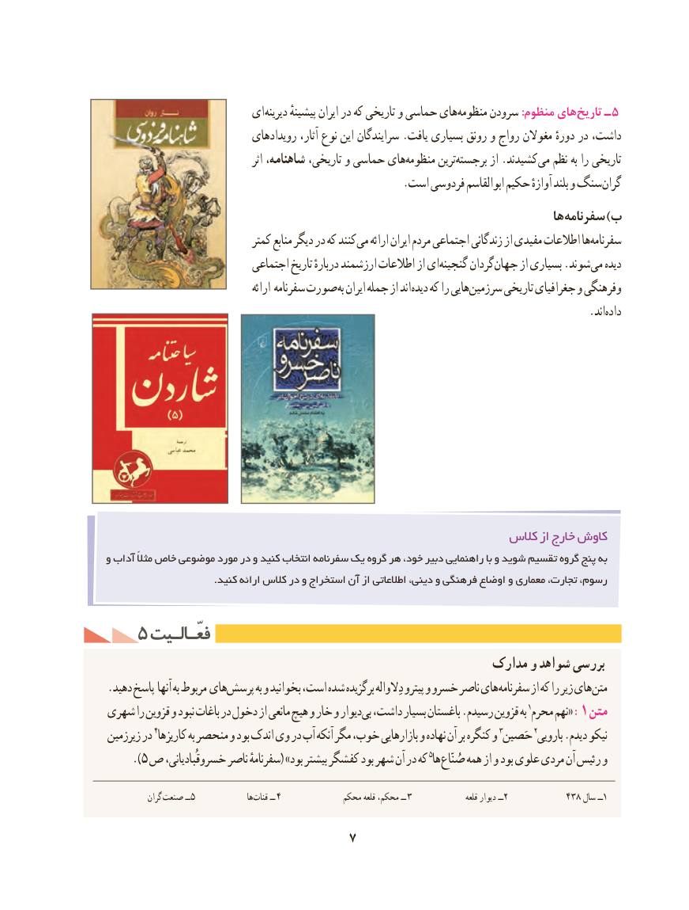

# PDF page 17

ای دیرینه پیشینهٔ ایران در که تاریخی و حماسی های منظومه سرودن :منظوم های تاریخ ـ 5
                             رویدادهای آثار، نوع این سرایندگان .یافت بسیاری رونق و رواج مغوالن دورهٔ در داشت،
                                         اثر شاهنامه، تاریخی، و حماسی هایمنظومه‌       ترینبرجسته‌       از .کشیدند می نظم به را تاریخی
   . است فردوسی ابوالقاسم حکیم آوازهٔ بلند و سنگ گران
                                                                                 ها سفرنامه )ب
                              کمتر منابع دیگر در که کنند می ارائه ایران مردم اجتماعی زندگانی از مفیدی اطالعات هاسفرنامه‌
                            اجتماعی تاریخ دربارهٔ ارزشمند اطالعات از ایگنجینه‌      گردان جهان از بسیاری .شوند می دیده
                                       ارائه سفرنامه صورت به ایران جمله از اند دیده که را هاییسرزمین‌      تاریخی جغرافیای و وفرهنگی
                                                  .‌اندداده

                                                         کالس از خارج کاوش
و آداب مثالً خاص موضوعی مورد در و کنید انتخاب سفرنامه یک گروه هر خود، دبیر راهنمایی با و شوید تقسیم گروه پنج به
                                 .کنید ارائه کالس در و استخراج آن از اطالعاتی دینی، و فرهنگی اوضاع و معماری تجارت، رسوم،

   5 فعّـالـیتفعّـالـیت
                                                       مدارک و شواهد بررسی
.‌دهید پاسخ آنها به مربوط هایپرسش به و بخوانید است، شده برگزیده دِالواله پیترو و خسرو ناصر های سفرنامه از که را زیر های متن
شهری را قزوین و نبود باغات در دخول از مانعی هیچ و خار و دیواربی١‌ داشت، بسیار باغستان .رسیدم قزوین به محرم نهم« :1 متن
زیرزمین در ٤کاریزها٣به منحصر و بود اندک وی در آب آنکه مگر خوب، بازارهایی و نهاده آن بر کنگره و حَصین٢نیکوبارویی .دیدم
     ).5 ص٥هاخسروقُبادیانی، ناصر سفرنامهٔ( »بود بیشتر کفشگر بود شهر آن در که        ‌ صُنّاع همه از و بود علوی مردی آن رئیس و

            گران صنعت ــ5                 هاقنات‌      ــ  4             محکم قلعه محکم، ــ  3                  قلعه دیوار ــ2            438 سال١ــ

                               7

