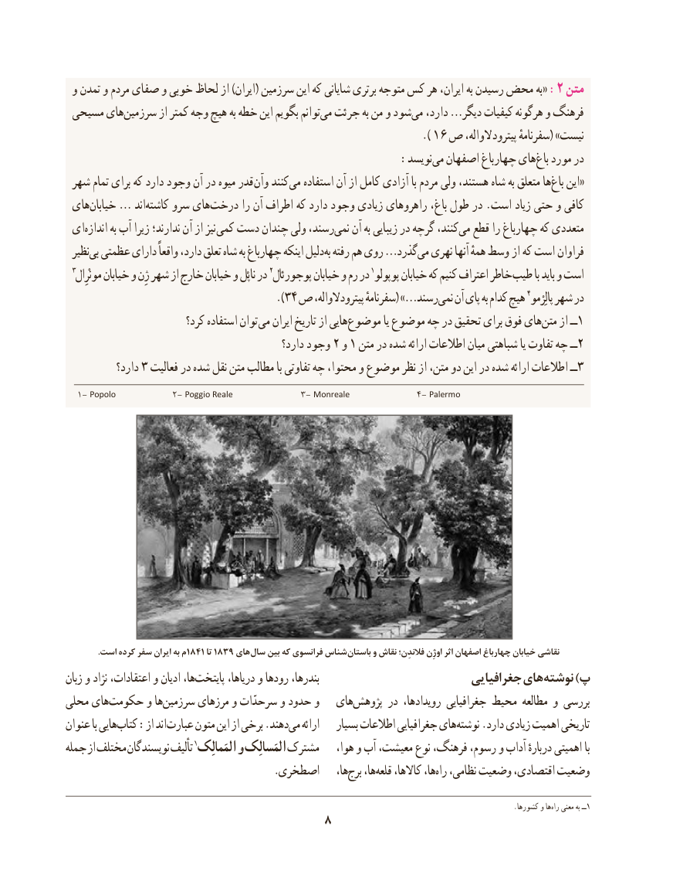

# PDF page 18

و تمدن و مردم صفای و خوبی لحاظ از )ایران( سرزمین این که شایانی برتری متوجه کس هر ایران، به رسیدن محض به« :2 متن
 مسیحی هایسرزمین‌        از کمتر وجه هیچ به خطه این بگویم توانممی‌  جرئت به من و شودمی‌  دارد، …دیگر کیفیات هرگونه و فرهنگ
                                                          ).16 ص پیترودالواله، سفرنامهٔ( »نیست
                    :‌نویسدمی اصفهان چهارباغ هایباغ‌  مورد در
 شهر تمام برای که دارد وجود آن در میوه قدر وآن کنندمی‌   استفاده آن از کامل آزادی با مردم ولی هستند، شاه به متعلق هاباغ‌«این
 هایخیابان‌  … اندکاشته‌    سرو هایدرخت‌       را آن اطراف که دارد وجود زیادی راهروهای باغ، طول در .است زیاد حتی و کافی
 ایاندازه‌       به آب زیرا ندارند؛ آن از نیز کمی دست چندان ولی رسند،نمی‌   آن به زیبایی در گرچه کنند،می‌  قطع را چهارباغ که متعددی
  نظیربی‌ عظمتی دارای واقعاً دارد، تعلق شاه به چهارباغ اینکه دلیل به رفته هم روی …گذردمی‌  نهری آنها همهٔ وسط از که است فراوان
  3مونْرِال خیابان و ژِن شهر از خارج خیابان و ناپْل در 2پوجورئال١خاطرخیابان و رم در پوپولو خیابان که کنیم اعتراف         طیب با باید و است
                                      ).34 ص پیترودالواله، سفرنامهٔ( » …رسندنمی‌   آن پای به کدام هیچ 4پالِرْمو شهر در
                          کرد؟ استفاده توان می ایران تاریخ از هاییموضوع‌           یا موضوع چه در تحقیق برای فوق هایمتن‌   از ــ1
                                                دارد؟ وجود 2 و 1 متن در شده ارائه اطالعات میان شباهتی یا تفاوت چه ــ2
           دارد؟ 3 فعالیت در شده نقل متن مطالب با تفاوتی چه محتوا، و موضوع نظر از متن، دو این در شده ارائه اطالعات ــ3
  ١- Popolo            ٢- Poggio Reale              ٣- Monreale              ٤- Palermo

               .است کرده سفر ایران به م 1841 تا 1839 های سال بین که فرانسوی شناس باستان و نقاش فالندِن؛ اوژِن اثر اصفهان چهارباغ خیابان نقاشی
زبان و نژاد اعتقادات، و ادیان ها،پایتخت‌       دریاها، و رودها بندرها،                           جغرافیایی های نوشته )پ
محلی هایحکومت‌      و هاسرزمین‌      مرزهای و سرحدّات و حدود و   هایپژوهش‌      در رویدادها، جغرافیایی محیط مطالعه و بررسی
عنوان با هاییب‌ کتا‌ :از اند عبارت متون این از برخی .دهندمی‌   ارائه    بسیار اطالعات جغرافیایی های نوشته .دارد زیادی اهمیت تاریخی
جمله از مختلف نویسندگان تألیف 1المَمالِک و المَسالِک مشترک    هوا، و آب معیشت، نوع فرهنگ، رسوم، و آداب دربارهٔ اهمیتی با
                                       .اصطخری    ها،برج‌   ها،قلعه‌    کاالها، ها،راه‌  نظامی، وضعیت اقتصادی، وضعیت

                       .‌کشورها و هاراه معنی به ــ1
                                 8

