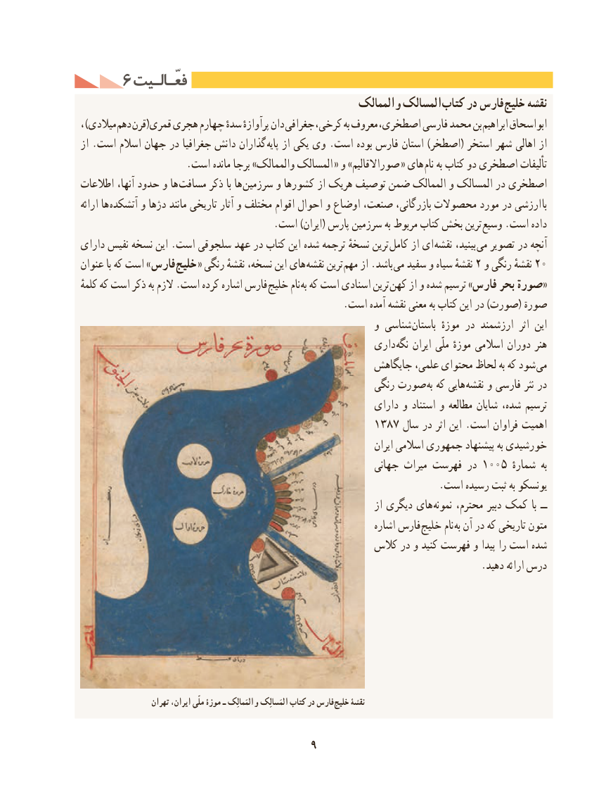

# PDF page 19

6 فعّـالـیتفعّـالـیت
                                                    والممالک المسالک کتاب در فارس خلیج نقشه
، )میالدی دهم قرن(قمری هجری چهارم سدهٔ پرآوازهٔ دان  جغرافی  ،معروفکرخی به            ،بناصطخری فارسی محمد     ابراهیم ابواسحاق
از .است اسالم جهان در جغرافیا دانش گذاران پایه از یکی وی .است بوده فارس استان )اصطخر( استخر شهر اهالی از
  . «است مانده برجا »والممالک المسالک  و »صوراالقالیم « های نام به کتاب دو اصطخری تألیفات
اطالعات آنها، حدود و ها مسافت ذکر با ها سرزمین و کشورها از هریک توصیف ضمن الممالک و المسالک در اصطخری
ارائه ها آتشکده و دژها مانند تاریخی آثار و مختلف اقوام احوال و اوضاع صنعت، بازرگانی، محصوالت مورد در ارزشی  با
  . است )ایران( پارس سرزمین به مربوط کتاب بخش ترین وسیع .است داده
دارای نفیس نسخه این .است سلجوقی عهد در کتاب این شده ترجمه نسخهٔ ترین  کامل از ای نقشه بینید،  می تصویر در آنچه
عنوان با که است » فارس خلیج « رنگی نقشهٔ نسخه، این های نقشه ترین مهم از .باشد می٢سفید و سیاه نقشهٔ و٢٠رنگی نقشهٔ
کلمهٔ که است ذکر به الزم .است کرده اشاره فارس خلیج نام به که است اسنادی ترین  «کهن از و شده ترسیم »فارس بحر صورة
                                                     .است آمده نقشه معنی به کتاب این در )صورت( صورة
                                                            و شناسی باستان  موزهٔ در ارزشمند  اثر این
                                                        داری نگه ایران ملّی موزهٔ اسالمی دوران هنر
                                                      جایگاهش علمی، محتوای لحاظ به که شود می
                                                          رنگی صورت به که هایی نقشه و فارسی نثر در
                                                             دارای و استناد و مطالعه شایان شده، ترسیم
              ١٣٨اهمیت٧ سال در اثر این .است فراوان
                                                                              ایران اسالمی جمهوری پیشنهاد به خورشیدی
                                                            جهانی میراث فهرست در ١٠٠٥ ٔبهشماره
                                                                         .است رسیده ثبت به یونسکو
                                                                          از دیگری های  نمونه محترم، دبیر کمک  با ــ
                                                                      اشاره فارس خلیج نام به آن در که تاریخی متون
                                                   کالس در و کنید فهرست و پیدا را است شده
                                                                                 .دهید ارائه درس

                    تهران ایران، ملّی موزۀ ـ المَمالِک و المَسالِک کتاب در فارس خلیج نقشۀ

                                     9

