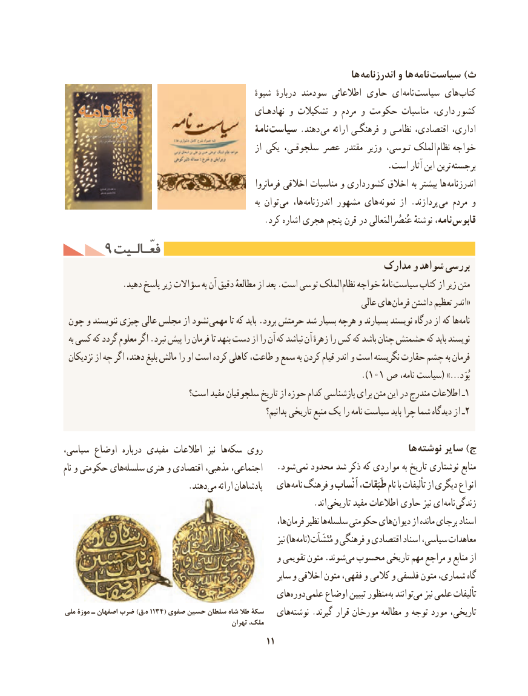

# PDF page 21

ها اندرزنامه و ها نامه  سیاست )ث
                                                           شیوهٔ  دربارهٔ سودمند اطالعاتی حاوی ای نامه سیاست های  کتاب
                                                   نهادهـای و تشکیالت و مردم و حکومت مناسبات داری،  کشور
                                                       نامۀ سیاست .دهند  می ارائه فرهنگـی و نظامـی اقتصادی، اداری،
                                                        از یکی سلجوقـی، عصر مقتدر وزیر تـوسی،  الملک نظام  خواجه
          . است آثار این ترین برجسته
                                                            فرمانروا اخالقی مناسبات و کشورداری اخالق به بیشتر ها  اندرزنامه
                                                                         به توان می ها،  اندرزنامه مشهور های نمونه از .پردازند  می مردم و
  . کرد اشاره هجری پنجم قرن در عُنصُرالمَعالی نوشتهٔ نامه، قابوس
     9 فعّـالـیتفعّـالـیت
                                                           مدارک و شواهد بررسی
 . دهید پاسخ زیر سؤاالت به آن دقیق مطالعهٔ از بعد .است توسی الملک نظام خواجه نامهٔ سیاست کتاب از زیر متن
                                                                               عالی های «فرمان داشتن تعظیم اندر
 چون و ننویسند چیزی عالی مجلس از نشود مهمی تا که باید .برود حرمتش شد بسیار هرچه و بسیارند نویسند درگاه از که هانامه‌
  به کسی که گردد معلوم اگر .نبرد پیش را فرمان تا بنهد دست از را آن که نباشد آن زهرهٔ را کس که باشد چنان حشمتش که باید نویسند
 نزدیکان از چه اگر دهند، بلیغ مالش را او است کرده کاهلی طاعت، و سمع به کردن قیام اندر و است نگریسته حقارت چشم به فرمان
                                                                ).101 ص نامه، سیاست( …»بُوَد
                          است؟ مفید سلجوقیان تاریخ از حوزه کدام بازشناسی برای متن این در مندرج اطالعات ـ1
                                                                     بدانیم؟ تاریخی منبع یک را نامه سیاست باید چرا شما دیدگاه از ـ2

سیاسی، اوضاع  درباره مفیدی اطالعات  نیز  هاسکه‌   روی                                  ها  نوشته سایر )ج
نام و حکومتی هایسلسله‌     هنری و اقتصادی مذهبی، اجتماعی،   .شود نمی محدود شد ذکر که مواردی به تاریخ نوشتاری منابع
            .‌دهندمی ارائه پادشاهان   های نامه  فرهنگ و اَنْساب طَبَقات، نام با تألیفات از دیگری انواع
                                . اند تاریخی مفید اطالعات حاوی نیز ای نامه زندگی
                                                                 ها،فرمان‌     نظیر هاسلسله‌    حکومتی هایدیوان‌     از مانده برجای اسناد
                                                                             نیز )ها (نامه  مُنْشَآت و فرهنگی و اقتصادی اسناد سیاسی، معاهدات
                                                   و  تقویمی متون .شوندمی‌  محسوب تاریخی مهم مراجع و منابع از
                                                            سایر و اخالقی متون فقهی، و  کالمی و فلسفی متون شماری، گاه
                                              هایدوره‌       علمی اوضاع تبیین منظور به توانندمی‌   نیز علمی تألیفات
ملی۱۱۳۴موزۀ ـ اصفهان ضرب )ق.ه       ( صفوی حسین سلطان شاه طال سکۀ                                              هاینوشته‌    .گیرند قرار مورخان مطالعه و توجه مورد تاریخی،                                                     تهران  ،ملک
                                                  11

