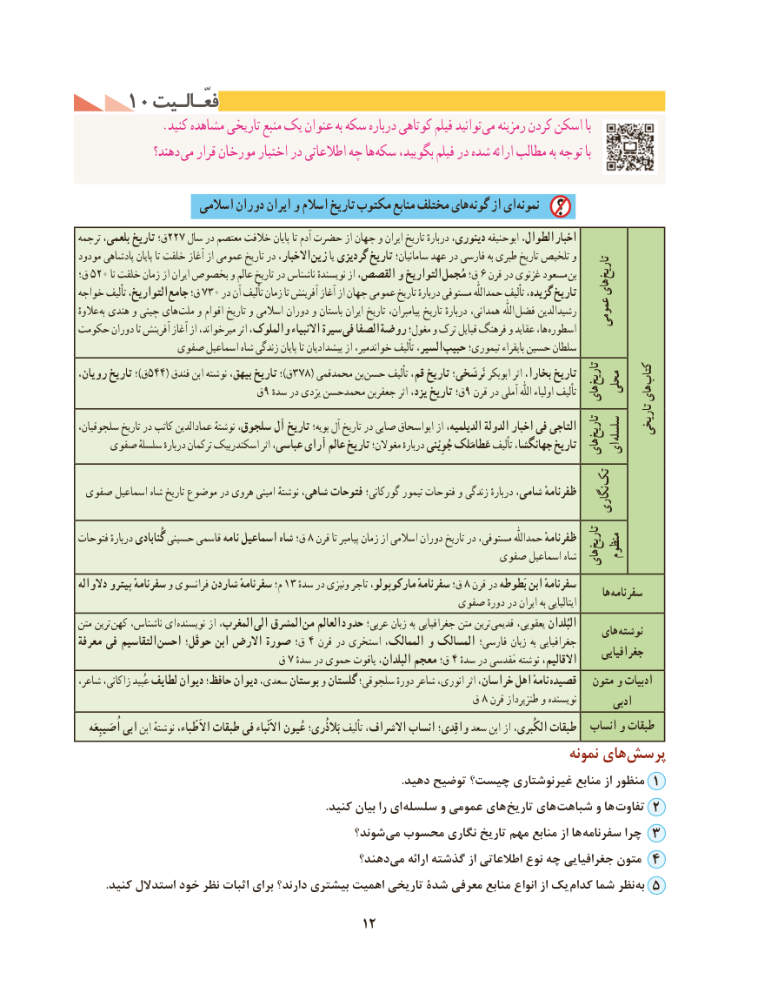

# PDF page 22

1010 فعّـالـیتفعّـالـیت
              .کنید مشاهده تاریخی منبع یک عنوان به سکه درباره کوتاهی فیلم توانید می رمزینه کردن اسکن با
              دهند؟ می قرار مورخان اختیار در اطالعاتی چه ها سکه بگویید، فیلم در شده ارائه مطالب به توجه با

                     اسالمی دوران ایران و اسالم تاریخ مکتوب منابع مختلف های گونه از ای نمونه
ترجمه بلعمی، تاریخ ق؛٢٢الطوال،٧ سال در معتصم خالفت پایان تا آدم حضرت از جهان و ایران تاریخ دربارهٔ دینوری، ابوحنیفه               اخبار
مودود پادشاهی پایان تا خلقت آغاز از عمومی تاریخ در االخبار، زین یا گردیزی تاریخ سامانیان؛ عهد در فارسی به طبری تاریخ تلخیص و
                                                                                                             تاریخ ق؛  ٥٢التواریخ٠ تا خلقت زمان از ایران بخصوص و عالم تاریخ در ناشناس نویسندهٔ از القصص، و                مُجمل٦ق؛  قرن در غزنوی مسعود بن
خواجه تألیف التواریخ، جامع٣تاریخق؛ ٧ ٠ در آن تألیف زمان تا آفرینش آغاز از جهان عمومی تاریخ دربارهٔ مستوفی حمداللّٰه تألیف گزیده،     های
عالوهٔ به هندی و چینی های ملت و اقوام تاریخ و اسالمی دوران و باستان ایران تاریخ پیامبران، تاریخ دربارهٔ همدانی، اللّٰه فضل رشیدالدین   عمومی
حکومت دوران تا آفرینش آغاز از میرخواند، اثر والملوک، االنبیاء سیرة فی الصفا روضة مغول؛ و ترک قبایل فرهنگ و عقاید ها، اسطوره
               صفوی اسماعیل شاه زندگی پایان تا پیشدادیان از خواندمیر، تألیف السیر، حبیب تیموری؛ بایقراء حسین سلطان
رویان، تاریخ ؛)ق٥٤٤ ( فندق٣٧٨ابن نوشته بیهق، تاریخ ؛)ق      ( محمدقمی بن  حسن تألیف قم، تاریخ نَرشَخی؛ ابوبکر اثر بخارا، تاریخ تاریخ      کتاب                                                                                          محلی                             ٩ق سدهٔ در یزدی محمدحسن جعفربن اثر یزد، تاریخ ٩ق؛ قرن در آملی اللّٰه اولیاء تألیف های    های
                                                                                                                                              تاریخیسلجوقیان، تاریخ در کاتب عمادالدین نوشتهٔ سلجوق، آل تاریخ بویه؛ آل تاریخ در صابی ابواسحاق از الدیلمیه، الدولة اخبار فی التاجی تاریخ سلسله
     صفوی سلسلهٔ دربارهٔ ترکمان اسکندربیک اثر عباسی، آرای عالم تاریخ مغوالن؛ دربارهٔ جُوِْینی عَطامَلک تألیف جهانگشا، تاریخ هایای

                                            تک
 صفوی اسماعیل شاه تاریخ موضوع در هروی امینی نوشتهٔ شاهی، فتوحات گورکانی؛ تیمور فتوحات و زندگی دربارهٔ شامی، ظفرنامهٔ                                                                                                             نگاری

فتوحات دربارهٔ گُنابادی حسینی قاسمی نامه اسماعیل شاه ق؛ ٨ قرن تا پیامبر زمان از اسالمی دوران تاریخ در مستوفی، حمداللّٰه ظفرنامهٔ تاریخ                                                                                                                 منظوم                                                                صفوی اسماعیل شاه های
دالواله پیترو سفرنامهٔ و فرانسوی شاردن سفرنامهٔ م؛ ١٣ ق؛سده٨در ونیزی تاجر مارکوپولو، سفرنامهٔ     قرن در بَطوطه ابن سفرنامهٔ                                                                                                                                ها سفرنامه                                                         صفوی دورهٔ در ایران به ایتالیایی
متن ترین  کهن ناشناس، ای  نویسنده از المغرب، الی المشرق  من العالم حدود عربی؛ زبان به جغرافیایی متن ترین قدیمی یعقوبی، البُلدان                                                                                                  های نوشتهمعرفة فی التقاسیم  احسن٤حوقَل؛ ابن االرض صورة ق؛   قرن در استخری الممالک، و المسالک فارسی؛ زبان به جغرافیایی                                                                                                                جغرافیایی  ق٤٧ سدهٔ در حموی یاقوت البلدان، معجم ق؛ ٔاالقالیم،سده در مَقدسی نوشته
شاعر، زاکانی، عُبید لطایف دیوان حافظ؛ دیوان سعدی، بوستان و گلستان سلجوقی؛ دورهٔ شاعر انوری، اثر خراسان، اهل نامهٔ قصیده   متون و ادبیات
                                                     ق٨ قرن طنزپرداز و نویسنده        ادبی
    اُصَیبِعَه ابی ابن نوشتهٔ ْطباء، االَطبقاتطبقات فی االَْنباء عُیون بَالذُری؛ تألیف االشراف، انساب واقِدی؛ سعد ابن از الکُبری،        انساب و طبقات
                                                                                  نمونه های‌پرسش
  .1دهید توضیح چیست؟ غیرنوشتاری منابع از منظور
                                                                                      .کنید بیان را ای  سلسله و عمومی های تاریخ های شباهت و ها  تفاوت 2
                                             شوند؟‌می محسوب نگاری تاریخ مهم منابع از ها  سفرنامه چرا 3
                                             دهند؟‌می ارائه گذشته از اطالعاتی نوع چه جغرافیایی متون 4
         .کنید استدالل خود نظر اثبات برای دارند؟ بیشتری اهمیت تاریخی شدۀ معرفی منابع انواع از یک کدام شما نظر به 5
                                         12

