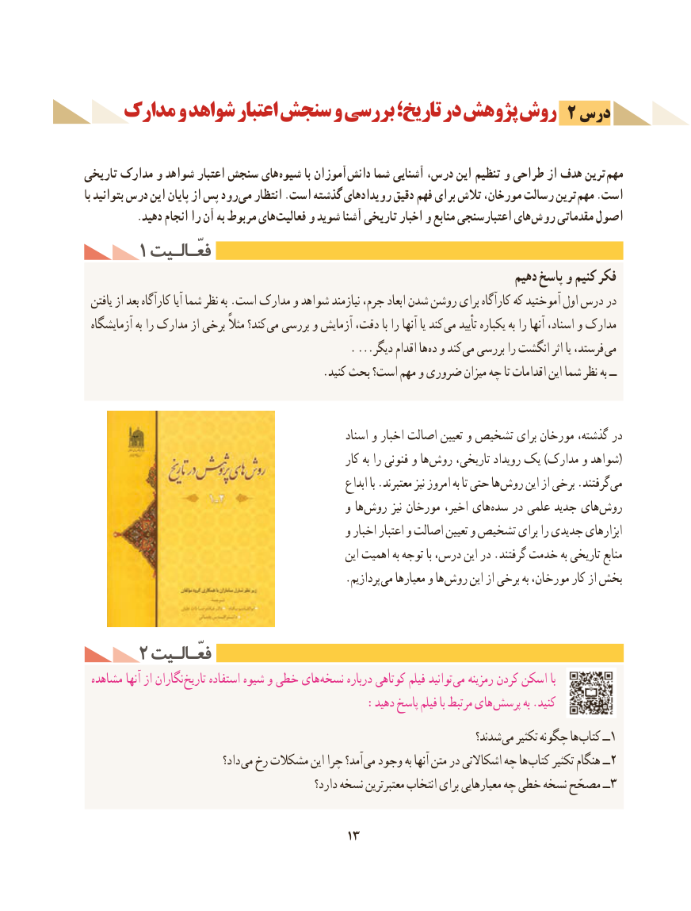

# PDF page 23

مدارک و شواهد اعتبار سنجش و بررسی تاریخ؛ در پژوهش روش 2 درس

تاریخی مدارک و شواهد اعتبار سنجش های شیوه با آموزان دانش شما آشنایی درس، این تنظیم و طراحی از هدف ترین مهم
با بتوانید درس این پایان از پس رود می انتظار .است گذشته رویدادهای دقیق فهم برای تالش مورخان، رسالت ترین مهم .است
 . دهید انجام را آن به مربوط های فعالیت و شوید آشنا تاریخی اخبار و منابع اعتبارسنجی های روش مقدماتی اصول
     1 فعّـالـیتفعّـالـیت
                                                                            دهیم پاسخ و کنیم فکر
  یافتن از بعد كارآگاه آیا شما نظر به .است مدارک و شواهد نیازمند جرم، ابعاد شدن روشن برای کارآگاه که آموختید اول درس در
 آزمایشگاه به را مدارک از برخی مثالً کند؟ می بررسی و آزمایش دقت، با را آنها یا کند می تأیید یکباره به را آنها اسناد، و مدارک
       . ...دیگر اقدام ها ده و کند می بررسی را انگشت اثر یا فرستد، می
                                           .کنید بحث است؟ مهم و ضروری میزان چه تا اقدامات این شما نظر به ــ

                                                         اسناد و اخبار اصالت تعیین و تشخیص برای مورخان گذشته، در
                                                        کار به را فنونی و ها (روش تاریخی، رویداد یک )مدارک و شواهد
                                                           ابداع با .معتبرند نیز امروز به تا حتی ها روش این از برخی .گرفتند می
                                               و ها روش نیز مورخان اخیر، های سده در علمی جدید های روش
                                               و اخبار اعتبار و اصالت تعیین و تشخیص برای را جدیدی ابزارهای
                                                         این اهمیت به توجه با درس، این در .گرفتند خدمت به تاریخی منابع
              . پردازیم می معیارها و ها روش این از برخی به مورخان، کار از بخش

     2 فعّـالـیتفعّـالـیت
 مشاهده آنها از نگاران تاریخ استفاده شیوه و خطی های نسخه درباره کوتاهی فیلم توانید می رمزینه کردن اسکن با
    : دهید پاسخ فیلم با مرتبط های پرسش به .کنید
                                                                            شدند؟ می تکثیر چگونه ها کتاب ــ1
                               داد؟ می رخ مشکالت این چرا آمد؟ می وجود به آنها متن در اشکاالتی چه ها کتاب تکثیر هنگام ــ2
                                                  دارد؟ نسخه معتبرترین انتخاب برای معیارهایی چه خطی نسخه مصحّح ــ3

                                         13

