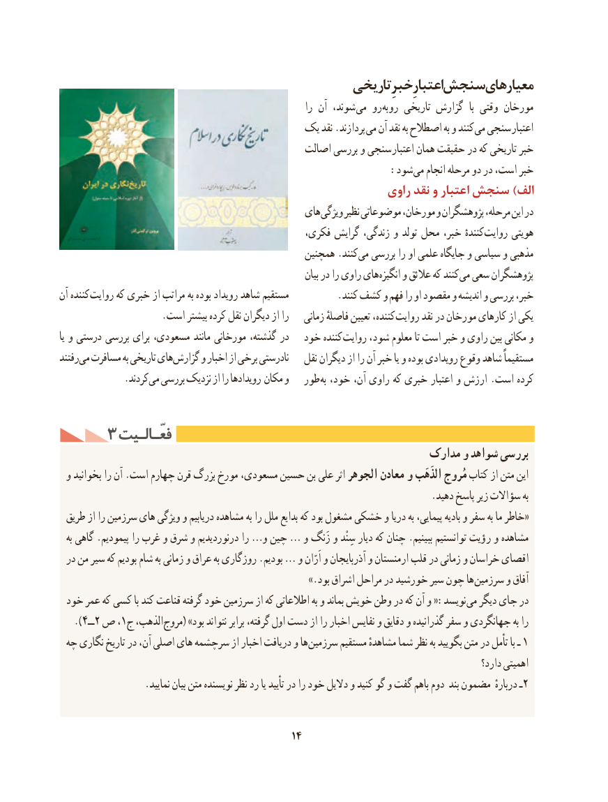

# PDF page 24

تاریخیخبرِاعتبارِسنجشمعیارهای
                                                                را آن شوند، می رو به رو تاریخی گزارش  با وقتی مورخان
                                  یک نقد .پردازند می آن نقد به اصطالح به و کنند می سنجی اعتبار
                                               اصالت بررسی و سنجی اعتبار همان حقیقت در که تاریخی خبر
                          : شود می انجام مرحله دو در است، خبر
                                                        راوی نقد و اعتبار سنجش )الف
                                               های ویژگی نظیر موضوعاتی مورخان، و پژوهشگران مرحله، این در
                                               فکری، گرایش زندگی، و تولد محل خبر، کنندهٔ روایت هویتی
                                                 همچنین .کنند می بررسی را او علمی جایگاه و سیاسی و مذهبی
                                                                       بیان در را راوی های انگیزه و عالئق که کنند می سعی پژوهشگران
آن کننده روایت که خبری از مراتب به بوده رویداد شاهد مستقیم          .کنند کشف و فهم را او مقصود و اندیشه و بررسی خبر،
                     .است بیشتر کرده نقل دیگران از را    زمانی فاصلهٔ تعیین کننده، روایت نقد در مورخان کارهای از یکی
یا و درستی بررسی برای مسعودی، مانند مورخانی گذشته، در   خود کننده روایت شود، معلوم تا است خبر و راوی بین مکانی و
رفتند می مسافرت به تاریخی های گزارش و اخبار از برخی نادرستی   نقل دیگران از را آن خبر یا و بوده رویدادی وقوع شاهد مستقیماً
     . کردندمی بررسی نزدیک از را رویدادها مکان و   طور به خود، آن، راوی که خبری اعتبار و ارزش .است کرده

     3 فعّـالـیتفعّـالـیت
                                                            مدارک و شواهد بررسی
 و بخوانید را آن .است چهارم قرن بزرگ مورخ مسعودی، حسین بن علی اثر الجوهر معادن و الذَهَب مُروج كتاب از متن این
                                                                            .دهید پاسخ زیر سؤاالت به
 طریق از را سرزمین های ویژگی و دریابیم مشاهده به را ملل بدایع كه بود مشغول خشكی و دریا به پیمایی، بادیه و سفر به ما خاطر«
  به گاهی .پیمودیم را غرب و شرق و درنوردیدیم را …و چین … و زَنگ و سِنْد دیار كه چنان .ببینیم توانستیم رؤیت و مشاهده
 در من سیر كه بودیم شام به زمانی و عراق به روزگاری .بودیم … و اَرّان و آذربایجان و ارمنستان قلب در زمانی و خراسان اقصای
    .» بود اشراق مراحل در خورشید سیر چون ها سرزمین و آفاق
 خود عمر كه كسی با كند قناعت گرفته خود سرزمین از كه اطالعاتی به و بماند خویش وطن در كه آن و :«نویسد می دیگر جای در
   ).4ــ2 ص ،1ج الذهب، مروج( »بود نتواند برابر گرفته، اول دست از را اخبار نفایس و دقایق و گذرانیده سفر و جهانگردی به را
 چه نگاری تاریخ در آن، اصلی های سرچشمه از اخبار دریافت و ها سرزمین مستقیم مشاهدهٔ شما نظر به بگویید متن در تأمل با ـ 1
                                                                                                        دارد؟ اهمیتی
.2نمایید بیان متن نویسنده نظر رد یا تأیید در را خود دالیل و كنید گو و گفت باهم دوم بند مضمون دربارهٔ ـ

                                            14

