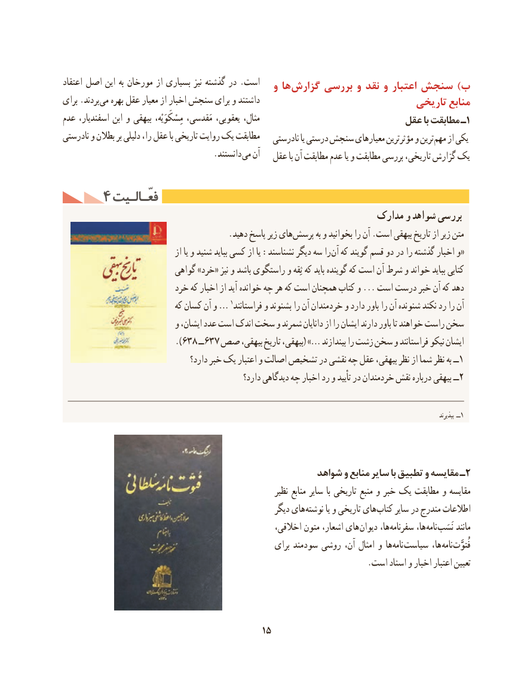

# PDF page 25

اعتقاد اصل این به مورخان از بسیاری نیز گذشته در .است                                            و ها گزارش بررسی و نقد و اعتبار سنجش )ب
برای .بردند می بهره عقل معیار از اخبار سنجش برای و داشتند                              تاریخی منابع
عدم اسفندیار، ابن و بیهقی مِسْکَوَیْه، مَقدسی، یعقوبی، مثال،                         عقل با مطابقت ـ1
نادرستی و بطالن بر دلیلی را، عقل با تاریخی روایت یک مطابقت                                                        نادرستی یا درستی سنجش معیارهای مؤثرترین و ترین مهم از یکی
                                    .دانستند می آن                                            عقل با آن مطابقت عدم یا و مطابقت بررسی تاریخی، گزارش یک

     4 فعّـالـیتفعّـالـیت
                                                           مدارک و شواهد بررسی
     . دهید پاسخ زیر های پرسش به و بخوانید را آن .است بیهقی تاریخ از زیر متن
                                  از یا و شنید بباید کسی از یا :نشناسند دیگر سه را «آن که گویند قسم دو در را گذشته اخبار و
                           گواهی »خرد« نیز و باشد راستگوی و ثِقه که باید گوینده که است آن شرط و خواند بباید کتابی
                         خرد که اخبار از آید  خوانده چه هر که است همچنان کتاب و ... است درست خبر آن که دهد
                              که کسان آن و … 1فراستانند و بشنوند را آن خردمندان و دارد باور را آن شنونده نکند رد را آن
                           و ایشان، عدد است اندک سخت و شمرند دانایان از را ایشان دارند باور تا خواهند راست سخن
                            ).638 ــ637 صص بیهقی، تاریخ بیهقی،( …» بیندازند را زشت سخن و فراستانند نیکو ایشان
                                     دارد؟ خبر یک اعتبار و اصالت تشخیص در نقشی چه عقل بیهقی، نظر از شما نظر به ــ1
                                                    دارد؟ دیدگاهی چه اخبار رد و تأیید در خردمندان نقش درباره بیهقی ــ2

                                                                                                                                                                                 بپذیرند ــ1

                                                  شواهد و منابع سایر با تطبیق و مقایسه ـ2
                                                               نظیر منابع سایر با تاریخی منبع و خبر یک مطابقت و مقایسه
                                                         دیگر های نوشته یا و تاریخی های کتاب سایر در مندرج اطالعات
                                                       اخالقی، متون اشعار، های دیوان ها، سفرنامه ها، نامه نَسَب مانند
                                                        برای سودمند روشی آن، امثال و ها نامه سیاست ها، نامه فُتوَّت
                                                                         .است اسناد و اخبار اعتبار تعیین

                                          15

