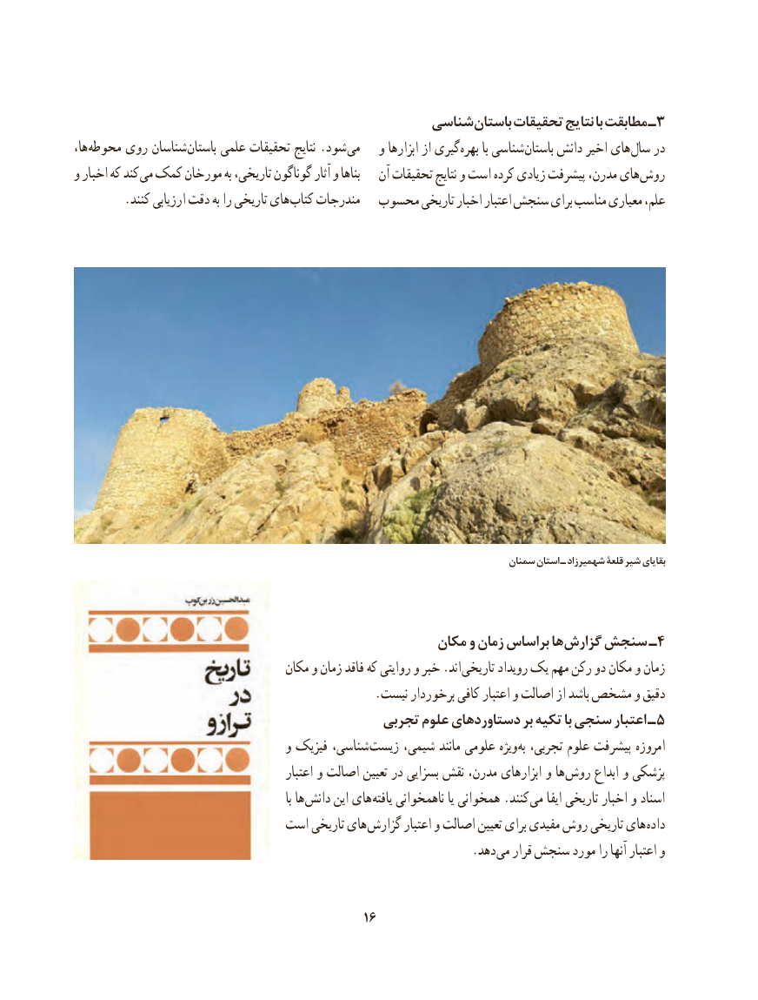

# PDF page 26

شناسی باستان تحقیقات نتایج با مطابقت ـ3
،ها محوطه روی شناسان باستان علمی تحقیقات نتایج .شود می   و ابزارها از گیری بهره با شناسی باستان دانش اخیر های سال در
و اخبار که کند می کمک مورخان به تاریخی، گوناگون آثار و بناها   آن تحقیقات نتایج و است کرده زیادی پیشرفت مدرن، های روش
 . کنند ارزیابی دقت به را تاریخی های کتاب مندرجات  محسوب تاریخی اخبار اعتبار سنجش برای مناسب معیاری علم،

                                                                                  سمنان استان ـ شهمیرزاد قلعۀ شیر بقایای

                                                 مکان و زمان براساس ها گزارش سنجش ـ4
                                    مکان و زمان فاقد که روایتی و خبر .اند تاریخی رویداد یک مهم رکن دو مکان و زمان
                                                  .نیست برخوردار کافی اعتبار و اصالت از باشد مشخص و دقیق
                                          تجربی علوم دستاوردهای بر تکیه با سنجی اعتبار ـ 5
                                   و فیزیک شناسی، زیست شیمی، مانند علومی ویژه به تجربی، علوم پیشرفت امروزه
                                              اعتبار و اصالت تعیین در بسزایی نقش مدرن، ابزارهای و ها روش ابداع و پزشکی
                                                                   با ها دانش این های یافته ناهمخوانی یا همخوانی .کنند می ایفا تاریخی اخبار و اسناد
                           است تاریخی های گزارش اعتبار و اصالت تعیین برای مفیدی روش تاریخی های داده
                             . دهد می قرار سنجش مورد را آنها اعتبار و

                                            16

