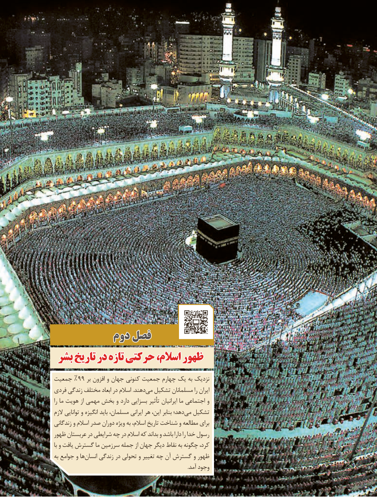

# PDF page 29

دومدوم فصلفصل
 بشربشر تاریختاریخ دردر تازهتازه حركتیحركتی اسالم،اسالم، ظهورظهور
جمعیت %99 بر افزون و جهان كنونی جمعیت چهارم یک به نزدیک
فردی زندگی مختلف ابعاد در اسالم .دهندمی‌  تشكیل مسلمانان را ایران
را ما هویت از مهمی بخش و دارد بسزایی تأثیر ایرانیان ما اجتماعی و
الزم توانایی و انگیزه باید مسلمان، ایرانی هر این، بنابر دهد؛می‌  تشكیل
زندگانی و اسالم صدر دوران ویژه به اسالم، تاریخ شناخت و مطالعه برای
ظهور عربستان در شرایطی چه در اسالم كه بداند و باشد دارا را خدا رسول
با و یافت گسترش ما سرزمین جمله از جهان دیگر نقاط به چگونه كرد،
به جوامع و هاانسان‌    زندگی در تحولی و تغییر چه آن گسترش و ظهور
                                                                                                         .آمد وجود

