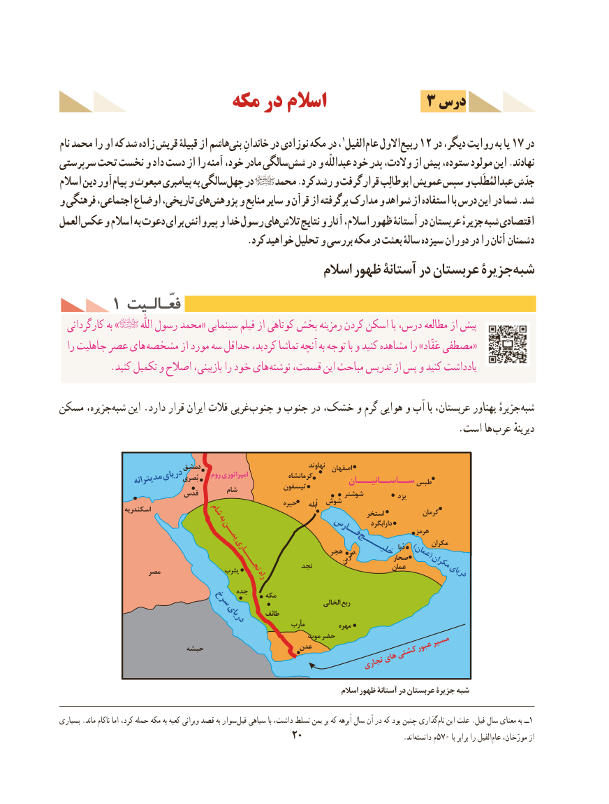

# PDF page 30

3 درس                  مكه در اسالم

نام محمد را او كه شد زاده قریش قبیلۀ از هاشمبنی‌   خاندانِ در نوزادی مکه در ، 1الفیلعام‌   االولربیع‌   12 در دیگر، روایت به یا 17 در
سرپرستی تحت نخست و داد دست از را آمنه خود، مادر سالگیشش‌   در و عبداللّه خود پدر والدت، از پیش ستوده، مولود این .نهادند
اسالم دین آورپیام‌  و مبعوث پیامبری به سالگیچهل‌   در    محمد .كرد رشد و گرفت قرار ابوطالِب عمویش سپس و عبدالمُطَلب جدّش
و فرهنگی اجتماعی، اوضاع تاریخی، هایپژوهش‌     و منابع سایر و قرآن از برگرفته مدارک و شواهد از استفاده با درس این در شما .شد
العملعكس‌    و اسالم به دعوت برای پیروانش و خدا رسول هایتالش‌     نتایج و آثار اسالم، ظهور آستانۀ در عربستان جزیرهٔ‌شبه اقتصادی
                                         .كرد خواهید تحلیل و بررسی مكه در بعثت سالۀ سیزده دوران در را آنان دشمنان
                                              اسالم ظهور آستانۀ در عربستان جزیرۀشبه‌
     1 فعّـالـیتفعّـالـیت
  کارگردانی به »           اللّٰه رسول محمد« سينمایی فيلم از كوتاهی بخش رمزينه كردن اسكن با درس، مطالعه از پيش
  را جاهليت عصر های «مشخصه از مورد سه حداقل كردید، تماشا آنچه به توجه با و كنید مشاهده را »عَقّاد مصطفی
 . كنيد تكميل و اصالح بازبینی، را خود های نوشته قسمت، اين مباحث تدريس از پس و كنید يادداشت

مسكن جزیره، ‌شبه این .دارد قرار ایران فالت غربیجنوب‌     و جنوب در خشک، و گرم هوایی و آب با عربستان، پهناور جزیرهٔ‌شبه
                      . است ها عرب دیرینهٔ

                            دمشق                                       نهاوند  اصفهان                     دریایبُصری                  مدیترانه              روم امپراتوری             کرمانشاه        ســاســانیـــان طبس                                              شام            تیسفون                         قدس                                     شوشتر           یزد                                                                 حیره      اُبله  شوش                    اسکندریه        شام                                       استخر            کرمان                  به                                                                                                                  دارابگرد
                                                                                                         هرمز                               یمــن               فــارس
                                                                                                                                                                                              دُبا )   مکران                                                       خلیــــج                                                                عمان(                                                                                        صحار                                                                 هجربحرین                                                                نجد                      عمان     مکران                                            تجــــاری                      مصر                 یثرب                                                                                  دریای                                راه
                                            جده                  سرخ        مکه                الخالی ربع
                                                         طائف                              دریای                                                                 مأرب          مهره
                                                          موت حضر                                                                    مسیر                                                                         عبور                             حبشه                      عدن                                                       کشتی                                                        های                                                              تجاری

                                                                                 اسالم ظهور آستانۀ در عربستان جزیرۀ شبه

بسیاری .ماند ناكام اما كرد، حمله مكه به كعبه ویرانی قصد به سوارفیل‌   سپاهی با داشت، تسلط یمن بر كه اَبرهه سال آن در كه بود چنین گذاری ‌نام این علت .فیل سال معنای به ــ1
                                            20                             .اند ‌دانسته م570 با برابر را الفیلعام‌   مورّخان، از

