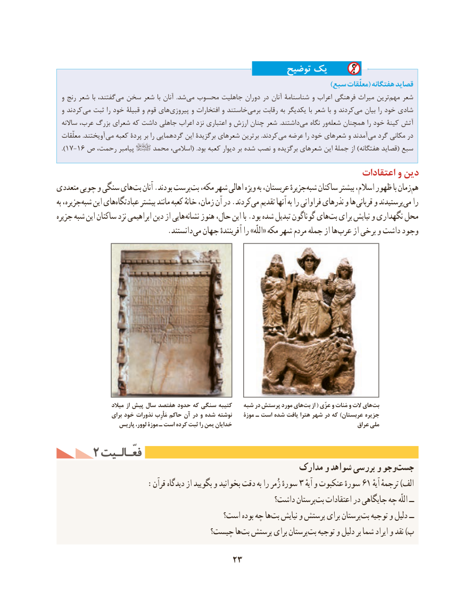

# PDF page 33

توضیح یک
                                                                                               )سبع معلّقات( هفتگانه قصاید
  و رنج شعر با گفتند،می‌  سخن شعر با آنان  .شد‌می محسوب جاهلیت دوران در آنان شناسنامۀ و اعراب فرهنگی میراث ترین ‌مهم شعر
  و كردند می ثبت را خود قبیلۀ و قوم های ‌پیروزی و افتخارات و خاستند ‌برمی رقابت به یكدیگر با شعر با و كردندمی‌   بیان را خود شادی
  ساالنه عرب، بزرگ شعرای كه داشت جاهلی اعراب نزد اعتباری و ارزش چنان شعر  .داشتند‌می نگاه ور ‌شعله همچنان را خود كینۀ آتش
  معلّقات .آویختند  می كعبه پردۀ بر را گردهمایی این برگزیدۀ شعرهای برترین .كردند می عرضه را خود شعرهای و آمدند ‌می گرد مكانی در
 ).17-16 ص رحمت، پیامبر     محمد اسالمی،( .بود كعبه دیوار بر شده نصب و برگزیده شعرهای این جملۀ از )هفتگانه قصاید( سبع
                                                                         اعتقادات و دین
متعددی چوبی و سنگی هایبت‌   آنان .بودند پرستبت‌  مكه، شهر اهالی ویژه به عربستان، جزیرهٔشبه‌   ساكنان بیشتر اسالم، ظهور با زمانهم‌
به جزیره،شبه‌   این هایعبادتگاه‌       بیشتر مانند كعبه خانهٔ زمان، آن در .كردندمی‌   تقدیم آنها به را فراوانی نذرهای و ها قربانی و پرستیدندمی‌   را
جزیره شبه این ساکنان نزد ابراهیمی دین از هایی نشانه هنوز حال، این با .بود شده تبدیل گوناگون هایبت‌  برای نیایش و نگهداری محل
        . دانستند می جهان آفرینندهٔ را »اللّه« مکه شهر مردم جمله از ها عرب از برخی و داشت وجود

                      میالد از پیش سال هفتصد حدود که سنگی کتیبه   شبه در پرستش مورد های بت از (  عزّی و مَنات و الت های بت
                     برای خود نذورات مَأرِب حاکم آن در و شده نوشته    موزۀ ـ است شده یافت هترا شهر در که )عربستان جزیره
                    پاریس لوور، موزۀ ـ است کرده ثبت را یمن خدایان                                          عراق ملی
     2 فعّـالـیتفعّـالـیت
                                                   مدارک و شواهد بررسی و وجوجست‌
 :3قرآن دیدگاه از بگویید و بخوانید دقت به را زُمر سورهٔ   آیهسورهٔو عنكبوت    61 آیهٔالفترجمهٔ )
                                                     داشت؟ پرستانبت‌  اعتقادات در جایگاهی چه اللّه ــ
                                       است؟ بوده چه هابت‌  نیایش و پرستش برای پرستانبت‌  توجیه و دلیل ــ
                                 چیست؟ هابت‌  پرستش برای پرستانبت‌  توجیه و دلیل بر شما ایراد و نقد )ب

                                   23

