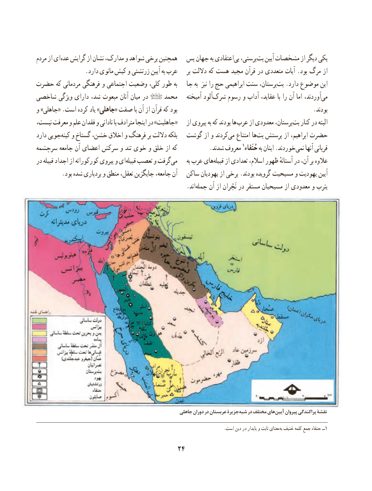

# PDF page 34

مردم از ای عده گرایش از نشان مدارک، و شواهد برخی همچنین  پس جهان به اعتقادیبی‌  پرستی،بت‌   آیین مشخصات از دیگر یكی
                .دارد مانوی کیش و زرتشتی آیین به عرب     بر داللت كه هست مجید قرآن در متعددی آیات .بود مرگ از
حضرت كه مردمانی فرهنگی و اجتماعی وضعیت كلی، طور به   جا به  نیز را حج ابراهیمی سنت پرستان،بت‌  .دارد موضوع این
شاخصی ویژگی‌     دارای شد، مبعوث آنان میان در     محمد    آمیخته آلودشرک‌    رسوم و آداب عقاید، با را آن اما آوردند،می‌
و »جاهلی« .است كرده یاد »جاهلی« صفت با آن از قرآن كه بود                                             .بودند
نیست، معرفت و علم فقدان و نادانی با مترادف اینجا در »جاهلیت«    از پیروی به كه بودند ها عرب از معدودی پرستان،بت‌   كنار در البته
دارد جوییكینه‌   و گستاخ خشن، اخالق و فرهنگ بر داللت بلكه  گوشت از و كردندمی‌   امتناع هابت‌  پرستش از ابراهیم، حضرت
سرچشمه جامعه آن اعضای سركش و تند خوی و خلق از كه           .شدند معروف 1حُنَفاء به اینان .خوردندنمی‌    آنها قربانی
در قبیله اجداد از كوركورانه پیروی و ایقبیله‌   تعصب و گرفتمی‌        به عرب هایقبیله‌    از تعدادی اسالم، ظهور آستانهٔ در آن، بر عالوه
         .بود شده بردباری و منطق تعقل، جایگزین جامعه، آن   ساكن یهودیان از برخی .بودند گرویده مسیحیت و یهودیت آیین
                                                  .اندجمله‌    آن از نَجْران در مستقر مسیحیان از معدودی و یثرب

                                          )عمان(                                                                                 مکران                                                                                         دریای

                                                       جاهلی دوران در عربستان جزیرۀ شبه در مختلف های آیین پیروان پراکندگی نقشۀ

                                                                                                                                                                                                                                                                                                                                                                                                                                                                     ا       . است دین در پایدار و ثابت معنای به حَنیف کلمه جمع حنفاء ــ1

                                     24

