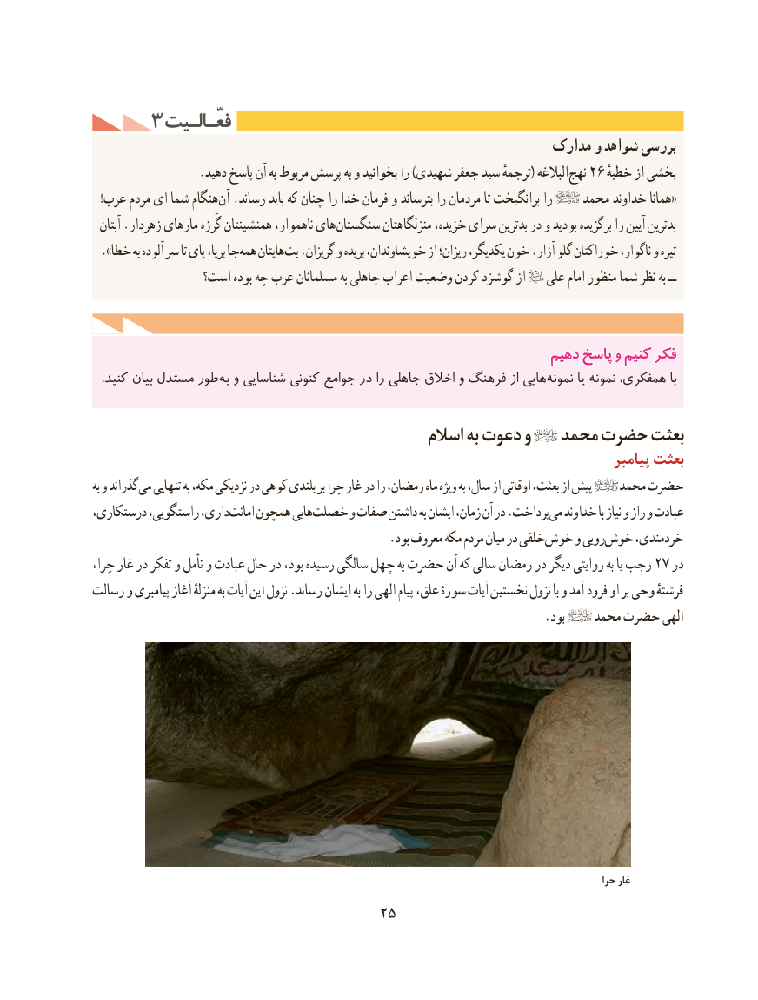

# PDF page 35

3 فعّـالـیتفعّـالـیت
                                                           مدارک و شواهد بررسی
 . دهید پاسخ آن به مربوط پرسش به و بخوانید را )شهیدی جعفر سید ترجمهٔ( البالغه نهج 26 خطبهٔبخشیاز
  !عرب مردم ای شما هنگام آن .رساند باید که چنان را خدا فرمان و بترساند را مردمان تا برانگیخت را    محمد خداوند همانا«
  آبتان .زهردار مارهای گَرزه همنشینتان ناهموار، های سنگستان منزلگاهتان خزیده، سرای بدترین در و بودید برگزیده را آیین بدترین
». خطا به آلوده سر تا پای برپا، جاهمه هایتان بت .گریزان و بریده خویشاوندان، از ریزان؛ یکدیگر، خون .آزار گلو خوراکتان ناگوار، و تیره
                است؟ بوده چه عرب مسلمانان به جاهلی اعراب وضعیت کردن گوشزد از   علی امام منظور شما نظر به ــ

                                                              دهیمدهیم پاسخپاسخ وو کنیمکنیم فکرفکر
. كنید بیان مستدل طور به و شناسایی کنونی جوامع در را جاهلی اخالق و فرهنگ از هایینمونه‌       یا نمونه‌    همفکری، با

                                              اسالم به دعوت و   محمد حضرت بعثت
                                                                                    پیامبر بعثت
به و گذراندمی‌  تنهایی به مكه، نزدیكی در كوهی بلندی بر حِرا غار در را رمضان، ماه ویژه به سال، از اوقاتی بعثت، از پیش    محمد حضرت
درستكاری، راستگویی، داری،امانت‌   همچون هاییخصلت‌      و صفات داشتن به ایشان زمان، آن در .پرداختمی‌  خداوند با نیاز و راز و عبادت
                                                 .بود معروف مكه مردم میان در خلقیخوش‌    و روییخوش‌    خردمندی،
حِرا، غار در تفکر و تأمل و عبادت حال در بود، رسیده سالگی چهل به حضرت آن كه سالی رمضان در دیگر روایتی به یا رجب 27 در
رسالت و پیامبری آغاز منزلهٔ به آیات این نزول .رساند ایشان به را الهی پیام علق، سورهٔ آیات نخستین نزول با و آمد فرود او بر وحی فرشتهٔ
                                                                          .بود    محمد حضرت الهی

                                                                                                              حرا غار
                                    25

