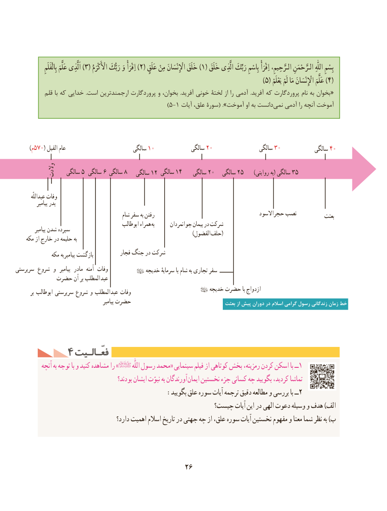

# PDF page 36

)بِالْقَلَم۳عَلَّمَ اَلَّذِی    ( اأأْلَْكْرَم)رَبُّكَ وَ اِقْرَأْ 2( عَلَق۱)مِنْ اإْلِْنْسَانَ خَلَقَ    ( خَلَقَبِسْمِالَّذِی رَبِّكَ بِاسْمِ اِقْرَأْ الـرَّحِیمِ، الـرَّحْمَنِ  اللّٰهِ
                                                                                                                    )۵( یَعْلَم۴)لَمْ مَا اإْلِْنْسَانَ عَلَّمَ    (
           قلم با كه خدایی  .است ارجمندترین پروردگارت و بخوان،  .آفرید خونی لختۀ از را آدمی  .آفرید كه پروردگارت نام به بخوان «
                                                )5-1 آیات علق، سورۀ( ».آموخت او به دانستنمی‌   آدمی را آنچه آموخت

        )م 570( الفیل عام                         سالگی 10             سالگی 20                 سالگی 30            سالگی 40
           والدت   سالگی 5 سالگی 6 سالگی 8   سالگی 12 سالگی 14    سالگی 20   سالگی 25      )روایتی به( سالگی 35

         عبداللّه وفات
            پیامبر پدر
                                          شام سفر به رفتن                                      حجراالسود نصب           بعثت
                                             ابوطالب همراه  به      جوانمردان پیمان در شرکت           پیامبر شدن سپرده                 ) (الفضول حلف    مکه از خارج در حلیمه به
                                         فجار جنگ در شرکت              مکه به پیامبر بازگشت
سرپرستی شروع و   پیامبر  مادر  آمنه وفات          خدیجه سرمایهٔ با شام به تجاری سفر
          حضرت آن بر المطلب عبد
                                                 خدیجه حضرت با ازدواج         بر ابوطالب سرپرستی شروع و المطلب عبد وفات
                                                 پیامبر حضرت                                    بعثت از پیش دوران در اسالم گرامی رسول زندگانی زمان خط

        4 فعّـالـیتفعّـالـیت
          آنچه به توجه با و کنید مشاهده را »          اللّٰه رسول محمد« سینمایی فیلم از کوتاهی بخش رمزینه، کردن اسکن با ــ1
                                          بودند؟ ایشان نبوّت به آورندگان ایمان نخستین جزء کسانی چه بگویید کردید، تماشا
                                       :بگویید علق سوره آیات ترجمه دقیق مطالعه و بررسی با ــ2
                                                   چیست؟ آیات این در الهی دعوت وسیله و هدف )الف
                                       دارد؟ اهمیت اسالم تاریخ در جهتی چه از علق، سوره آیات نخستین مفهوم و معنا شما نظر به )ب

                                           26

