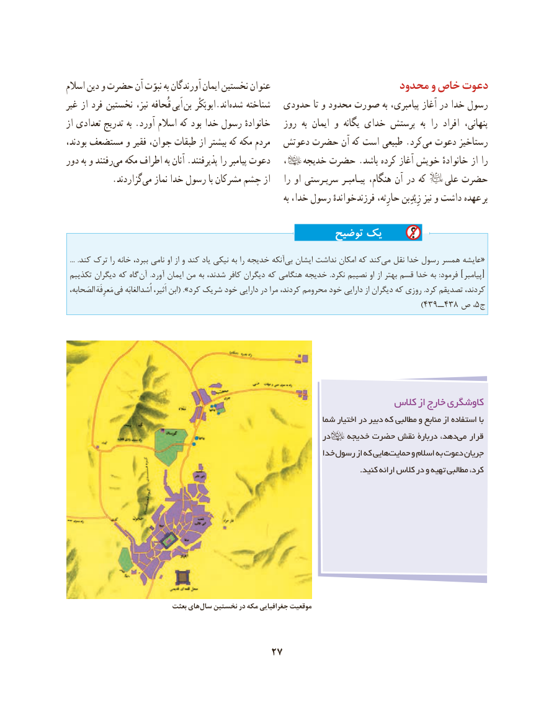

# PDF page 37

اسالم دین و حضرت آن نبوّت به آورندگان ایمان نخستین عنوان                      محدود و خاص دعوت
غیر از فرد نخستین نیز، قُحافه  اَبی  بن ابوبَکْر.اند‌شده شناخته  حدودی تا و محدود صورت به پیامبری، آغاز در خدا رسول
از تعدادی تدریج به .آورد اسالم که بود خدا رسول خانوادهٔ   روز  به ایمان و  یگانه خدای پرستش  به را  افراد  پنهانی،
بودند، مستضعف و فقیر جوان، طبقات از بیشتر كه مكه مردم   دعوتش حضرت آن كه است طبیعی .كرد می دعوت رستاخیز
دور به و رفتندمی‌  مكه اطراف به آنان .پذیرفتند را پیامبر دعوت    ،       خدیجه حضرت .باشد كرده آغاز خویش خانوادهٔ از را
   .‌گزاردند می نماز خدا رسول با مشركان چشم از    را او سرپـرستی پیـامبـر هنگام، آن در كه         علی حضرت
                                                                                به خدا، رسول فرزندخواندهٔ حارِثه، زِیْدِبن نیز و داشت عهده بر

                                               توضیح یک

  ...  .كند ترک را خانه ببرد، نامی او از و كند یاد نیكی به را خدیجه آنكهبی‌  ایشان نداشت امكان كه كند‌«می نقل خدا رسول همسر عایشه
 تكذیبم دیگران كه گاه آن  .آورد ایمان من به شدند، كافر دیگران كه هنگامی خدیجه  .نكرد نصیبم او از بهتر قسم خدا به  :فرمود ‌ ][پیامبر
 الصَحابه، مَعرِفَه.. فی اُْسدالغابَه اَثیر، ابن( ».كرد شریک خود دارایی در مرا كردند، محرومم خود دارایی از دیگران كه روزی .كرد تصدیقم كردند،
                                                                                  )439ــ438 ص ،5ج

                                                           كالس از خارج كاوشگری
                                                            شما اختیار در دبیر كه مطالبی و منابع از استفاده با
                                                               در    خدیجه حضرت نقش دربارۀ دهد،می‌   قرار
                                                              خدا رسول از كه هاییحمایت‌     و اسالم به دعوت جریان
                                                                                                                   .کنید ارائه كالس در و تهیه مطالبی كرد،

                             بعثت های سال نخستین در مکه جغرافیایی موقعیت

                                   27

