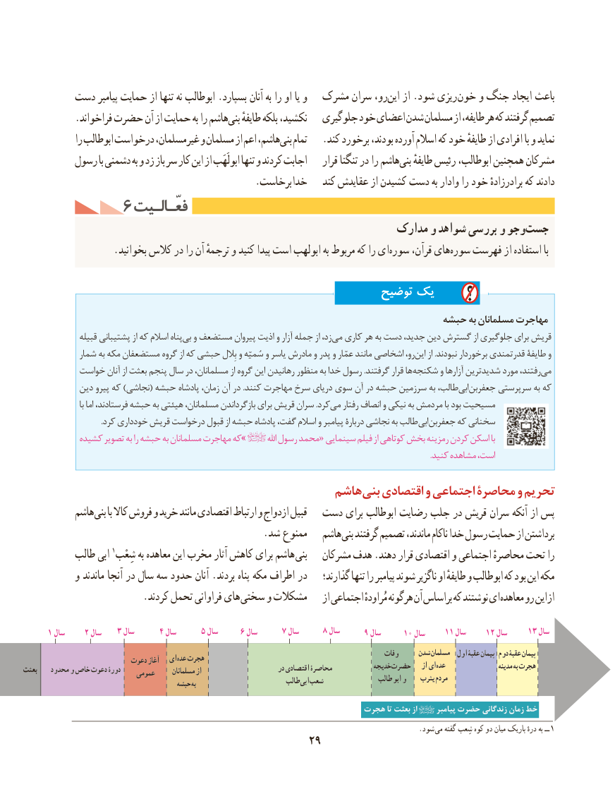

# PDF page 39

دست پیامبر حمایت از تنها نه ابوطالب .بسپارد آنان به را او یا و  مشرک سران رو،این‌   از .شود ریزی خون و جنگ ایجاد باعث
           .فراخواند حضرت آن از حمایت به را هاشمبنی‌   طایفهٔ بلكه نكشید،   جلوگیری خود اعضای شدن مسلمان از طایفه، هر كه گرفتند تصمیم
              را ابوطالب درخواست غیرمسلمان، و مسلمان از اعم هاشم،بنی‌   تمام   .كند برخورد بودند، آورده اسالم كه خود طایفهٔ از افرادی با و نماید
         رسول با دشمنی به و زد باز سر كار این از ابولَهَب تنها و کردند اجابت    قرار تنگنا در را هاشمبنی‌   طایفهٔ رئیس ابوطالب، همچنین مشركان
                                               .برخاست خدا   کند عقایدش از کشیدن دست به وادار را خود برادرزادهٔ که دادند
          6 فعّـالـیتفعّـالـیت
                                                           مدارک و شواهد بررسی و وجوجست‌
 .‌بخوانید كالس در را آن ترجمهٔ و كنید پیدا است ابولهب به مربوط كه را ایسوره قرآن، هایسوره‌   فهرست از استفاده با

                                                        توضیح یک
                                                                     حبشه به مسلمانان مهاجرت
                قبیله پشتیبانی از كه اسالم پناهبی‌  و مستضعف پیروان اذیت و آزار جمله از زد، می کاری هر به دست جدید، دین گسترش از جلوگیری برای قریش
             شمار به مكه مستضعفان گروه از كه حبشی بِالل و سُمیّه و یاسر مادرش و پدر و عمّار مانند اشخاصی رو،این‌    از .نبودند برخوردار قدرتمندی طایفۀ و
           خواست آنان از بعثت پنجم سال در مسلمانان، از گروه این رهانیدن منظور به خدا رسول .گرفتند قرار ها‌  شكنجه و آزارها شدیدترین مورد رفتند،می‌
            دین پیرو كه )نجاشی( حبشه پادشاه زمان، آن در .كنند مهاجرت سرخ دریای سوی آن در حبشه سرزمین به طالب،ابی‌    جعفربن سرپرستی به كه
                        با اما فرستادند، حبشه به هیئتی مسلمانان، بازگرداندن برای قریش سران .كردمی‌   رفتار انصاف و نیكی به مردمش با بود مسیحیت
                                         .کرد خودداری قریش درخواست قبول از حبشه پادشاه گفت، اسالم و پیامبر دربارۀ نجاشی به طالب ابی جعفربن که سخنانی
            کشیده تصویر به را حبشه به مسلمانان مهاجرت که»         اهلل رسول محمد« سینمایی فیلم از کوتاهی بخش رمزینه کردن اسکن با
                                                                                                                                                                                                                      .کنید مشاهده است،

                                             هاشم بنی اقتصادی و اجتماعی محاصرۀ و تحریم
           هاشم بنی با کاال فروش و خرید مانند اقتصادی ارتباط و ازدواج قبیل  دست برای ابوطالب رضایت جلب در قریش سران آنکه از پس
                                                 .شد ممنوع   هاشم بنی گرفتند تصمیم ماندند، ناکام خدا رسول حمایت از برداشتن
          طالب ابی 1شِعْب به معاهده این مخرب آثار کاهش برای هاشم بنی   مشرکان هدف .دهند قرار اقتصادی و اجتماعی محاصرهٔ تحت را
           و ماندند آنجا در سال سه حدود آنان .بردند پناه مکه اطراف در    گذارند؛ تنها را پیامبر شوند ناگزیر او طایفهٔ و ابوطالب که بود این مکه
                        .کردند تحمل فراوانی های سختی و مشکالت    از اجتماعی مُراودهٔ هرگونه آن براساس که نوشتند ای معاهده رو  این از

      1 سال    2 سال   3 سال      4 سال     5 سال     6 سال     7 سال     8 سال     9 سال     10 سال    11 سال    12 سال     13 سال
                                                                                                    وفات     شدن مسلمان  اول عقبۀ پیمان دوم عقبۀ پیمان                           دعوت آغاز  ای عده هجرت
بعثت    محدود و خاص دعوت دورۀ    عمومی      مسلمانان از                       در اقتصادی محاصرۀ            خدیجه حضرت   از ای عده                   مدینه به هجرت
                                            حبشه به                         طالب ابی شعب               طالب ابو و    یثرب مردم

                                                                هجرت تا بعثت از      پیامبر حضرت زندگانی زمان خط
                                             . شود می گفته شِعب کوه دو میان باریک درهٔ به ــ 1
                                              29

