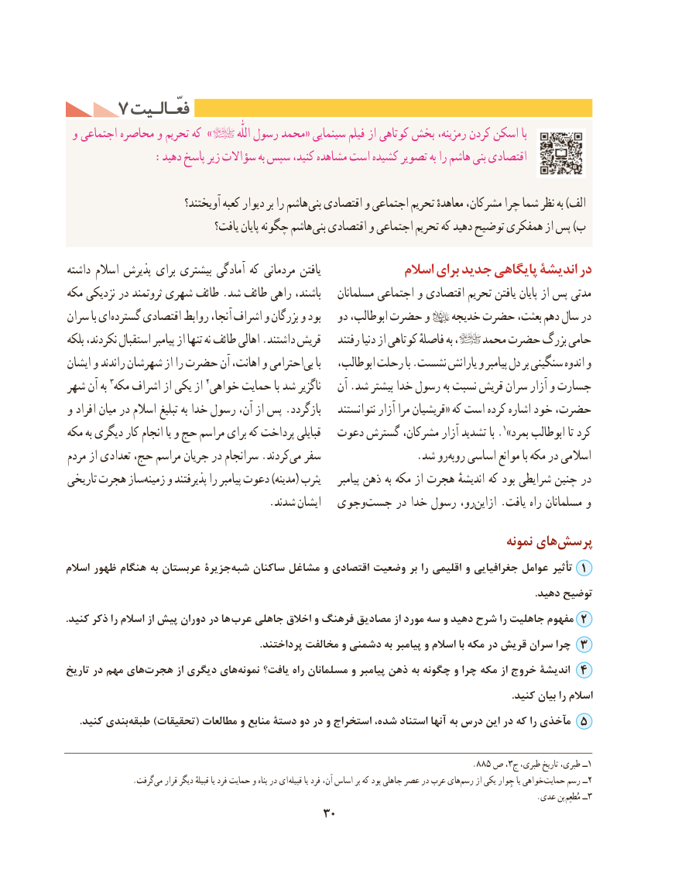

# PDF page 40

7 فعّـالـیتفعّـالـیت
 و اجتماعی محاصره و تحریم که »           اللّٰه رسول محمد« سینمایی فیلم از کوتاهی بخش رمزینه، کردن اسکن با
             :دهید پاسخ زیر سؤاالت به سپس کنید، مشاهده است کشیده تصویر به را هاشم بنی اقتصادی

                           آویختند؟ کعبه دیوار بر را هاشم بنی اقتصادی و اجتماعی تحریم معاهدهٔ مشرکان، چرا شما نظر به )الف
                               یافت؟ پایان چگونه هاشم بنی اقتصادی و اجتماعی تحریم که دهید توضیح همفکری از پس )ب

داشته اسالم پذیرش برای بیشتری آمادگی كه مردمانی یافتن              اسالم برای جدید پایگاهی اندیشۀ در
مكه نزدیكی در ثروتمند شهری طائف .شد طائف راهی باشند،    مسلمانان اجتماعی و اقتصادی تحریم یافتن پایان از پس مدتی
سران با ایگسترده‌     اقتصادی روابط آنجا، اشراف و بزرگان و بود   دو ابوطالب، حضرت و    خدیجه حضرت بعثت، دهم سال در
بلكه نكردند، استقبال پیامبر از تنها نه طائف اهالی .داشتند قریش    رفتند دنیا از كوتاهی فاصلهٔ به ،    محمد حضرت بزرگ حامی
ایشان و راندند شهرشان از را حضرت آن اهانت، و احترامیبی‌   با   ابوطالب، رحلت با .نشست یارانش و پیامبر دل بر سنگینی اندوه و
شهر آن به 3مكه اشراف از یكی از 2خواهی حمایت با شد ناگزیر   آن .شد بیشتر خدا رسول به نسبت قریش سران آزار و جسارت
و افراد میان در اسالم تبلیغ به خدا رسول آن، از پس .بازگردد    نتوانستند آزار مرا قریشیان« كه است كرده اشاره خود حضرت،
مكه به دیگری كار انجام یا و حج مراسم برای كه پرداخت قبایلی   دعوت گسترش مشركان، آزار تشدید با .1»بمرد ابوطالب تا كرد
مردم از تعدادی حج، مراسم جریان در سرانجام .كردندمی‌  سفر      .‌شد روروبه اساسی موانع با مكه در اسالمی
تاریخی هجرت ساززمینه‌    و پذیرفتند را پیامبر دعوت )مدینه( یثرب    پیامبر ذهن به مكه از هجرت اندیشهٔ كه بود شرایطی چنین در
                                      .شدند ایشان  وجویجست‌     در خدا رسول رو،ازاین‌    .یافت راه مسلمانان و
                                                                                   نمونه های‌پرسش
اسالم ظهور هنگام به عربستان جزیرۀشبه‌    ساكنان مشاغل و اقتصادی وضعیت بر را اقلیمی و جغرافیایی عوامل تأثیر 1
                                                                                                                                                                                       .دهید توضیح
. كنید ذكر را اسالم از پیش دوران در ها عرب جاهلی اخالق و فرهنگ مصادیق از مورد سه و دهید شرح را جاهلیت مفهوم 2
                                                                            .پرداختند مخالفت و دشمنی به پیامبر و اسالم با مكه در قریش سران چرا 3
تاریخ در مهم هایهجرت‌        از دیگری های‌نمونه یافت؟ راه مسلمانان و پیامبر ذهن به چگونه و چرا مكه از خروج اندیشۀ 4
                                                                                                                                                                              .كنید بیان را اسالم
     .کنید بندی ‌طبقه )تحقیقات( مطالعات و منابع دستۀ دو در و استخراج شده، استناد آنها به درس این در كه را مآخذی 5

                                                                                        .885 ص ،3ج طبری، تاریخ طبری، ــ1
                 .گرفت‌می قرار دیگر قبیلهٔ یا فرد حمایت و پناه در ای قبیله یا فرد آن، اساس بر كه بود جاهلی عصر در عرب هایرسم‌    از یكی جِوار یا خواهی ‌حمایت رسم ــ2
                                                                                                                          .عدی بن  مُطعِم ــ3
                                        30

