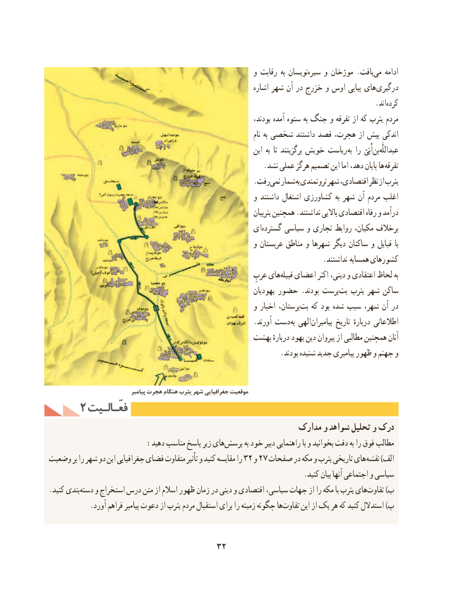

# PDF page 42

و رقابت به نویسانسیره‌    و مورّخان .یافتمی‌   ادامه
                                                                   اشاره شهر آن در خزرج و اوس پیاپی های درگیری
                                                                                          .اندکرده‌
                                                                        بودند، آمده ستوه به جنگ و تفرقه از که یثرب مردم
                                                                                         نام به شخصی داشتند قصد هجرت، از پیش اندکی
                                                                    این به  تا برگزینند خویش ریاست به را  اُبَیّبن‌  عبداللّٰه‌
    . نشد عملی هرگز تصمیم این اما دهد، پایان ها تفرقه
                                                        .رفتنمی‌  شمار به ثروتمندی شهر اقتصادی، نظر از یثرب
                                                         و داشتند اشتغال کشاورزی به شهر آن‌  مردم اغلب
                                                                                  یثربیان همچنین .نداشتند باالیی اقتصادی رفاه و درآمد
                                                 ایگسترده‌     سیاسی و تجاری روابط مکیان، برخالف
                                                         و عربستان مناطق و شهرها دیگر ساکنان و قبایل  با
                                                                           .نداشتند همسایه کشورهای
                                                             عربِ هایقبیله‌   اعضای اکثر دینی، و اعتقادی لحاظ به
                                                                   یهودیان حضور .بودند پرستبت‌   یثرب شهر ساکن
                                                         و اخبار پرستان،بت‌   که بود شده سبب شهر، آن در
                                                        .آورند دست به الهی پیامبران تاریخ دربارهٔ اطالعاتی
                                              بهشت دربارهٔ یهود دین پیروان از مطالبی همچنین آنان
                                                                .بودند شنیده جدید پیامبری ظهور و جهنم و

                                   پیامبر هجرت هنگام یثرب شهر جغرافیایی موقعیت
    2 فعّـالـیتفعّـالـیت
                                                      مدارک و شواهد تحلیل و درک
  :‌دهید مناسب پاسخ زیر هایپرسش به خود دبیر راهنمایی با و بخوانید دقت به را فوق مطالب
وضعیت بر را شهر دو این جغرافیایی فضای متفاوت تأثیر و کنید مقایسه را 32 و 27 صفحات در مکه و یثرب تاریخی های نقشه )الف
                                                                      .کنید بیان آنها اجتماعی و سیاسی
.‌کنید بندیدسته و استخراج درس متن از اسالم ظهور زمان در دینی و اقتصادی سیاسی، جهات از را مکه با یثرب هایتفاوت‌       )ب
.‌آورد فراهم پیامبر دعوت از یثرب مردم استقبال برای را زمینه چگونه هاتفاوت این از یک هر که کنید استدالل )پ

                                  32

