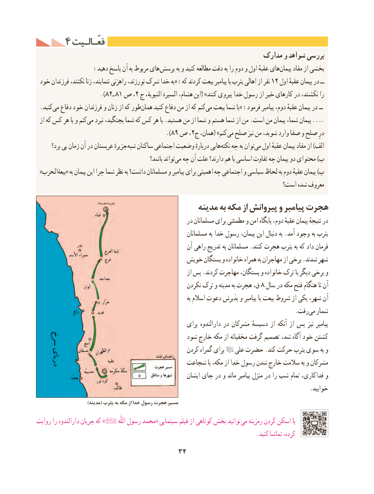

# PDF page 44

4 فعّـالـیتفعّـالـیت
                                                           مدارک و شواهد بررسی
  : دهید پاسخ آن به مربوط های پرسش به و کنید مطالعه دقت به را دوم و اول عقبهٔ هایپیمان‌     مفاد از بخشی
 خود فرزندان نکنند، زنا ننمایند، راهزنی نورزند، شرک خدا به« :که کردند بیعت پیامبر با یثرب اهالی از نفر 12 اول عقبهٔ پیمان در ــ
                     ).82ـ 81 ص ،2 ج النبویة، السیرة هشام، ابن( »کنند پیروی خدا رسول از خیر کارهای در نکشند، را
 .کنیدمی‌  دفاع خود فرزندان و زنان از که طورهمان‌    کنید دفاع من از که کنممی‌  بیعت شما با« :فرمود پیامبر دوم، عقبهٔ پیمان در ــ
 از که کس هر با و کنممی‌....نبرد بجنگید، شما که کس هر با .هستید من از شما و هستم شما از من .است من پیمان شما، پیمان
                                          ).89 ص ،2ج همان،( »کنممی‌  صلح نیز من شوید، وارد صفا و صلح درِ
       برد؟ پی زمان آن در عربستان جزیرهٔشبه‌   ساکنان اجتماعی وضعیت دربارهٔ هایینکته‌   چه به توانمی‌  اول عقبهٔ پیمان مفاد از )الف
                                             باشد؟ تواندمی‌  چه آن علت دارند؟ هم با اساسی تفاوت چه پیمان دو محتوای )ب
 »الحرببیعة‌   « به پیمان این چرا شما نظر به داشت؟ مسلمانان و پیامبر برای اهمیتی چه اجتماعی و سیاسی لحاظ به دوم عقبهٔ پیمان )پ
                                                                        است؟ شده معروف

                                               )مدینه( یثرب                                        مدینه به مکه از پیروانش و پیامبر هجرت
                                                    در مسلمانان برای مطمئنی و امن پایگاه دوم، عقبهٔ پیمان نتیجهٔ در
                                                           مسلمانان به خدا رسول پیمان، این دنبال به .آمد وجود  به یثرب
                                                        آن راهی تدریج به مسلمانان .کنند هجرت یثرب به که داد فرمان
                                      خویش بستگان و خانواده همراه به مهاجران از برخی .شدند شهر
                                                               از پس .کردند مهاجرت بستگان، و خانواده ترک با دیگر برخی و
                                                     نکردن ترک و مدینه به هجرت ق، 8 سال در مکه فتح هنگام تا آن
                                                                                به اسالم دعوت پذیرش و پیامبر با بیعت شروط از یکی شهر، آن
                                  .‌رفتمی شمار
                                                        برای دارالندوه در مشرکان دسیسهٔ از آنکه از پس نیز پیامبر
                                            شود خارج مکه از مخفیانه گرفت تصمیم شد، آگاه خود کشتن
                                                   کردن گمراه برای   علی حضرت .کند حرکت یثرب سوی به و
                                       شجاعت با مکه، از خدا رسول شدن خارج سالمت به و مشرکان
                                                         ایشان جای در و ماند پیامبر منزل در را شب تمام فداکاری، و
                                                                                           .خوابید
                           )مدینه( یثرب به مکه از خدا رسول هجرت مسیر
روایت را دارالندوه جریان که »           اللّٰه رسول محمد« سینمایی فیلم از کوتاهی بخش توانید می رمزینه کردن اسکن با
                                                                         .کنید تماشا کرده،
                                  34

