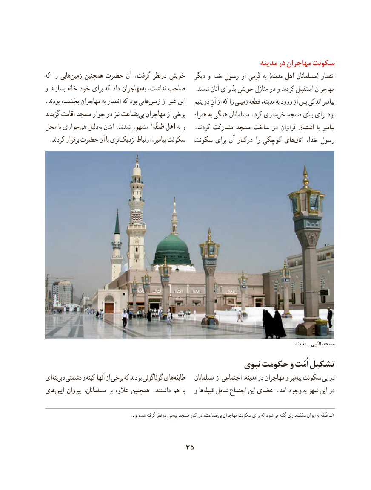

# PDF page 45

مدینه در مهاجران سکونت
که را هاییزمین‌    همچنین حضرت آن .گرفت درنظر خویش   دیگر و خدا رسول از گرمی به )مدینه اهل مسلمانان( انصار
و بسازند خانه خود برای که داد مهاجران به نداشت، صاحب   .شدند آنان پذیرای خویش منازل در و کردند استقبال مهاجران
.بودند بخشیده مهاجران به انصار که بود هاییزمین‌     از غیر این    یتیم دو آنِ از که را زمینی قطعه مدینه، به ورود از پس اندکی پیامبر
گزیدند اقامت مسجد جوار در نیز بضاعتبی‌  مهاجران از برخی    همراه به همگی مسلمانان .کرد خریداری مسجد بنای برای بود
محل با جواری هم دلیل به اینان .شدند مشهور 1صُفّه اهل به و   .کردند مشارکت مسجد ساخت در فراوان اشتیاق  با پیامبر
.‌کردند برقرار حضرت آن با ترینزدیک ارتباط پیامبر، سکونت  سکونت برای آن درکنار را کوچکی هایاتاق‌    خدا، رسول

                                                                                                              مدینه ـ النّبی مسجد
                                                نبوی حکومت و اُمّت تشکیل
ای دیرینه دشمنی و کینه آنها از برخی که بودند گوناگونی هایطایفه‌        مسلمانان از اجتماعی مدینه، در مهاجران و پیامبر سکونت پی در
هایآیین‌    پیروان مسلمانان، بر عالوه همچنین .داشتند هم  با   و هاقبیله‌   شامل اجتماع این اعضای .آمد وجود به شهر این در

  . بود شده گرفته درنظر پیامبر، مسجد کنار در بضاعت، بی مهاجران سکونت برای که شود می گفته داری  سقف ایوان به صُفّه ــ1

                                 35

